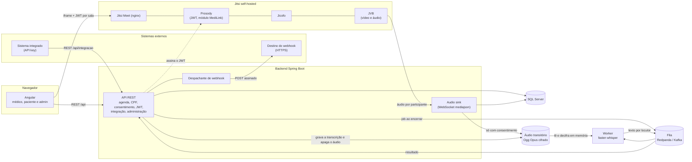
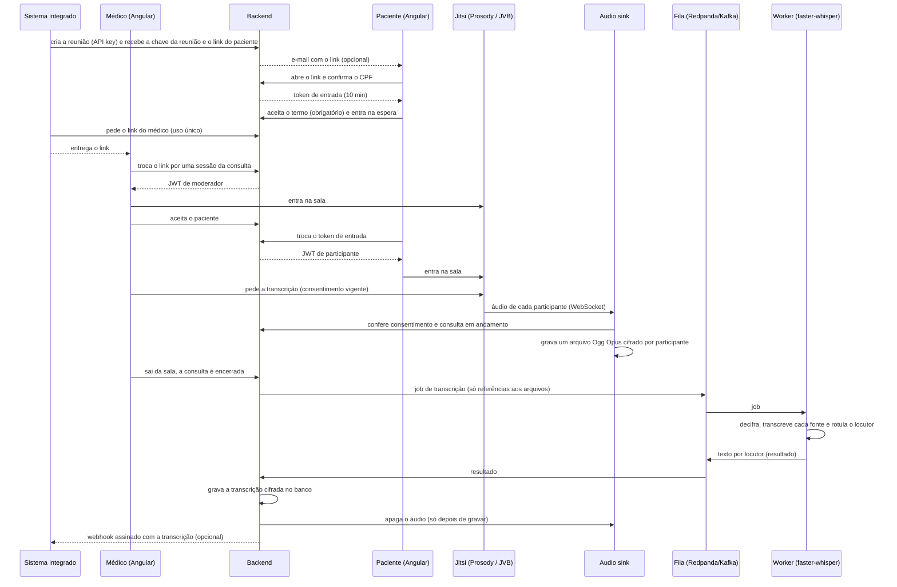
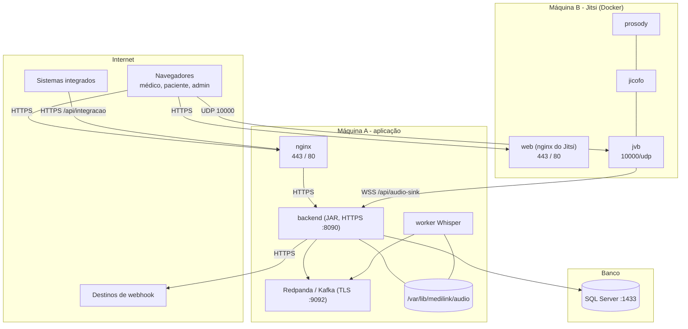

# MediLink

Plataforma de **telemedicina self-hosted** sobre o [Jitsi Meet](https://jitsi.org/). O médico (ou um sistema integrado) agenda a consulta e o paciente recebe um link; o paciente confirma a identidade por CPF, aceita o termo de consentimento e aguarda o aceite do médico; a consulta acontece por vídeo; o áudio é capturado **no servidor**, transcrito de forma assíncrona e a transcrição vai para o prontuário (e, se configurado, é devolvida por webhook ao sistema de origem). Nenhum dado sensível sai da infraestrutura própria, salvo o destino de webhook que o administrador cadastrar.


> **Aviso.** Os trechos sobre LGPD e sigilo médico são orientação de engenharia, não aconselhamento jurídico. O termo de consentimento é uma minuta. Tudo isso precisa ser validado pelo jurídico e pelo encarregado de dados (DPO) antes do uso real.
>
> **Aviso sobre a implantação.** O ambiente de desenvolvimento foi exercitado de ponta a ponta. A **implantação em produção descrita aqui nunca foi executada** com certificados reais, DNS público e mais de uma máquina: os passos seguem o que o código exige e o que as imagens documentam, e cada item que não foi exercitado vem marcado com **⚠ não exercitado**. Leia a seção [O que ainda não foi validado em produção](#o-que-ainda-não-foi-validado-em-produção) antes de decidir.

## Sumário

- [Visão geral](#visão-geral)
- [Status do projeto](#status-do-projeto)
- [Funcionalidades](#funcionalidades)
- [Arquitetura](#arquitetura)
- [Stack](#stack)
- [Estrutura do repositório](#estrutura-do-repositório)
- [Desenvolvimento local](#desenvolvimento-local)
- [Configuração](#configuração)
- [API](#api)
- [Segurança e privacidade](#segurança-e-privacidade)
- [Implantação em produção](#implantação-em-produção)
  - [1. Topologia e portas](#1-topologia-e-portas)
  - [2. Pré-requisitos e dimensionamento](#2-pré-requisitos-e-dimensionamento)
  - [3. DNS, certificados e firewall](#3-dns-certificados-e-firewall)
  - [4. Segredos e chaves](#4-segredos-e-chaves)
  - [5. SQL Server](#5-sql-server)
  - [6. Fila: Redpanda ou Kafka](#6-fila-redpanda-ou-kafka)
  - [7. Backend](#7-backend)
  - [8. Jitsi](#8-jitsi)
  - [9. Worker de transcrição (Whisper)](#9-worker-de-transcrição-whisper)
  - [10. Frontend e nginx da aplicação](#10-frontend-e-nginx-da-aplicação)
  - [11. Primeiros passos depois de subir](#11-primeiros-passos-depois-de-subir)
  - [12. Verificação pós-implantação](#12-verificação-pós-implantação)
  - [13. Operação](#13-operação)
  - [14. Checklist de entrada em produção](#14-checklist-de-entrada-em-produção)
  - [15. Solução de problemas](#15-solução-de-problemas)
  - [O que ainda não foi validado em produção](#o-que-ainda-não-foi-validado-em-produção)
- [Customizações em imagens e brokers](#customizações-em-imagens-e-brokers)
- [Testes](#testes)
- [Decisões de arquitetura](#decisões-de-arquitetura)
- [Limitações conhecidas](#limitações-conhecidas)
- [Roadmap](#roadmap)
- [Documentação](#documentação)
- [Contribuindo](#contribuindo)
- [Licença](#licença)

## Visão geral

| Pergunta | Resposta |
| --- | --- |
| Quem usa? | **Médicos** (entram por link de uso único emitido pelo sistema de origem, ou pelo login provisório em desenvolvimento), **pacientes** (link único, CPF opcional, termo obrigatório), **sistemas externos** (API por API key) e **administradores** (painel com senha + TOTP). |
| O que fica guardado? | Agendamentos (nome e e-mail do paciente cifrados, CPF só como HMAC), consultas, consentimento (versão e hash do termo aceito), **transcrição cifrada** e a trilha de auditoria (somente inserção). **O áudio é apagado** assim que a transcrição é gravada. |
| Onde roda? | No seu servidor: Jitsi (Docker/Podman), backend Spring Boot, frontend estático atrás de nginx, SQL Server, fila Kafka/Redpanda e um worker Python com `faster-whisper` em CPU (GPU possível, ⚠ não exercitado). |
| O que é decisão sua? | Prazos de retenção, texto do termo de consentimento, base legal, provedor de identidade do médico e dimensionamento. Veja [Limitações conhecidas](#limitações-conhecidas). |

## Status do projeto

O projeto segue **SDD (Spec-Driven Development)**: especificação → plano técnico → tarefas verificáveis. Cada tarefa só é dada como pronta com o critério de aceite satisfeito.

| Fase | Tarefa | Estado |
| --- | --- | --- |
| Fundação | **T01** Jitsi self-hosted (Meet, Prosody, Jicofo, JVB) | Pronta |
| Fundação | **T02** Autenticação por JWT no Jitsi | Pronta |
| Agendamento | **T03** Modelo de dados e migrações | Pronta |
| Agendamento | **T04** Agendamento com link predefinido | Pronta |
| Agendamento | **T05** Envio do link por e-mail | Pronta |
| Acesso | **T06** Tela de acesso e validação de CPF (desativável) | Pronta |
| Acesso | **T07** JWT do médico (moderador) e do paciente | Pronta |
| Consulta | **T08** Aceite do paciente pelo médico | Pronta |
| Consulta | **T09** Consentimento antes da captura (hoje obrigatório) | Pronta |
| Consulta | **T10** Frontend Angular e encerramento da consulta | Pronta (ver [limitações](#limitações-conhecidas)) |
| Transcrição | **T11** Audio sink (captura do áudio no servidor) | Pronta |
| Transcrição | **T12** Fila e worker de transcrição (faster-whisper) | Pronta |
| Transcrição | **T13** Gravar a transcrição e descartar o áudio | Pronta |
| Compliance | **T14** Criptografia em repouso, auditoria de leitura, retenção | Pronta |
| Integração | **T16** API key e agendamentos por API | Pronta |
| Integração | **T17** Médico entra por link de uso único; reabertura e inatividade | Pronta |
| Administração | **T18** Administrador (senha + TOTP), painel, keys e termo de consentimento | Pronta |
| Integração | **T19** Webhook de devolução da transcrição | Pronta |
| Escala | **T15** Vários JVBs, autoscaling e teste de carga (até 1.000 salas) | Mapeada, não iniciada |

O estado detalhado de cada tarefa, com o que foi e o que **não** foi verificado, está em [`docs/tasks.md`](docs/tasks.md).

## Funcionalidades

| Requisito | Descrição | Situação |
| --- | --- | --- |
| RF-01 | O médico (ou o sistema integrado) agenda informando paciente, CPF (opcional por API), e-mail (opcional), data/hora e se a validação de CPF está ativa; o sistema gera um link único e persistente | Feito |
| RF-02 | O link aponta para uma sala fixa; o médico é o host (moderador) | Feito |
| RF-03 | Envio do link ao paciente por e-mail, com registro | Feito |
| RF-04 | O paciente confirma o CPF (desativável); limite de tentativas e resposta genérica para não revelar o que existe | Feito |
| RF-05 | O paciente aguarda e só recebe a credencial da sala depois do aceite explícito do médico | Feito |
| RF-06 | O áudio é capturado durante a consulta e transcrito de forma assíncrona após o encerramento | Feito |
| RF-07 | A transcrição é gravada no banco e o arquivo de áudio é descartado (falha mantém o áudio) | Feito |
| RF-08 | **Consentimento obrigatório**: toda teleconsulta é registrada; sem aceitar o termo o paciente não chega à espera nem à sala | Feito |
| RF-09 | Integração por API key: criar, alterar, cancelar e consultar reuniões; iniciar a sala por link de uso único do médico | Feito |
| RF-10 | Administração: painel de andamento, sistemas integrados, API keys, termo de consentimento versionado e webhooks | Feito |
| RF-11 | Webhook de devolução da transcrição, assinado, para a URL base cadastrada + caminho do agendamento | Feito |

Também implementado: bloqueio do acesso direto à interface do Jitsi (só carrega dentro do MediLink), restrições de sala (sem chat, compartilhamento de tela, convites etc.), supressão de ruído e qualidade de vídeo no nível 2, reabertura da consulta em até 10 minutos, encerramento por inatividade do médico e retenção configurável. Veja [`docs/plan.md`](docs/plan.md).

## Arquitetura



### Fluxo de uma consulta



Os fluxos e as decisões estão detalhados em [`docs/plan.md`](docs/plan.md).

## Stack

| Camada | Tecnologia |
| --- | --- |
| Backend | Java 25, Spring Boot 4.1 (Web MVC, Security, Data JPA, Validation, WebSocket, Mail, Kafka, Actuator), Flyway, Maven Wrapper |
| Banco | SQL Server 2019 ou superior (driver `mssql-jdbc`) |
| Frontend | Angular 21 (standalone, zoneless, signals), Vitest, IFrame External API do Jitsi |
| Vídeo | Jitsi Meet self-hosted (imagens oficiais `ghcr.io/jitsi`), Docker ou Podman |
| Captura de áudio | Sink WebSocket no backend (protocolo `mediajson`), gravador Ogg Opus próprio, cifra AES-256-GCM |
| Transcrição | Worker Python 3.12 com `faster-whisper` (modelo `turbo`, CPU `int8`), fila Redpanda (dev) / Kafka ou Redpanda (produção) |

## Estrutura do repositório

```text
MediLink/
├── backend/                       API Spring Boot e audio sink
│   ├── src/main/java/br/com/medilink/
│   │   ├── domain/                entidades (Medico, Agendamento, Consulta, Transcricao, Integrador, ApiKey, AuditLog...)
│   │   ├── repository/            repositórios Spring Data
│   │   ├── service/               regras: agenda, CPF, consentimento, JWT do Jitsi, e-mail, aceite, termo
│   │   ├── web/                   controllers REST e DTOs (médico e paciente)
│   │   ├── security/              cadeia de segurança, perfil dev e perfil prod
│   │   ├── sink/                  audio sink: WebSocket, gravador Ogg Opus, portão do consentimento
│   │   ├── transcricao/           fila, consumidor de resultados, descarte do áudio, leitura da transcrição
│   │   ├── crypto/                cifra em repouso (AES-256-GCM) de texto e áudio
│   │   ├── retencao/              retenção e expurgo
│   │   ├── integracao/            API key, API de integração e limite de uso
│   │   ├── medico/                link de uso único e sessão do médico
│   │   ├── admin/                 administrador (senha + TOTP), painel, termo versionado
│   │   ├── webhook/               webhook: destino, assinatura, cliente HTTPS anti-SSRF, despachante
│   │   └── config/                propriedades e exigências do perfil prod
│   ├── src/main/resources/db/migration/   migrações Flyway (V1 a V11)
│   ├── config/local.env.example   modelo da conexão com o SQL Server local
│   └── run-mssql.sh               roda testes e a aplicação contra o SQL Server local
├── frontend/                      Angular 21 (telas do médico, do paciente e do administrador)
├── worker/                        worker de transcrição (Python, faster-whisper, consumidor Kafka)
├── infra/
│   ├── jitsi/                     Jitsi self-hosted: compose, .env, regras de nginx, módulo Prosody, config do Jicofo
│   │   └── e2e/                   verificação ponta a ponta (Chrome headless com microfone falso)
│   └── dev/                       smtp_sink.py, redpanda.sh, webhook_sink.py e smoke_integracao.py (desenvolvimento)
└── docs/
    ├── spec.md                    especificação (o quê e por quê)
    ├── plan.md                    plano técnico e registro de decisões (o como)
    └── tasks.md                   tarefas, estado e backlog mapeado
```

## Desenvolvimento local

### Pré-requisitos

| Item | Versão / observação |
| --- | --- |
| JDK | 25 (com `javac`, não apenas JRE) |
| Node.js | 20.19 ou superior (Angular 21); o CLI 22 exige Node 22+ |
| SQL Server | 2019 ou superior, acessível em `localhost:1433` |
| Docker ou Podman | para o Jitsi e o Redpanda; com Podman rootless é preciso o socket do usuário (`systemctl --user start podman.socket`) e o `docker-compose` |
| Python | 3.12 com `venv` (worker de transcrição) |
| Google Chrome | só para a verificação ponta a ponta (`infra/jitsi/e2e`) |

Todos os comandos partem da raiz do repositório.

### 1. Banco de dados

Crie dois bancos vazios no SQL Server (o Flyway cria as tabelas):

```sql
CREATE DATABASE medilink_dev;
CREATE DATABASE medilink_test;
```

Copie o modelo da conexão e preencha a senha. O arquivo `config/local.env` **não é versionado**.

```bash
cd backend
cp config/local.env.example config/local.env
# edite config/local.env: MEDILINK_DB_USER e MEDILINK_DB_PASSWORD, e gere a MEDILINK_DATA_KEY (openssl rand -base64 32)
```

### 2. Jitsi self-hosted

```bash
cd infra/jitsi
./dev.sh init   # cria o .env com segredos aleatórios e as pastas de configuração
./dev.sh up     # instala as regras do MediLink e sobe web, prosody, jicofo e jvb
```

Em desenvolvimento o Jitsi usa um certificado autoassinado. Abra `https://localhost:8443` uma vez no navegador e aceite o certificado; a página mostra "Acesso direto bloqueado", que é o esperado (a interface só carrega dentro do MediLink).

Para parar: `./dev.sh down`. Outros comandos: `./dev.sh logs`, `./dev.sh env`.

### 3. Backend

```bash
cd backend
eval "$(../infra/jitsi/dev.sh env)"   # exporta os segredos do Jitsi e do sink
./run-mssql.sh dev                    # sobe em http://localhost:8090 (perfil dev, banco medilink_dev)
```

O perfil `dev` cria: um **médico de exemplo** (`application-dev.properties`), um **administrador de exemplo** (`admin@medilink.local`, com o TOTP cadastrado no primeiro login) e liga o modo de desenvolvimento do webhook (HTTP e endereços locais). **Nunca use esse perfil fora do desenvolvimento.**

### 4. Servidor SMTP de desenvolvimento (opcional)

```bash
python3 infra/dev/smtp_sink.py 1025 infra/dev/mails
```

Recebe os e-mails do link e os grava como `.eml` em `infra/dev/mails/`.

### 5. Fila e worker de transcrição

```bash
infra/dev/redpanda.sh up                          # broker em localhost:9092 e os dois tópicos (imagem ~120 MB)
cd worker
python3 -m venv .venv && .venv/bin/pip install -r requirements-dev.txt
.venv/bin/python -m medilink_worker               # a 1ª execução baixa o modelo Whisper turbo (~1,6 GB)
```

O worker precisa da **mesma `MEDILINK_DATA_KEY` do backend** (o áudio é gravado cifrado). Detalhes em [`worker/README.md`](worker/README.md). Sem o broker o backend continua funcionando: o job fica pendente e é reenviado quando ele voltar.

### 6. Frontend

```bash
cd frontend
npm install        # o .npmrc usa legacy-peer-deps (bug do npm 10.8.2 com peer deps)
npx ng serve       # http://localhost:4200, com proxy de /api para o backend em :8090
```

- Médico (login provisório de desenvolvimento): `http://localhost:4200/medico`
- Administrador: `http://localhost:4200/admin`
- Paciente: o link gerado no agendamento (`http://localhost:4200/sala/{roomName}`)
- Médico por link de uso único (integração): `http://localhost:4200/medico/acesso#t=…`

### 7. Roteiro de teste manual

1. Entre como médico, crie um agendamento (data futura) e clique em **Entrar na sala**.
2. Abra o link do paciente em outra aba ou navegador, confirme o CPF e aceite o termo.
3. Como médico, clique em **Aceitar paciente**. O paciente entra na mesma sala.
4. O médico sai da sala (botão de desligar): a consulta deve ser encerrada.
5. Os arquivos de áudio (cifrados, `.opus.enc`) ficam em `${MEDILINK_SINK_DIR:-/tmp/medilink-audio}/{consultaId}/` até a transcrição ser gravada.
6. Com o worker no ar, o resultado passa pelo tópico `medilink.transcricao.resultados` e o backend o grava; leia por `GET /api/consultas/{id}/transcricao`.

> **Janela de reabertura.** O backend só publica o job de transcrição depois de `medilink.consulta.tolerancia-reabertura` (padrão **10 minutos**) do encerramento. Para testar rápido, inicie o backend com `MEDILINK_CONSULTA_TOLERANCIA_REABERTURA=0s`.

## Configuração

### Backend (variáveis de ambiente)

| Variável | Obrigatória | Descrição |
| --- | --- | --- |
| `MEDILINK_DB_URL`, `MEDILINK_DB_USER`, `MEDILINK_DB_PASSWORD` | sim | Conexão JDBC com o SQL Server. Em produção a URL **precisa** ter `encrypt=true` e **não** pode ter `trustServerCertificate=true` |
| `MEDILINK_CPF_HMAC_KEY` | sim | Segredo do HMAC-SHA256 com que o CPF é guardado (também deriva as chaves dos tokens de entrada e das sessões de médico e administrador) |
| `MEDILINK_JITSI_APP_SECRET` | sim | Segredo HS256 do JWT do Jitsi (mínimo 32 caracteres); igual ao `JWT_APP_SECRET` do Jitsi |
| `MEDILINK_JITSI_APP_ID`, `MEDILINK_JITSI_AUDIENCE`, `MEDILINK_JITSI_XMPP_DOMAIN` | não | Padrões `medilink`, `jitsi`, `meet.jitsi`; devem casar com o `.env` do Jitsi |
| `MEDILINK_SINK_TOKEN` | sim | Segredo que o Jicofo envia ao sink (`SINK_TOKEN` do Jitsi); mínimo 32 caracteres |
| `MEDILINK_DATA_KEY` | sim | Chave mestra AES-256 (32 bytes em Base64: `openssl rand -base64 32`) da cifra em repouso. **Perdê-la torna as transcrições ilegíveis.** O worker precisa da mesma chave |
| `MEDILINK_DATA_KEY_ID`, `MEDILINK_DATA_KEYS_ANTERIORES` | não | Id da chave ativa (padrão `k1`) e, para rotação, chaves aposentadas (`id:base64,…` no worker; propriedade `medilink.crypto.chaves-anteriores.<id>` no backend) |
| `MEDILINK_ADMIN_EMAIL`, `MEDILINK_ADMIN_SENHA` | não | Criam o primeiro administrador quando ainda não há nenhum (senha de 12 a 128 caracteres; o TOTP é cadastrado no primeiro login). Remova do ambiente depois da primeira subida |
| `MEDILINK_CONSULTA_TOLERANCIA_REABERTURA` | não | Janela em que o médico ainda pode reabrir a consulta encerrada; **a transcrição só é enviada depois dela** (padrão `10m`) |
| `MEDILINK_SINK_DIR` | não | Pasta dos arquivos de áudio transitórios (padrão `${java.io.tmpdir}/medilink-audio`). Backend e worker precisam enxergar a **mesma** pasta |
| `MEDILINK_KAFKA_BOOTSTRAP` | não | Broker da fila de transcrição (padrão `localhost:9092`) |
| `MEDILINK_PUBLIC_BASE_URL` | não | Base pública do frontend, usada nos links enviados (paciente: `/sala/…`; médico: `/medico/acesso#t=…`). Padrão `http://localhost:4200` |
| `MEDILINK_MAIL_HOST`, `MEDILINK_MAIL_PORT`, `MEDILINK_MAIL_USER`, `MEDILINK_MAIL_PASSWORD`, `MEDILINK_MAIL_FROM` | não | Relay SMTP (padrão `localhost:1025`) |
| `MEDILINK_MAIL_AUTH`, `MEDILINK_MAIL_STARTTLS` | não | `true` num relay real: autentica e **exige** STARTTLS antes de enviar a senha (padrão `false`, para o sink local) |
| `MEDILINK_TLS_KEYSTORE`, `MEDILINK_TLS_KEYSTORE_PASSWORD` | prod | Keystore PKCS12 do HTTPS do backend (inclusive do WSS do sink) |
| `MEDILINK_KAFKA_TRUSTSTORE`, `MEDILINK_KAFKA_TRUSTSTORE_PASSWORD` | prod | Truststore com a CA do broker (Kafka em SSL) |

A aplicação **não sobe** sem os segredos obrigatórios: não há valor padrão para eles.

Propriedades que podem ser ajustadas (por arquivo de configuração externo do Spring ou argumento de linha de comando; várias também aceitam variável de ambiente, como `MEDILINK_CONSULTA_TOLERANCIA_REABERTURA`):

| Propriedade | Padrão | Efeito |
| --- | --- | --- |
| `medilink.consulta.tolerancia-reabertura` | `10m` | Prazo para reabrir a consulta; o job de transcrição só é enviado depois |
| `medilink.consulta.inatividade-do-medico` | `5m` | Sem sinal do médico por este tempo, o servidor encerra a consulta em andamento |
| `medilink.consulta.janela-antes` / `janela-depois` | `30m` / `12h` | Quando o sistema integrado pode pedir o link do médico |
| `medilink.consulta.validade-do-link-do-paciente` | `24h` | O link do paciente vale até o horário agendado + este prazo (consulta ainda não iniciada) |
| `medilink.consulta.validade-do-link-do-medico` / `validade-da-sessao-do-medico` | `5m` / `8h` | Link de uso único e sessão que ele abre |
| `medilink.retencao.tentativa-cpf` | `24h` | Apaga as tentativas falhas de CPF |
| `medilink.retencao.audio-maximo` | `7d` | Teto de guarda do áudio, mesmo de job que falhou |
| `medilink.retencao.transcricao` | `0s` | Prazo para apagar a transcrição (`0s` = guardar); transcrição não entregue por webhook nunca é apagada |
| `medilink.transcricao.retencao-dos-topicos` | `24h` | `retention.ms` dos dois tópicos da fila |
| `medilink.integracao.limite-por-minuto` | `120` | Requisições por API key e por minuto (por instância) |
| `medilink.admin.sessao-ttl` / `max-falhas` / `bloqueio` | `30m` / `5` / `15m` | Sessão e bloqueio do administrador |
| `medilink.webhook.recuos` | `1m,5m,30m,2h,6h,24h` | Esperas entre as tentativas do webhook |
| `medilink.webhook.modo-dev` | `false` | **Só desenvolvimento**: libera HTTP e endereços locais no webhook; o perfil `prod` recusa subir com ele ligado |

### Jitsi (`infra/jitsi/.env`)

O `./dev.sh init` gera o arquivo a partir de `.env.example`. Principais chaves:

| Chave | Efeito |
| --- | --- |
| `AUTH_TYPE=jwt`, `ENABLE_GUESTS=0` | Só entra em sala quem tem JWT válido |
| `JWT_APP_ID`, `JWT_APP_SECRET`, `JWT_ACCEPTED_ISSUERS`, `JWT_ACCEPTED_AUDIENCES` | Validação do JWT emitido pelo backend |
| `XMPP_DOMAIN` | Domínio XMPP interno (não é DNS); precisa casar com `medilink.jitsi.xmpp-domain` |
| `XMPP_MUC_MODULES` | Módulos do componente MUC: `token_affiliation` (papel de moderador pelo token) e `medilink_transcription` |
| `ENABLE_LOBBY` | Mantido, mas o aceite do paciente é feito no backend (ver [decisões](#decisões-de-arquitetura)) |
| `ENABLE_P2P=0` | Toda a mídia passa pelo JVB (necessário para a captura no servidor) |
| `CSP_HEADER` | Quem pode embutir a interface do Jitsi (a origem do MediLink) |
| `ENABLE_WELCOME_PAGE=0`, `ENABLE_HTTP_REDIRECT=1`, `DISABLE_POLLS=1`, `ENABLE_BREAKOUT_ROOMS=0` | Sem página inicial, HTTP só redireciona, sem enquetes nem salas de apoio |
| `SINK_WS_URL`, `SINK_TOKEN` | Destino e segredo da exportação de áudio |
| `JVB_ADVERTISE_IPS` | IP que o JVB anuncia aos clientes (em produção, o IP público) |
| `JITSI_IMAGE_VERSION` | Versão fixa das imagens (nunca `latest` nem `unstable`) |

Para a lista completa de restrições da sala, veja `infra/jitsi/custom-config.js` e a seção "Configuração da sala" de [`docs/plan.md`](docs/plan.md).

### Worker

Variáveis `MEDILINK_*` do worker em [`worker/README.md`](worker/README.md) (broker, tópicos, pasta de áudio, modelo, dispositivo, chaves de cifra, TLS do broker).

### Frontend

Duas constantes em `frontend/src/app/core/config.ts`, **fixadas na compilação** (não há configuração em tempo de execução):

| Constante | Padrão | Produção |
| --- | --- | --- |
| `JITSI_DOMAIN` | `localhost:8443` | Domínio público do Jitsi, sem `https://` (por exemplo `meet.clinica.com.br`) |
| `E2EE_ATIVA_POR_PADRAO` | `false` | Mantenha `false`: com E2EE a captura no servidor não funciona |

## API

Rotas do **médico** exigem autenticação (HTTP Basic provisório em desenvolvimento, ou a **sessão** aberta pelo link de uso único); as do **paciente** são públicas e se protegem pelo link não adivinhável, pelo CPF e pelo token de entrada.

| Método | Rota | Quem | Função |
| --- | --- | --- | --- |
| `POST` | `/api/agendamentos` | médico | Cria o agendamento e retorna o link |
| `GET` | `/api/agendamentos/{id}` | médico | Consulta o agendamento (só o dono) |
| `POST` | `/api/agendamentos/{id}/enviar-email` | médico | Envia o link ao paciente |
| `POST` | `/api/agendamentos/{id}/token-jitsi` | médico | JWT de moderador para a sala |
| `GET` | `/api/me` | médico | Nome e e-mail do médico autenticado |
| `GET` | `/api/consultas/{id}` | médico | Estado da consulta e se há paciente aguardando (também é o sinal de vida do médico) |
| `GET` | `/api/consultas/{id}/transcricao` | médico | Transcrição com falantes e tempos (`200`); `202` enquanto processa; `409` consulta aberta ou transcrição falhou; `404` de outro médico ou sem áudio; `410` expirada. Cada leitura é auditada |
| `POST` | `/api/consultas/{id}/aceite` | médico | Admite o paciente (idempotente) |
| `POST` | `/api/consultas/{id}/encerrar` | médico | Encerra a consulta em andamento (idempotente) e cria o job de transcrição |
| `POST` | `/api/consultas/{id}/reabrir` | médico | Reabre uma consulta encerrada há pouco (dentro da tolerância) |
| `POST` | `/api/consultas/{id}/participante` | médico ou paciente | O cliente informa o próprio endpoint do Jitsi; o papel vem da autenticação |
| `GET` | `/api/salas/{roomName}/acesso` | paciente | Dados mínimos da tela de acesso |
| `POST` | `/api/salas/{roomName}/validar-cpf` | paciente | Valida o CPF e devolve o token de entrada e o `consultaId` |
| `POST` | `/api/salas/{roomName}/token` | paciente | `202` enquanto aguarda o aceite; `200` com o JWT depois; **`409` se não aceitou o termo** |
| `GET` | `/api/termo-consentimento` | paciente | Termo vigente (versão, texto e hash) |
| `POST` | `/api/consultas/{id}/consentimento` | paciente | Registra, recusa ou retira o consentimento |
| `WS` | `/api/audio-sink/{meetingId}?sala={roomName}` | JVB | Recebe o áudio (autenticado por `Authorization: Bearer`) |
| `GET` | `/actuator/health` | público | Saúde da aplicação |

### API de integração (sistemas externos, por API key)

Autenticada pelo cabeçalho `X-API-Key: mlk_<id>_<segredo>` (nunca na URL), só servidor a servidor. Cada key pertence a um sistema integrado, tem escopos e pode ser revogada; um sistema só enxerga o que criou (o resto responde `404`). Detalhes em [`docs/plan.md`](docs/plan.md).

| Método | Rota | Escopo | Função |
| --- | --- | --- | --- |
| `POST` | `/api/integracao/v1/agendamentos` | `agendamento:escrever` | Cria a reunião e devolve a **chave da reunião** e o **link do paciente**. A mesma `agendamento.chave` devolve a existente (idempotente) |
| `PATCH` | `/api/integracao/v1/agendamentos/{chave}` | `agendamento:escrever` | Altera só o informado, enquanto a consulta não começou |
| `DELETE` | `/api/integracao/v1/agendamentos/{chave}` | `agendamento:escrever` | **Cancela** (o link para de funcionar); depois de iniciada, `409` |
| `GET` | `/api/integracao/v1/agendamentos/{chave}` | `agendamento:ler` | Estado da reunião, sem dado do paciente |
| `POST` | `/api/integracao/v1/agendamentos/{chave}/acesso-medico` | `sala:iniciar` | Recebe `{nomeMedico, chaveMedico}` e devolve o **link de uso único** do médico; nunca um JWT |
| `POST` | `/api/medico/sessao` | pública | O navegador do médico troca o link por uma sessão presa àquela consulta |

Exemplo de criação:

```bash
curl -X POST https://app.clinica.com.br/api/integracao/v1/agendamentos \
  -H "X-API-Key: $MEDILINK_API_KEY" -H "Content-Type: application/json" -d '{
    "medico":      { "nome": "Dra. Ana Lima", "chave": "CRM-SP-123456" },
    "agendamento": { "chave": "meu-sistema-9876",
                     "quando": { "data": "2026-11-05", "horario": "14:30" } },
    "paciente":    { "nome": "Maria Souza", "cpf": "529.982.247-25", "email": "maria@exemplo.com" },
    "notificar": true,
    "webhook": { "caminho": "/clinica-42/consultas?tenant=7" }
  }'
```

`quando` aceita `{ "dataHora": "2026-11-05T14:30:00-03:00" }` **ou** `{ "data", "horario", "fuso" }` (padrão `America/Sao_Paulo`). Com `cpf`, o paciente precisa confirmá-lo para entrar; sem, a validação fica desligada. Resposta (`201`; `200` se a `agendamento.chave` já existia):

```json
{ "chaveReuniao": "5920535a-2211-42b0-930b-37291716a274", "referencia": "meu-sistema-9876",
  "linkPaciente": "https://app.clinica.com.br/sala/consulta-4f1c…", "status": "AGENDADO",
  "dataHora": "2026-11-05T17:30:00Z", "cpfObrigatorio": true, "consulta": "CRIADA",
  "notificacao": { "solicitada": true, "enviada": true } }
```

Para iniciar a sala, o sistema chama `POST …/{chaveReuniao}/acesso-medico` com `{ "nomeMedico": "Dra. Ana Lima", "chaveMedico": "CRM-SP-123456" }` e entrega ao médico o `linkMedico` recebido (`https://app.clinica.com.br/medico/acesso#t=…`): vale uma vez, por 5 minutos, e só dentro da janela do horário (30 min antes a 12 h depois). Pode ser pedido de novo quantas vezes for preciso; o último vale.

### API administrativa (`/api/admin/**`, sessão do administrador: senha + TOTP)

| Rota | Função |
| --- | --- |
| `POST /api/admin/login` | Senha e código do autenticador; no primeiro acesso entrega o segredo para cadastrá-lo |
| `GET /api/admin/painel` | Contagens e estados (sem dado de paciente) e incidentes |
| `POST /api/admin/jobs/{consultaId}/reenviar` | Recoloca na fila um job que falhou |
| `…/administradores` | Lista, cria e desativa administradores |
| `…/integradores`, `…/integradores/{id}/chaves`, `…/chaves/{id}/revogar`, `…/integradores/{id}/webhook` | Sistemas integrados, API keys (mostradas uma vez) e webhook |
| `…/termos` (`POST`, `PUT /{id}`, `POST /{id}/publicar`, `DELETE /{id}`) | Versões do termo de consentimento; publicada é imutável |
| `GET /api/admin/webhooks/entregas`, `POST …/{id}/reenviar` | Estado das entregas de webhook e reenvio |

A interface fica em `/admin` (login) e `/admin/painel` (Andamento, Sistemas e keys, Termo de consentimento, Webhooks).

### Webhook de devolução

Se o agendamento informou `webhook.caminho` e o sistema tem webhook ativo, a plataforma envia um `POST` assinado para a **URL base cadastrada pelo administrador + o caminho/parâmetros do agendamento** quando a transcrição fica pronta (`transcricao.concluida`) ou quando ela não vai existir (`transcricao.indisponivel`, com o motivo `SEM_AUDIO`, `FALHA_NO_ENVIO`, `FALHA_NO_WORKER` ou `EXPIRADO`).

Corpo de `transcricao.concluida` (o de `indisponivel` troca `transcricao` por `motivo`):

```json
{ "evento": "transcricao.concluida", "eventoId": "54604627-e83e-4276-9422-51508438bbf6", "criadoEm": "2026-10-30T03:07:26.315Z",
  "agendamento": { "chaveReuniao": "5920535a-…", "referencia": "meu-sistema-9876", "dataHora": "2026-11-05T17:30:00Z", "medicoChave": "CRM-SP-123456" },
  "consulta": { "status": "ENCERRADA", "inicioEm": "…", "fimEm": "…" },
  "transcricao": { "idioma": "pt", "duracaoMs": 28611, "criadaEm": "…", "texto": "Médico: …\nPaciente: …",
                   "segmentos": [ { "papel": "MEDICO", "inicioMs": 3120, "fimMs": 9800, "texto": "…" } ] } }
```

O corpo nunca leva CPF, e-mail nem o nome cadastrado do paciente. Cabeçalhos: `X-MediLink-Event`, `X-MediLink-Event-Id`, `X-MediLink-Delivery` e `X-MediLink-Signature: t=<epoch>,v1=<HMAC-SHA256(segredo, t + "." + corpo)>`.

- **Valide a assinatura** e recuse mensagens com `t` fora de 5 minutos; **deduplique** por `X-MediLink-Event-Id` (entrega "pelo menos uma vez").
- **Responda `2xx`.** `5xx`, `429`, `408` e falhas de rede repetem (1 min, 5 min, 30 min, 2 h, 6 h, 24 h); os demais `4xx` e qualquer redirecionamento encerram a entrega.
- **Defesas do lado da plataforma:** só HTTPS com certificado e nome verificados, nenhum endereço interno, nenhum redirecionamento; o destino não pode sair da URL base cadastrada.

```python
import hashlib, hmac, time

def assinatura_valida(segredo: str, cabecalho: str, corpo: bytes) -> bool:
    t, v1 = cabecalho.split(",")
    t, v1 = int(t.removeprefix("t=")), v1.removeprefix("v1=")
    esperado = hmac.new(segredo.encode(), f"{t}.".encode() + corpo, hashlib.sha256).hexdigest()
    return abs(time.time() - t) <= 300 and hmac.compare_digest(esperado, v1)
```

Receptor de teste: `python3 infra/dev/webhook_sink.py 9099 <segredo>`.

Os erros seguem RFC 9457 (`ProblemDetail`), sem repetir valores informados (por exemplo, o CPF).

## Segurança e privacidade

- **CPF**: guardado apenas como **HMAC-SHA256** com segredo do servidor (um hash simples seria revertido por força bruta em 11 dígitos), comparado em tempo constante, e nunca em log, URL ou resposta. A validação tem limite de **5 falhas em 15 minutos** por agendamento e devolve a mesma resposta para CPF errado, sala inexistente ou agendamento cancelado.
- **Link e sala**: nome da sala com 128 bits aleatórios; um JWT HS256 por sala, com expiração; o paciente nunca recebe moderação. O link do paciente vence no horário + 24 h se a consulta nunca começou.
- **Aceite no backend**: a credencial do Jitsi do paciente só é emitida depois do aceite do médico. Como a sala do Jitsi nasce aberta, esse portão fica no backend, e sem JWT ninguém entra.
- **Interface do Jitsi não exposta**: navegação direta (`Sec-Fetch-Dest: document`) recebe 403 e só o iframe do MediLink carrega a interface; `frame-ancestors` restringe quem pode embutir. É uma camada de ocultação; **a fronteira de segurança é o JWT**.
- **Integração por API key**: key de 256 bits só no cabeçalho e guardada como hash, com escopos, validade, revogação e limite de uso; um sistema nunca enxerga o de outro; o médico entra por **link de uso único** (token no fragmento da URL, 5 min) que vira uma sessão presa a UMA consulta, e o JWT do Jitsi nunca sai da plataforma.
- **Administração**: senha (BCrypt) + TOTP com código de uso único, bloqueio por tentativas, sessão curta só em memória, painel sem nenhum dado de paciente, tudo auditado.
- **Webhook**: destino preso à URL base cadastrada, só HTTPS com certificado e nome verificados, nenhum endereço interno (anti-SSRF, com o IP fixado na conexão), nenhum redirecionamento, corpo assinado por HMAC com carimbo de tempo e sem CPF, e-mail nem nome do paciente.
- **Consentimento obrigatório**: toda teleconsulta é registrada, então quem não aceita o termo não chega à sala de espera nem à sala (o médico também não consegue aceitá-lo). Quem retira o consentimento no meio da consulta perde a credencial e a tela encerra a participação; o médico vê um alerta. Termo versionado, com a versão e o hash do texto gravados junto da data. O **audio sink confere o consentimento por conta própria** a cada segundo e descarta o áudio sem ele, independentemente de quem pediu a exportação.
- **Fila e worker**: o job só tem referências (nada de áudio, texto, CPF ou nome); o worker valida o caminho do arquivo, nunca registra o texto em log e, em falha, devolve só o tipo do erro. O **resultado carrega o texto da consulta** (dado sensível de saúde): o tópico precisa de TLS e controle de acesso no broker e tem retenção curta.
- **Cifragem em repouso (AES-256-GCM)**: o áudio é gravado já cifrado (`.opus.enc`) e o worker o decifra só em memória; as colunas da transcrição e o nome e o e-mail do paciente guardam `enc:…`. Um dump do banco ou um `cat` no disco não mostram a consulta. Chave mestra fora do git e do banco; formato e rotação em [`docs/plan.md`](docs/plan.md).
- **Retenção**: tentativas de CPF (24 h), teto de guarda do áudio mesmo de job que falhou (7 dias), prazo opcional da transcrição e tópicos da fila (24 h). Prazos são de partida; a decisão final é do jurídico.
- **Em produção, TLS é obrigatório**: no perfil `prod` a aplicação **não sobe** com banco sem `encrypt=true`/certificado verificado, sem HTTPS/WSS, com a fila sem SSL, com a migração de texto legado ligada ou com o modo de desenvolvimento do webhook ligado. Também não existe usuário de senha em produção (o Spring Boot não cria o usuário padrão).
- **Descarte do áudio**: só depois de a transcrição estar gravada no banco; se o disco falhar, o texto fica salvo e o descarte é repetido até concluir. Falha do worker mantém o áudio. Ordem e garantias em [`docs/plan.md`](docs/plan.md).
- **Auditoria**: criação, aceite, consentimento, emissão de token, e-mail, captura, gravação da transcrição, descarte do áudio, leitura da transcrição e tentativas negadas, ações administrativas e uso de API keys são registrados sem dado sensível. A tabela é **somente de inserção** no SQL Server (gatilho).
- **Criptografia de ponta a ponta (E2EE)**: **desligada por padrão**, por decisão registrada em [`docs/plan.md`](docs/plan.md). A captura do áudio no servidor é incompatível com E2EE; a mídia continua cifrada em trânsito (DTLS-SRTP e TLS) até o servidor de vídeo, que é da própria clínica. Existe um flag no frontend para ligá-la, ao custo de a captura deixar de funcionar.
- **Segredos**: nenhum valor secreto é versionado (`infra/jitsi/.env` e `backend/config/local.env` ficam fora do git).

## Implantação em produção

> **Escopo.** Este guia leva uma instalação do zero até uma consulta de ponta a ponta. Os nomes de exemplo são `app.clinica.com.br` (frontend + API), `api.clinica.com.br` (nome **interno** do backend, usado pelo nginx e pelo JVB), `fila.interno.clinica.com.br` (broker) e `meet.clinica.com.br` (Jitsi). Troque pelos seus. Comandos em Debian/Ubuntu com `systemd`; adapte à sua distribuição.

### 1. Topologia e portas

Instalação de referência com **três papéis**; numa clínica pequena as máquinas A e B podem ser a mesma (e a fila fica com o backend).



| Origem → destino | Porta | Para quê | Exposição |
| --- | --- | --- | --- |
| Internet → nginx (A) | 443/tcp, 80/tcp | Frontend e `/api` (80 só redireciona e renova certificado) | Pública |
| Internet → Jitsi web (B) | 443/tcp, 80/tcp | Interface do Jitsi dentro do iframe; 80 redireciona/ACME | Pública |
| Internet → JVB (B) | **10000/udp** | Mídia (vídeo e áudio) dos participantes | Pública |
| nginx (A) → backend | 8090/tcp (HTTPS) | Proxy de `/api` | Só loopback ou rede interna |
| JVB (B) → backend | 8090/tcp (WSS) | Exportação de áudio (`/api/audio-sink`) | **Só da máquina B para A** |
| backend, worker → fila | 9092/tcp (TLS) | Jobs e resultados | Só rede interna |
| backend → SQL Server | 1433/tcp (TLS) | Banco | Só rede interna |
| backend → relay SMTP | 587/tcp (STARTTLS) | E-mail do link | Saída |
| backend → destino de webhook | 443/tcp | Devolução da transcrição | Saída, só para o host cadastrado |
| worker → internet | nenhuma | Só na 1ª execução, para baixar o modelo (depois `HF_HUB_OFFLINE=1`) | Saída restrita |
| Jicofo REST `127.0.0.1:8888`, JVB Colibri `127.0.0.1:8080` | — | Administração interna do Jitsi | **Nunca públicas** (o compose já as prende ao loopback) |

Backend e worker **precisam enxergar a mesma pasta de áudio** (`MEDILINK_SINK_DIR`). O mais simples e seguro é rodá-los na mesma máquina e **com o mesmo usuário de serviço** (os arquivos são criados com permissão `600` e as pastas com `700`).

### 2. Pré-requisitos e dimensionamento

| Componente | Requisito |
| --- | --- |
| Relógio | **NTP ativo em todas as máquinas.** TOTP, JWT e as assinaturas de webhook dependem de hora correta |
| Backend | JRE 25 (o JDK só é necessário para compilar), 2 GB de RAM para começar |
| Jitsi | Docker Engine com plugin `compose` (ou Podman com `podman compose`). Em Podman rootless, portas abaixo de 1024 exigem `sysctl net.ipv4.ip_unprivileged_port_start=80` |
| nginx | 1.25.1 ou superior (a configuração usa `http2 on;`) |
| Worker | Python 3.12 + `venv`; ~1,6 GB de disco para o modelo; **CPU: ≈ 2× o tempo real por fonte em 8 núcleos** (22 s de processamento para 45 s de áudio). Estimativa de memória: 4 GB por worker (⚠ não medida) |
| Fila | Redpanda ou Kafka, 1 nó basta para começar; retenção de 24 h por padrão |
| SQL Server | 2019 ou superior (validado na 2022 Express; ⚠ 2019 exata não exercitada). **TDE exige Standard ou Enterprise**; a Express não tem |
| Disco de áudio | Pequeno: ~4 kB/s por fonte, apagado após a transcrição. Dimensione para o pior caso de falha do worker (o teto é 7 dias) |
| Dimensionamento de carga | **Não há dimensionamento validado.** O alvo de 1.000 consultas simultâneas é a etapa T15 (não iniciada). Com P2P desligado toda a mídia passa pelo JVB (≈ 2.000 streams para 1.000 salas) |

### 3. DNS, certificados e firewall

1. **DNS** (`A`/`AAAA`): `app.clinica.com.br` → máquina A; `meet.clinica.com.br` → máquina B; `api.clinica.com.br` → máquina A (pode ser um nome só da rede interna).
2. **Certificados** (todos precisam ser **válidos e confiáveis**; o código recusa autoassinados em produção):
   - `app.clinica.com.br`: Let's Encrypt (`certbot --nginx`) ou CA corporativa — usado pelo nginx.
   - `meet.clinica.com.br`: o container `web` do Jitsi obtém sozinho com `ENABLE_LETSENCRYPT=1` (seção 8) ou você monta o seu.
   - `api.clinica.com.br`: certificado do **backend** (HTTPS obrigatório no perfil `prod`). Use CA pública (validação DNS-01, se o nome for interno) ou CA privada. O **JVB** e o **nginx** precisam confiar nesta CA (seções 8 e 10).
3. **Firewall**: abra apenas o que a tabela da seção 1 marca como "Pública". Em particular **8090, 9092 e 1433 nunca ficam abertos à internet**.

### 4. Segredos e chaves

Gere cada segredo uma vez, guarde em cofre (Vault, KMS, gerenciador de segredos) e entregue aos serviços por arquivo de ambiente `0600` ou pelo orquestrador. **Nada disso vai para o git.**

| Segredo | Como gerar | Usado por | Se perder |
| --- | --- | --- | --- |
| `MEDILINK_DATA_KEY` | `openssl rand -base64 32` | backend **e** worker | **Transcrições e áudios pendentes ficam ilegíveis; nenhum backup do banco as recupera.** Guarde em local separado do banco |
| `MEDILINK_CPF_HMAC_KEY` | `openssl rand -hex 32` | backend | Os CPFs já cadastrados deixam de validar; sessões e tokens em curso caem |
| `JWT_APP_SECRET` (Jitsi) = `MEDILINK_JITSI_APP_SECRET` (backend) | `openssl rand -hex 32` | Jitsi e backend | Ninguém entra em sala até os dois lados voltarem a coincidir |
| `SINK_TOKEN` (Jitsi) = `MEDILINK_SINK_TOKEN` (backend) | `openssl rand -hex 32` | Jicofo → backend | O áudio não é capturado |
| Senha do banco | gerenciador de senhas | backend | — |
| Senha do keystore do backend | `openssl rand -hex 24` | backend | Regerar o keystore |
| Senha do administrador inicial | gerenciador de senhas (12+ caracteres) | primeiro login | Criar outro administrador por ambiente (`MEDILINK_ADMIN_*` num banco sem administradores) ou por outro administrador |
| Segredos dos webhooks e API keys | gerados no painel e mostrados **uma vez** | sistemas integrados | Gerar de novo no painel |

### 5. SQL Server

1. Instale o SQL Server 2019+ (ou use o seu). Ative TLS e **force a criptografia** com um certificado confiável cujo nome seja o do servidor. No Linux (⚠ não exercitado):

   ```bash
   sudo /opt/mssql/bin/mssql-conf set network.tlscert /etc/ssl/sql/sql.crt
   sudo /opt/mssql/bin/mssql-conf set network.tlskey /etc/ssl/sql/sql.key
   sudo /opt/mssql/bin/mssql-conf set network.tlsprotocols 1.2
   sudo /opt/mssql/bin/mssql-conf set network.forceencryption 1
   sudo systemctl restart mssql-server
   ```

2. Crie o banco e o usuário da aplicação. A aplicação executa as **migrações Flyway ao subir**, então o usuário precisa de DDL (`db_owner`):

   ```sql
   CREATE DATABASE medilink;
   GO
   CREATE LOGIN medilink_app WITH PASSWORD = '<senha-forte>', CHECK_POLICY = ON;
   GO
   USE medilink;
   CREATE USER medilink_app FOR LOGIN medilink_app;
   ALTER ROLE db_owner ADD MEMBER medilink_app;
   GO
   ```

3. **URL de conexão** do backend (o nome no certificado precisa bater com o host):

   ```text
   jdbc:sqlserver://sql.interno.clinica.com.br:1433;databaseName=medilink;encrypt=true;trustServerCertificate=false
   ```

   Se o certificado do SQL Server é de uma CA privada, importe essa CA no truststore da JVM do backend (`keytool -importcert -cacerts …`).
4. **TDE** (criptografia em repouso do banco inteiro; Standard/Enterprise; ⚠ não exercitado). É camada **adicional**: o texto da transcrição, o nome e o e-mail do paciente já ficam cifrados pela aplicação.

   ```sql
   USE master;
   CREATE MASTER KEY ENCRYPTION BY PASSWORD = '<senha-forte>';
   CREATE CERTIFICATE TdeMediLink WITH SUBJECT = 'TDE MediLink';
   BACKUP CERTIFICATE TdeMediLink TO FILE = '/var/opt/mssql/backup/TdeMediLink.cer'
     WITH PRIVATE KEY (FILE = '/var/opt/mssql/backup/TdeMediLink.pvk', ENCRYPTION BY PASSWORD = '<outra-senha>');
   USE medilink;
   CREATE DATABASE ENCRYPTION KEY WITH ALGORITHM = AES_256 ENCRYPTION BY SERVER CERTIFICATE TdeMediLink;
   ALTER DATABASE medilink SET ENCRYPTION ON;
   ```

   **Guarde o certificado e a chave privada do TDE fora do servidor**: sem eles o backup não restaura.
5. **Backup**: rotina diária completa + log de transações, com `BACKUP … WITH COMPRESSION, CHECKSUM` (e `ENCRYPTION` se não houver TDE), cópia fora do servidor e **teste de restauração periódico**.

O gatilho `tr_audit_log_somente_insercao` (migração V7) impede `UPDATE` e `DELETE` em `audit_log`. Quem tem DDL ainda pode removê-lo, e isso fica no log do SQL Server.

### 6. Fila: Redpanda ou Kafka

A aplicação usa a API do Kafka, então serve **Redpanda** (usado no desenvolvimento) ou **Apache Kafka**. A fila carrega o **texto da consulta** (resultado): use TLS e rede interna.

**Tópicos** (um por sentido):

| Tópico | Quem escreve | Quem lê | Conteúdo | Retenção |
| --- | --- | --- | --- | --- |
| `medilink.transcricao.jobs` | backend | worker (grupo `medilink-transcricao`) | Referências aos arquivos de áudio (sem áudio nem texto) | 24 h |
| `medilink.transcricao.resultados` | worker | backend (grupo `medilink-backend`) | **Texto da consulta por locutor** | 24 h |

#### 6.1 Redpanda (passo a passo)

> Os arquivos e comandos desta subseção são o ponto de partida, **⚠ não exercitados** em modo produção com TLS: confira as chaves na documentação da versão do Redpanda que você instalar. O que foi exercitado é o `redpanda.sh` de desenvolvimento (`--mode dev-container`, sem TLS).

1. Pastas e certificados do broker (certificado com o **nome pelo qual os clientes se conectam**, por exemplo `fila.interno.clinica.com.br`):

   ```bash
   sudo mkdir -p /srv/redpanda/{data,certs}
   sudo cp node.crt node.key ca.crt /srv/redpanda/certs/
   sudo chown -R 101:101 /srv/redpanda         # uid do usuário redpanda na imagem
   ```

2. `/srv/redpanda/redpanda.yaml`:

   ```yaml
   redpanda:
     data_directory: /var/lib/redpanda/data
     node_id: 0
     kafka_api:
       - { name: interno, address: 0.0.0.0, port: 9092 }
     kafka_api_tls:
       - name: interno
         enabled: true
         cert_file: /etc/redpanda/certs/node.crt
         key_file: /etc/redpanda/certs/node.key
         truststore_file: /etc/redpanda/certs/ca.crt
         require_client_auth: false
     advertised_kafka_api:
       - { name: interno, address: fila.interno.clinica.com.br, port: 9092 }
     auto_create_topics_enabled: false
   ```

3. Suba o container, fixando a versão usada nos testes (a mesma do `redpanda.sh`):

   ```bash
   docker run -d --name medilink-redpanda --restart unless-stopped \
     -v /srv/redpanda/data:/var/lib/redpanda/data \
     -v /srv/redpanda/redpanda.yaml:/etc/redpanda/redpanda.yaml:ro \
     -v /srv/redpanda/certs:/etc/redpanda/certs:ro \
     -p 9092:9092 docker.io/redpandadata/redpanda:v26.2.6 \
     redpanda start --mode production --smp 2 --memory 2G --reserve-memory 0M --node-id 0 --check=false
   ```

   (`--check=false` dispensa os testes de ajuste de kernel; em máquina dedicada, rode `rpk redpanda tune all` e use `--check=true`. Em desenvolvimento a flag é `--mode dev-container`.)
4. Crie os tópicos **antes** do backend (o backend só cria o que faltar, com 1 partição, e ajusta a retenção na subida). Para vários workers em paralelo, crie `jobs` com **N partições** (a chave é a consulta, então a ordem por consulta é preservada):

   ```bash
   docker exec medilink-redpanda rpk topic create medilink.transcricao.jobs -p 1 -r 1 -c retention.ms=86400000 \
     -X brokers=fila.interno.clinica.com.br:9092 -X tls.enabled=true -X tls.ca=/etc/redpanda/certs/ca.crt
   docker exec medilink-redpanda rpk topic create medilink.transcricao.resultados -p 1 -r 1 -c retention.ms=86400000 \
     -X brokers=fila.interno.clinica.com.br:9092 -X tls.enabled=true -X tls.ca=/etc/redpanda/certs/ca.crt
   ```

#### 6.2 Apache Kafka (equivalente)

KRaft com um listener SSL (`server.properties`; ⚠ não exercitado):

```properties
process.roles=broker,controller
node.id=1
controller.quorum.voters=1@fila.interno.clinica.com.br:9093
listeners=SSL://0.0.0.0:9092,CONTROLLER://0.0.0.0:9093
advertised.listeners=SSL://fila.interno.clinica.com.br:9092
controller.listener.names=CONTROLLER
inter.broker.listener.name=SSL
ssl.keystore.type=PKCS12
ssl.keystore.location=/etc/kafka/certs/broker.p12
ssl.keystore.password=<senha>
ssl.client.auth=none
auto.create.topics.enable=false
```

```bash
kafka-topics.sh --bootstrap-server fila.interno.clinica.com.br:9092 --command-config cliente-ssl.properties \
  --create --topic medilink.transcricao.jobs --partitions 1 --replication-factor 1 --config retention.ms=86400000
```

#### 6.3 O que o código faz e o que ele não faz com a fila

- O backend ajusta o `retention.ms` dos dois tópicos **na subida** (`AjusteDeRetencaoDosTopicos`) se `spring.kafka.admin.auto-create` for `true` (padrão). Se a conta do broker não permite alterar configurações, desligue (`SPRING_KAFKA_ADMIN_AUTO_CREATE=false`) e mantenha a retenção você mesmo.
- **TLS do lado do servidor:** backend (`spring.kafka.security.protocol=SSL` + truststore em `MEDILINK_KAFKA_TRUSTSTORE*`) e worker (`MEDILINK_KAFKA_SECURITY_PROTOCOL=SSL` + `MEDILINK_KAFKA_CA`).
- **Autenticação/autorização de cliente (SASL ou mTLS) não está ligada no código** (o worker só aceita a CA do servidor; o backend não define as propriedades de SASL/keystore de cliente). Proteja a fila por **rede privada e firewall**; se precisar de ACL por usuário, será preciso acrescentar essas propriedades (⚠ não implementado).

### 7. Backend

1. **Usuário e pastas**:

   ```bash
   sudo useradd --system --home /opt/medilink --shell /usr/sbin/nologin medilink
   sudo mkdir -p /opt/medilink/backend /etc/medilink/tls /var/lib/medilink/audio
   sudo chown -R medilink:medilink /opt/medilink /var/lib/medilink
   sudo chmod 700 /var/lib/medilink/audio
   sudo chown root:medilink /etc/medilink && sudo chmod 750 /etc/medilink
   ```

2. **Compilar e instalar o JAR** (numa máquina com JDK 25; os testes precisam do SQL Server, por isso `-DskipTests` aqui; rode a suíte no seu pipeline):

   ```bash
   cd backend && ./mvnw -B -DskipTests package
   sudo install -o medilink -g medilink -m 0640 target/medilink-0.0.1-SNAPSHOT.jar /opt/medilink/backend/medilink.jar
   ```

3. **Keystore HTTPS** a partir do certificado de `api.clinica.com.br` (o backend serve HTTPS; é uma exigência do perfil `prod`, inclusive para o WSS do sink):

   ```bash
   openssl pkcs12 -export -in fullchain.pem -inkey privkey.pem -name medilink \
     -out /etc/medilink/tls/backend.p12 -passout pass:<senha-do-keystore>
   sudo chown medilink:medilink /etc/medilink/tls/backend.p12 && sudo chmod 600 /etc/medilink/tls/backend.p12
   ```

   Renovou o certificado? Regere o `.p12` e reinicie o serviço (use um gancho do `certbot`).
4. **Truststore do Kafka** com a CA do broker (se for CA privada):

   ```bash
   keytool -importcert -alias fila-ca -file ca.crt -keystore /etc/medilink/tls/fila-trust.p12 -storetype PKCS12 -storepass <senha> -noprompt
   sudo chown medilink:medilink /etc/medilink/tls/fila-trust.p12 && sudo chmod 600 /etc/medilink/tls/fila-trust.p12
   ```

5. **Arquivo de ambiente** `/etc/medilink/backend.env` (modo `0600`, dono `medilink`). Valores entre `<>` vêm do cofre:

   ```bash
   SPRING_PROFILES_ACTIVE=prod
   SERVER_PORT=8090
   MEDILINK_PUBLIC_BASE_URL=https://app.clinica.com.br

   MEDILINK_DB_URL=jdbc:sqlserver://sql.interno.clinica.com.br:1433;databaseName=medilink;encrypt=true;trustServerCertificate=false
   MEDILINK_DB_USER=medilink_app
   MEDILINK_DB_PASSWORD=<senha-do-banco>

   MEDILINK_CPF_HMAC_KEY=<hex-64>
   MEDILINK_DATA_KEY=<base64-32-bytes>
   MEDILINK_JITSI_APP_ID=medilink
   MEDILINK_JITSI_AUDIENCE=jitsi
   MEDILINK_JITSI_XMPP_DOMAIN=meet.jitsi
   MEDILINK_JITSI_APP_SECRET=<igual ao JWT_APP_SECRET do Jitsi>
   MEDILINK_SINK_TOKEN=<igual ao SINK_TOKEN do Jitsi>
   MEDILINK_SINK_DIR=/var/lib/medilink/audio

   MEDILINK_TLS_KEYSTORE=/etc/medilink/tls/backend.p12
   MEDILINK_TLS_KEYSTORE_PASSWORD=<senha-do-keystore>

   MEDILINK_KAFKA_BOOTSTRAP=fila.interno.clinica.com.br:9092
   MEDILINK_KAFKA_TRUSTSTORE=/etc/medilink/tls/fila-trust.p12
   MEDILINK_KAFKA_TRUSTSTORE_PASSWORD=<senha>

   MEDILINK_MAIL_HOST=smtp.seu-provedor.com
   MEDILINK_MAIL_PORT=587
   MEDILINK_MAIL_USER=<usuario>
   MEDILINK_MAIL_PASSWORD=<senha>
   MEDILINK_MAIL_AUTH=true
   MEDILINK_MAIL_STARTTLS=true
   MEDILINK_MAIL_FROM=no-reply@clinica.com.br

   # Só na primeira subida; depois REMOVA estas duas linhas
   MEDILINK_ADMIN_EMAIL=admin@clinica.com.br
   MEDILINK_ADMIN_SENHA=<12+ caracteres>
   ```

   O `MEDILINK_MAIL_FROM` deve pertencer a um domínio com SPF/DKIM configurados no seu provedor; do contrário o e-mail do link cai em spam.
6. **Serviço systemd** `/etc/systemd/system/medilink-backend.service`:

   ```ini
   [Unit]
   Description=MediLink - backend
   After=network-online.target
   Wants=network-online.target

   [Service]
   User=medilink
   Group=medilink
   EnvironmentFile=/etc/medilink/backend.env
   ExecStart=/usr/bin/java -XX:MaxRAMPercentage=60 -jar /opt/medilink/backend/medilink.jar
   Restart=on-failure
   RestartSec=5
   NoNewPrivileges=yes
   PrivateTmp=yes
   ProtectSystem=strict
   ProtectHome=yes
   ReadWritePaths=/var/lib/medilink/audio

   [Install]
   WantedBy=multi-user.target
   ```

   ```bash
   sudo systemctl daemon-reload && sudo systemctl enable --now medilink-backend
   journalctl -u medilink-backend -f
   ```

7. **Primeira subida.** O Flyway aplica as migrações V1 a V11, o termo v1 (arquivado) e v2 (vigente) são criados a partir dos arquivos e o primeiro administrador nasce das variáveis `MEDILINK_ADMIN_*`. Se o perfil `prod` achar a configuração insegura, o serviço **recusa iniciar** e o log diz o que corrigir (`Configuração insegura para produção: …`, só com nomes de propriedades). Teste:

   ```bash
   curl --cacert ca.pem https://api.clinica.com.br:8090/actuator/health        # {"status":"UP"}
   ```

> **Médico em produção.** Não existe login de médico por senha no perfil `prod` (o HTTP Basic é provisório e só tem usuário em desenvolvimento). O médico entra **pelo link de uso único** que o sistema integrado obtém em `…/acesso-medico`. A tela `/medico/agendar` (agendamento pelo próprio médico) depende desse login provisório e só serve em desenvolvimento. Em produção, agende pela API de integração.

### 8. Jitsi

O Jitsi roda em Docker a partir do `infra/jitsi/docker-compose.yml` (cópia **sem alterações** do [docker-jitsi-meet](https://github.com/jitsi/docker-jitsi-meet), Apache-2.0), com quatro serviços: `web`, `prosody`, `jicofo` e `jvb`. Tudo o que é específico do MediLink entra por **arquivos de configuração e variáveis**, nunca por imagem própria. A tabela completa do que é customizado está em [Customizações em imagens e brokers](#customizações-em-imagens-e-brokers).

1. **Instale o Docker Engine** com o plugin compose e copie `infra/jitsi/` para a máquina B (por exemplo `/opt/medilink/jitsi`). O `dev.sh` serve para produção também: ele escolhe `docker compose` se houver `docker`, copia as regras e sobe os serviços. Os passos manuais equivalentes estão logo abaixo, para quem usa gestão de configuração.
2. **Crie o `.env`** e edite:

   ```bash
   cd /opt/medilink/jitsi
   ./dev.sh init            # gera .env com segredos aleatórios (JWT_APP_SECRET, SINK_TOKEN, senhas internas)
   chmod 600 .env
   ```

   Ajustes **obrigatórios** para produção (no `.env`):

   | Chave | Valor em produção |
   | --- | --- |
   | `CONFIG` | `/opt/medilink/jitsi-config` (fora do repositório; é onde ficam chaves do Prosody, certificados e as regras instaladas) |
   | `HTTP_PORT` / `HTTPS_PORT` | `80` / `443` |
   | `PUBLIC_URL` | `https://meet.clinica.com.br` |
   | `JVB_ADVERTISE_IPS` | **IP público** da máquina B (o valor `127.0.0.1` de desenvolvimento faz a mídia não chegar a ninguém). Atrás de NAT, o IP público e redirecione `10000/udp` |
   | `ENABLE_LETSENCRYPT` / `LETSENCRYPT_DOMAIN` / `LETSENCRYPT_EMAIL` | `1` / `meet.clinica.com.br` / e-mail de contato (⚠ não exercitado aqui; exige as portas 80 e 443 acessíveis pela internet) |
   | `CSP_HEADER` | `"frame-ancestors 'self' https://app.clinica.com.br"` (quem pode embutir a interface) |
   | `SINK_WS_URL` | `wss://api.clinica.com.br:8090/api/audio-sink/{{MEETING_ID}}` (visto **de dentro** do container do JVB; **sem espaços**) |
   | `JWT_APP_SECRET` | copie para `MEDILINK_JITSI_APP_SECRET` do backend (ou `./dev.sh env` imprime as variáveis) |
   | `SINK_TOKEN` | copie para `MEDILINK_SINK_TOKEN` do backend |
   | `JITSI_IMAGE_VERSION` | mantenha **fixa** (`stable-11248-2` nos testes); só atualize depois de testar |
   | `TZ` | `America/Sao_Paulo` |

   Mantenha como estão: `AUTH_TYPE=jwt`, `ENABLE_AUTH=1`, `ENABLE_GUESTS=0`, `JWT_ACCEPTED_ISSUERS=medilink`, `JWT_ACCEPTED_AUDIENCES=jitsi`, `XMPP_DOMAIN=meet.jitsi`, `XMPP_MUC_MODULES=token_affiliation,medilink_transcription`, `ENABLE_P2P=0`, `ENABLE_WELCOME_PAGE=0`, `ENABLE_HTTP_REDIRECT=1`, `DISABLE_POLLS=1`, `ENABLE_BREAKOUT_ROOMS=0`.
3. **Instale as customizações do MediLink** e suba. `./dev.sh up` faz tudo de uma vez; o equivalente manual (com `CONFIG` já definido) é:

   ```bash
   CFG=/opt/medilink/jitsi-config
   sudo mkdir -p $CFG/{web/custom-ca,web/nginx-custom,storage/web,storage/transcripts,tmp/web-load-test,prosody/config,prosody/prosody-plugins-custom,jicofo,jvb/custom-ca,jigasi,jibri}
   # 1) regra do nginx do Jitsi que bloqueia navegação direta
   sudo cp nginx-custom/10-bloquear-acesso-direto.conf $CFG/web/nginx-custom/
   # 2) restrições da interface, anexadas ao config.js
   sudo cp custom-config.js $CFG/web/custom-config.js
   # 3) módulo do Prosody que liga a exportação de áudio
   sudo cp prosody-plugins/mod_medilink_transcription.lua $CFG/prosody/prosody-plugins-custom/
   # 4) config do Jicofo (URL e token do sink, vindos do .env)
   sed -e "s#__SINK_WS_URL__#$(grep '^SINK_WS_URL=' .env | cut -d= -f2-)#" \
       -e "s#__SINK_TOKEN__#$(grep '^SINK_TOKEN=' .env | cut -d= -f2-)#" \
       custom-jicofo.conf.template | sudo tee $CFG/jicofo/custom-jicofo.conf >/dev/null
   sudo chown -R 1000:1000 $CFG                       # uid do usuário dentro das imagens (⚠ confira com o seu runtime)
   docker compose up -d web prosody jicofo jvb
   ```

4. **Confiança no certificado do backend (WSS).** O JVB abre o WebSocket do sink; ele precisa confiar no certificado de `api.clinica.com.br`. Com CA pública não há o que fazer. Com **CA privada**, copie o `.crt` da CA para `$CFG/jvb/custom-ca/` (o compose monta essa pasta em `/usr/local/share/ca-certificates` e a imagem a instala no início; ⚠ não exercitado) e reinicie o `jvb`. O mesmo vale para `$CFG/jicofo/custom-ca/` se o Jicofo precisar.
5. **Firewall da máquina B**: `80/tcp`, `443/tcp` e `10000/udp` abertos; o resto fechado.
6. **Verifique** (seção 12): resposta 403 a `Sec-Fetch-Dest: document`, 200 a `iframe`, e recusa de quem não tem JWT.

> **Podman rootless.** Se usar Podman no lugar do Docker: `systemctl --user enable --now podman.socket`, instale o `docker-compose`, e o `dev.sh` já faz o `podman unshare chown` das pastas. Para as portas 80 e 443 sem root: `sysctl -w net.ipv4.ip_unprivileged_port_start=80`.

### 9. Worker de transcrição (Whisper)

O worker é um processo Python que consome a fila, **decifra o áudio em memória**, transcreve com [faster-whisper](https://github.com/SYSTRAN/faster-whisper) (modelo `turbo`, CPU `int8`, português fixo, VAD) e publica o texto por locutor. Não há container no repositório; o caminho validado é o `venv` com `systemd`.

1. **Instalar** (máquina A, mesmo usuário `medilink` do backend, para ler os arquivos `600`):

   ```bash
   sudo apt install python3.12 python3.12-venv
   sudo mkdir -p /opt/medilink/worker /opt/medilink/models
   sudo cp -r worker/medilink_worker worker/requirements.txt /opt/medilink/worker/
   sudo chown -R medilink:medilink /opt/medilink
   cd /opt/medilink/worker
   sudo -u medilink python3.12 -m venv .venv
   sudo -u medilink .venv/bin/pip install -r requirements.txt     # versões fixadas: faster-whisper, confluent-kafka, av==16.1.0, cryptography
   ```

2. **Baixar o modelo uma vez** (única etapa com acesso à internet; ~1,6 GB do Hugging Face), para a pasta `/opt/medilink/models`:

   ```bash
   sudo -u medilink .venv/bin/python -c "from faster_whisper import WhisperModel; WhisperModel('turbo', device='cpu', compute_type='int8', download_root='/opt/medilink/models')"
   ```

   Se a máquina não tem saída para a internet, baixe em outra e copie a pasta `/opt/medilink/models`. Depois, **ligue o modo offline** (`HF_HUB_OFFLINE=1`) para o worker nunca mais consultar o Hugging Face.
3. **Arquivo de ambiente** `/etc/medilink/worker.env` (`0600`, dono `medilink`):

   ```bash
   MEDILINK_KAFKA_BOOTSTRAP=fila.interno.clinica.com.br:9092
   MEDILINK_KAFKA_SECURITY_PROTOCOL=SSL
   MEDILINK_KAFKA_CA=/etc/medilink/tls/fila-ca.pem
   MEDILINK_SINK_DIR=/var/lib/medilink/audio
   MEDILINK_DATA_KEY=<a mesma do backend>
   MEDILINK_DATA_KEY_ID=k1
   MEDILINK_WHISPER_MODELO=turbo
   MEDILINK_WHISPER_DIR=/opt/medilink/models
   MEDILINK_WHISPER_DEVICE=cpu
   MEDILINK_WHISPER_COMPUTE=int8
   HF_HUB_OFFLINE=1
   ```

   O worker **recusa áudio sem cifra** (`MEDILINK_AUDIO_CIFRADO_OBRIGATORIO=0` desliga, só para arquivos de antes da T14). O arquivo `fila-ca.pem` é o certificado da CA do broker (o mesmo `ca.crt` da seção 6), em `/etc/medilink/tls/`.
4. **Serviço systemd** `/etc/systemd/system/medilink-worker.service`:

   ```ini
   [Unit]
   Description=MediLink - worker de transcrição
   After=network-online.target

   [Service]
   User=medilink
   Group=medilink
   WorkingDirectory=/opt/medilink/worker
   EnvironmentFile=/etc/medilink/worker.env
   ExecStart=/opt/medilink/worker/.venv/bin/python -m medilink_worker
   Restart=on-failure
   RestartSec=5
   NoNewPrivileges=yes
   PrivateTmp=yes
   ProtectSystem=strict
   ProtectHome=yes
   ReadWritePaths=/var/lib/medilink/audio /opt/medilink/models

   [Install]
   WantedBy=multi-user.target
   ```

   ```bash
   sudo systemctl daemon-reload && sudo systemctl enable --now medilink-worker
   journalctl -u medilink-worker -f        # deve mostrar "worker no ar: jobs=… resultados=…"
   ```

5. **Escala e GPU.**
   - Mais de um worker: suba outra instância com o mesmo `MEDILINK_WORKER_GRUPO` e crie o tópico `jobs` com partições suficientes (seção 6.1, passo 4).
   - GPU: `MEDILINK_WHISPER_DEVICE=cuda` e `MEDILINK_WHISPER_COMPUTE=float16`, com os drivers e bibliotecas CUDA/cuDNN que o `ctranslate2` exige (⚠ não exercitado). O SLA de transcrição e o número de GPUs são decisões em aberto.
   - O worker nunca grava texto em log. O backend só publica o job depois da janela de reabertura (10 min), então a transcrição aparece **pelo menos 10 minutos** depois do fim da consulta, mais o tempo de processamento (≈ 2× a duração em CPU).

### 10. Frontend e nginx da aplicação

1. **Compilar** com o domínio do Jitsi de produção. Edite `frontend/src/app/core/config.ts` **antes** de compilar (a constante é fixada no build):

   ```ts
   export const JITSI_DOMAIN = 'meet.clinica.com.br';
   ```

   ```bash
   cd frontend
   npm ci                                  # o .npmrc usa legacy-peer-deps
   npx ng build                            # produção por padrão; saída em dist/frontend/browser
   sudo mkdir -p /var/www/medilink
   sudo rsync -a --delete dist/frontend/browser/ /var/www/medilink/
   ```

2. **Instalar o nginx** (`apt install nginx`) e obter o certificado de `app.clinica.com.br` (`certbot --nginx -d app.clinica.com.br`).
3. **Cabeçalhos de segurança** em `/etc/nginx/snippets/medilink-seguranca.conf` (um arquivo incluído, porque `add_header` dentro de um `location` descarta os do `server`). A CSP libera o Jitsi (script `external_api.js` e iframe) e o acesso a câmera e microfone só para ele; **valide no navegador** com uma consulta real (⚠ não exercitado), pois o Angular usa estilos embutidos:

   ```nginx
   add_header Strict-Transport-Security "max-age=31536000; includeSubDomains" always;
   add_header X-Content-Type-Options "nosniff" always;
   add_header Referrer-Policy "no-referrer" always;
   add_header Permissions-Policy 'camera=(self "https://meet.clinica.com.br"), microphone=(self "https://meet.clinica.com.br"), geolocation=()' always;
   add_header Content-Security-Policy "default-src 'self'; script-src 'self' https://meet.clinica.com.br; style-src 'self' 'unsafe-inline'; img-src 'self' data:; connect-src 'self'; frame-src https://meet.clinica.com.br; frame-ancestors 'none'; base-uri 'self'; form-action 'self'" always;
   ```

4. **Site** `/etc/nginx/conf.d/medilink-app.conf`:

   ```nginx
   limit_req_zone $binary_remote_addr zone=medilink_api:10m rate=20r/s;

   upstream medilink_backend {
       server api.clinica.com.br:8090;          # nome interno do backend (o certificado precisa valer para este nome)
       keepalive 16;
   }

   server {
       listen 80;
       server_name app.clinica.com.br;
       return 301 https://$host$request_uri;
   }

   server {
       listen 443 ssl;
       http2 on;
       server_name app.clinica.com.br;

       ssl_certificate     /etc/letsencrypt/live/app.clinica.com.br/fullchain.pem;
       ssl_certificate_key /etc/letsencrypt/live/app.clinica.com.br/privkey.pem;
       ssl_protocols       TLSv1.2 TLSv1.3;

       root  /var/www/medilink;
       index index.html;
       client_max_body_size 1m;                  # a API só recebe JSON pequeno

       # API: tudo sob /api vai ao backend por HTTPS, verificando o certificado dele.
       location /api/ {
           include snippets/medilink-seguranca.conf;
           limit_req zone=medilink_api burst=40 nodelay;
           proxy_pass https://medilink_backend;
           proxy_http_version 1.1;
           proxy_set_header Connection "";
           proxy_set_header Host $host;
           proxy_set_header X-Forwarded-For $remote_addr;
           proxy_set_header X-Forwarded-Proto https;
           proxy_ssl_server_name on;
           proxy_ssl_name api.clinica.com.br;
           proxy_ssl_verify on;
           proxy_ssl_trusted_certificate /etc/ssl/certs/ca-certificates.crt;   # ou a CA privada do backend
           proxy_read_timeout 30s;
       }

       # Arquivos com hash no nome: cache longo.
       location ~* \.(?:js|css|woff2?|svg|png|ico)$ {
           include snippets/medilink-seguranca.conf;
           expires 1y;
           add_header Cache-Control "public, immutable";
           try_files $uri =404;
       }

       # Rotas do Angular (/sala/…, /medico/…, /admin…): sempre o index.html, sem cache.
       location / {
           include snippets/medilink-seguranca.conf;
           add_header Cache-Control "no-store";
           try_files $uri $uri/ /index.html;
       }
   }
   ```

   `sudo nginx -t && sudo systemctl reload nginx`. A rota `/api/audio-sink` **não** passa por aqui: o JVB fala direto com o backend (seção 8). Se você preferir expô-la pelo nginx, acrescente um `location /api/audio-sink/` com `proxy_http_version 1.1`, `Upgrade`/`Connection "upgrade"` e `proxy_read_timeout 3600s`, e aponte o `SINK_WS_URL` para `app.clinica.com.br` (⚠ não exercitado).

### 11. Primeiros passos depois de subir

1. **Administrador**: abra `https://app.clinica.com.br/admin`, entre com `MEDILINK_ADMIN_EMAIL` e a senha. No primeiro acesso a tela mostra o segredo do autenticador; cadastre-o (Google Authenticator, Authy, etc.) e informe o código. **Depois, remova `MEDILINK_ADMIN_EMAIL` e `MEDILINK_ADMIN_SENHA` do `backend.env`** e reinicie. Crie administradores adicionais pela API (`POST /api/admin/administradores`).
2. **Termo de consentimento**: em **Termo de consentimento**, revise o texto com o jurídico/DPO, crie uma nova versão (rascunho), publique. Se vai usar webhook, o texto precisa informar o envio da transcrição ao sistema do cliente. Cada consentimento grava a versão e o hash do texto aceito.
3. **Sistema integrado**: em **Sistemas e keys**, cadastre o sistema, gere a API key (escopos `agendamento:escrever`, `agendamento:ler`, `sala:iniciar`) e **copie-a agora** (não será mostrada de novo). Se o sistema recebe webhook, preencha a **URL base HTTPS** (por exemplo `https://api.cliente.com.br/hooks/medilink`), ative e copie o segredo de assinatura (também mostrado uma vez).
4. **Primeira reunião de teste** pela API (exemplo na seção [API](#api)), usando um e-mail seu para receber o link.

### 12. Verificação pós-implantação

| Verificação | Comando / ação | Resultado esperado |
| --- | --- | --- |
| Backend no ar | `curl --cacert ca.pem https://api.clinica.com.br:8090/actuator/health` | `{"status":"UP"}` |
| Frontend e API pelo nginx | `curl -s https://app.clinica.com.br/api/termo-consentimento` | JSON com `versao`, `texto`, `hash` |
| Jitsi não expõe a interface | `curl -s -o /dev/null -w '%{http_code}\n' https://meet.clinica.com.br/` e o mesmo com `-H 'Sec-Fetch-Dest: document'` | `200` sem o cabeçalho (curl), **`403`** com `document`, `200` com `iframe` |
| Só entra com JWT | `python3 -I infra/jitsi/verify_auth.py <sala> <jwt> https://meet.clinica.com.br` | sem token, token inválido ou de outra sala: recusado |
| Fila | `rpk topic list` e `rpk group describe medilink-backend` | os dois tópicos; grupo do backend sem *lag* |
| Worker | `journalctl -u medilink-worker -n 20` | "worker no ar" e nenhum erro de cifra |
| Painel | `/admin` → **Andamento** | contagens sem dado de paciente; nenhum incidente |
| Ponta a ponta | Reunião de teste: paciente aceita o termo, médico entra pelo link, os dois falam um minuto, médico encerra | arquivos `.opus.enc` aparecem em `/var/lib/medilink/audio/<consulta>/`; após a janela de reabertura e o processamento, `GET /api/consultas/<id>/transcricao` devolve o texto e **a pasta de áudio some** |
| Webhook (se usado) | Painel → **Webhooks** | entrega `ENTREGUE` (HTTP 2xx); assinatura válida no receptor |
| E-mail | Reunião de teste com `notificar: true` | resposta `notificacao.enviada: true` e o e-mail chega |

### 13. Operação

**Logs.** `journalctl -u medilink-backend`, `journalctl -u medilink-worker`, `docker compose logs` (Jitsi). Nenhum guarda texto de consulta, CPF ou chaves. **Exceção:** o Prosody registra o JWT inteiro em erros de `token_verification`; trate os logs do Prosody como sensíveis (o token vale por sala e expira em 2 h), com acesso restrito e rotação.

**Auditoria.** A tabela `audit_log` registra quem fez o quê (sem dado sensível). Exemplo:

```sql
SELECT TOP 100 momento, ator, acao, recurso FROM audit_log ORDER BY momento DESC;
```

**Backups** (o que guardar, com cópia fora do servidor):

| O quê | Frequência | Observação |
| --- | --- | --- |
| Banco `medilink` | diária + log de transações | Teste a restauração; com TDE, guarde também o certificado e a chave privada |
| `MEDILINK_DATA_KEY` e as chaves anteriores | a cada mudança | **Separada do backup do banco** |
| `infra/jitsi/.env` e `CONFIG` do Jitsi | a cada mudança | Contêm os segredos e as chaves do Prosody |
| `/etc/medilink/*.env` e o keystore do backend | a cada mudança | Em cofre |
| Redpanda/Kafka | não precisa | Os dados duram 24 h; jobs ainda não publicados são reenviados pelo backend a partir do banco |

**Atualização do backend.** Faça backup do banco, compile o novo JAR, troque `/opt/medilink/backend/medilink.jar` e reinicie. O Flyway aplica as migrações novas ao subir (**só para frente**; não há migração de volta). Para reverter, restaure o backup do banco e o JAR anterior. **Nunca altere uma migração já aplicada**: o Flyway recusa pelo checksum.

**Atualização do Jitsi.** Mude `JITSI_IMAGE_VERSION`, `docker compose pull`, `docker compose up -d` e repita as verificações da seção 12 (a regra de nginx, o módulo Lua e o `custom-config.js` dependem da versão da imagem).

**Rotação de chaves.**
- *Cifra em repouso*: gere a nova `MEDILINK_DATA_KEY` com novo `MEDILINK_DATA_KEY_ID` (`k2`), informe a antiga na propriedade `medilink.crypto.chaves-anteriores.k1` do backend (arquivo de configuração externo ou argumento de linha de comando) e em `MEDILINK_DATA_KEYS_ANTERIORES="k1:<base64>"` no worker; reinicie os dois. Os dados antigos continuam legíveis; **falta uma rotina que recifre o histórico** (⚠ não implementada).
- *JWT do Jitsi*: troque `JWT_APP_SECRET` (Jitsi) e `MEDILINK_JITSI_APP_SECRET` (backend) juntos e reinicie os dois; consultas em andamento perdem a credencial.
- *API keys*: gere outra no painel, troque no sistema integrado e revogue a antiga.
- *Segredo do webhook*: **Sistemas e keys → Webhook → gerar novo segredo**, e atualize o receptor.

**Monitoramento mínimo.** Alerte sobre: `actuator/health` fora do ar; incidentes no painel (`SEM_AUDIO`, `FALHA_NO_WORKER`, `FALHA_NO_ENVIO`, `EXPIRADO`); *lag* do grupo `medilink-backend`; disco de `/var/lib/medilink/audio` crescendo (indica worker parado); entregas de webhook em `FALHA`; expiração dos certificados.

**Retenção.** Os padrões estão na tabela de propriedades. O prazo da transcrição (`medilink.retencao.transcricao`) vem como `0s` (guardar): defina com o jurídico. A auditoria **não** é apagada pela aplicação.

### 14. Checklist de entrada em produção

- [ ] Perfil `prod` ativo; o modo de desenvolvimento do webhook desligado; `MEDILINK_ADMIN_*` removidas depois do primeiro login.
- [ ] Certificados válidos em `app`, `meet` e `api`; HTTPS forçado; HSTS ligado.
- [ ] SQL Server com TLS forçado e certificado verificado (`trustServerCertificate=false`); TDE e backup testado.
- [ ] Fila só na rede interna, com TLS; tópicos com retenção de 24 h.
- [ ] `JVB_ADVERTISE_IPS` com o IP público; `10000/udp` aberto; `8888` e `8080` do Jitsi presos ao loopback.
- [ ] `SINK_WS_URL` em `wss://` e o JVB confia no certificado do backend; `8090` acessível só pela máquina do Jitsi e pelo nginx.
- [ ] Segredos distintos por ambiente, em cofre; `MEDILINK_DATA_KEY` com cópia segura **separada** do banco.
- [ ] Verificação do bloqueio de acesso direto ao Jitsi (403/200) e de recusa sem JWT.
- [ ] Consulta de teste ponta a ponta com transcrição e áudio apagado; webhook e e-mail testados.
- [ ] Termo de consentimento revisado e publicado pelo jurídico/DPO; base legal e Relatório de Impacto documentados.
- [ ] NTP ativo; monitoramento e alertas configurados; procedimento de restauração testado.
- [ ] Teste com pessoas e dispositivos reais (câmera, microfone, redes diferentes) — **o que foi testado até aqui usou um Chrome de teste com microfone falso**.

### 15. Solução de problemas

| Sintoma | Causa provável | O que fazer |
| --- | --- | --- |
| Backend não sobe: `Configuração insegura para produção: …` | O perfil `prod` barrou TLS ausente, `trustServerCertificate=true`, fila sem SSL, `aceitar-texto-legado` ou `modo-dev` ligados | Corrija o item citado (o log traz só o nome da propriedade) |
| Backend não sobe: `Could not resolve placeholder 'MEDILINK_…'` | Segredo obrigatório ausente no `backend.env` | Defina a variável (não há valor padrão) |
| Backend não sobe: erro de validação do schema ou de checksum do Flyway | Banco com migração alterada à mão ou versão incompatível do JAR | Restaure o banco ou use o JAR da versão certa; nunca edite migração aplicada |
| Ninguém entra na sala ("not-allowed") | `JWT_APP_SECRET`/`MEDILINK_JITSI_APP_SECRET`, `JWT_APP_ID` ou audiência diferentes; relógio desajustado | Confira os pares e o NTP |
| Todos entram, mas sem vídeo/áudio | `JVB_ADVERTISE_IPS` errado ou `10000/udp` bloqueado | IP público no `.env`, libere a porta, reinicie o `jvb` |
| Consulta sem áudio (`SEM_AUDIO` no painel) | O JVB não alcança o backend, o `SINK_TOKEN` difere, o certificado do backend não é confiável para o JVB, ou o médico não pediu a transcrição | Teste `wss://` a partir do container do JVB, compare os tokens, instale a CA em `jvb/custom-ca` |
| `409` ao paciente pedir o token | Não aceitou o termo (regra do produto) | Mostrar o termo e registrar o consentimento |
| Transcrição não aparece | Janela de reabertura de 10 min; worker parado; *lag* na fila; chave de cifra diferente no worker | Veja o painel (jobs por status), `journalctl -u medilink-worker`, a chave e o tópico |
| Worker: erro de `av.open(metadata_errors=…)` | PyAV 17+ instalado | Use `requirements.txt` (pin `av==16.1.0`) |
| Worker tenta acessar a internet | `HF_HUB_OFFLINE` ausente | Defina `HF_HUB_OFFLINE=1` com o modelo já baixado |
| Webhook em `FALHA` com `DESTINO_BLOQUEADO` | A base resolve para endereço interno | O destino precisa ser público (a defesa anti-SSRF é intencional) |
| Webhook em `FALHA` com `TLS_RECUSADO` | Certificado do destino inválido ou nome não confere | Corrija o certificado do receptor e use **Reenviar** no painel |
| E-mail não chega e a resposta diz `enviada: false` | Relay recusou ou `MAIL_AUTH`/`STARTTLS` ausentes; `FROM` sem SPF/DKIM | Veja `EMAIL_LINK_FALHA` na auditoria e a configuração SMTP |
| Podman: volumes "not writable by the container user" | uid mapeado do rootless | `podman unshare chown -R 1000:1000 $CONFIG` (o `dev.sh up` faz) |
| `docker compose` reclama do socket (Podman) | Socket do usuário parado | `systemctl --user start podman.socket` |
| Tela do médico em branco após mudar de domínio | `JITSI_DOMAIN` compilado errado | Edite `config.ts` e recompile o frontend |
| Iframe do Jitsi recusado pelo navegador | `CSP_HEADER` do Jitsi não inclui a origem do app, ou a CSP/Permissions-Policy do nginx bloqueia | Ajuste `frame-ancestors` no `.env` do Jitsi e a CSP do nginx |

### O que ainda não foi validado em produção

Para não haver surpresa, tudo isto **não foi exercitado** (o código e as configurações existem, mas faltou ambiente real):

- TLS com certificados reais em todos os saltos: nginx → backend, JVB → backend (WSS, inclusive com CA privada em `custom-ca`), backend → SQL Server, backend/worker → fila.
- Let's Encrypt automático dentro do container `web` do Jitsi.
- Redpanda/Kafka em modo produção com TLS (os arquivos de configuração acima são o ponto de partida, não um resultado testado) e **autenticação de cliente na fila (SASL/mTLS), que o código não implementa**.
- SQL Server 2019 exato, `mssql-conf` com TLS forçado e TDE.
- A CSP e a Permissions-Policy do nginx com um navegador real.
- GPU (CUDA) para o Whisper e mais de um worker.
- Carga: **nenhum teste acima de uma consulta por vez**; o alvo de 1.000 simultâneas (T15) e o dimensionamento do JVB não foram validados.
- Pessoas e dispositivos reais (câmera, microfone, redes móveis), o efeito do nível de desempenho 2, da supressão de ruído e do P2P desligado.
- Rotina de recifragem do histórico depois de rotacionar a chave, limite de uso por API key distribuído entre várias instâncias e login de médico por provedor de identidade (pendentes de desenvolvimento).

## Customizações em imagens e brokers

O MediLink **não constrói imagens próprias**: usa as imagens oficiais do Jitsi e do Redpanda e injeta o que precisa por arquivos de configuração, variáveis de ambiente e um módulo Lua. Esta tabela é a lista completa do que foi customizado e onde.

| Componente | O que foi customizado | Arquivo / mecanismo | Efeito |
| --- | --- | --- | --- |
| Jitsi **web** (nginx) | Bloqueio da navegação direta | `infra/jitsi/nginx-custom/10-bloquear-acesso-direto.conf` → `${CONFIG}/web/nginx-custom/` | `Sec-Fetch-Dest: document` recebe `403`; iframe e recursos seguem |
| Jitsi web (`config.js`) | Interface mínima | `infra/jitsi/custom-config.js` → `${CONFIG}/web/custom-config.js` | Barra de ferramentas reduzida; sem chat, enquete, reações, convites, salas de apoio, prejoin e P2P |
| Jitsi web (env) | Cabeçalhos e páginas | `CSP_HEADER`, `ENABLE_WELCOME_PAGE=0`, `ENABLE_HTTP_REDIRECT=1`, `DISABLE_POLLS=1`, `ENABLE_BREAKOUT_ROOMS=0` | Só o app pode embutir; sem página inicial |
| **Prosody** (env) | Autenticação por JWT | `ENABLE_AUTH=1`, `AUTH_TYPE=jwt`, `ENABLE_GUESTS=0`, `JWT_*`, `XMPP_DOMAIN` | Só entra quem tem JWT válido do backend |
| Prosody (módulos) | Papel de moderador e exportação de áudio | `XMPP_MUC_MODULES=token_affiliation,medilink_transcription` | O JWT define quem modera; toda sala é marcada para exportar áudio |
| Prosody (plugin Lua) | `mod_medilink_transcription` | `infra/jitsi/prosody-plugins/` → `${CONFIG}/prosody/prosody-plugins-custom/` (montado em `/prosody-plugins-custom`) | Marca `asyncTranscription=true` e `transcription.urlParams.sala` em toda sala nova |
| **Jicofo** | Destino do áudio | `infra/jitsi/custom-jicofo.conf.template` → `${CONFIG}/jicofo/custom-jicofo.conf` (gerado com `SINK_WS_URL` e `SINK_TOKEN`) | `jicofo.transcription.url-template` e cabeçalho `Authorization: Bearer` |
| **JVB** | Mídia sempre pelo servidor | `ENABLE_P2P=0`, `JVB_ADVERTISE_IPS`, UDP `10000` | O áudio de cada participante chega ao JVB (e daí ao sink); CA privada em `${CONFIG}/jvb/custom-ca` |
| **Redpanda / Kafka** | Tópicos e retenção | `medilink.transcricao.jobs` e `.resultados`, `retention.ms=86400000`; ajustado pelo backend na subida | O texto da consulta não fica no broker além de 24 h |
| Redpanda / Kafka | TLS | listener TLS do broker; truststore no backend e CA no worker | Tráfego da fila cifrado (⚠ não exercitado) |
| **SQL Server** | Trilha de auditoria imutável | gatilho `tr_audit_log_somente_insercao` (migração V7) | `UPDATE`/`DELETE` em `audit_log` falham |
| SQL Server | Um termo vigente; unicidade por sistema | índices únicos filtrados (V8, V10) | Integridade sem depender só da aplicação |
| SQL Server | Conexão cifrada | `encrypt=true;trustServerCertificate=false` (exigido no perfil `prod`) | TLS verificado |
| nginx da **aplicação** | Frontend, proxy de `/api` e cabeçalhos | seção 10 | HTTPS, CSP, Permissions-Policy, limite de taxa |

### Detalhe: regra de nginx do Jitsi

`infra/jitsi/nginx-custom/10-bloquear-acesso-direto.conf` é incluído pelo `meet.conf` da imagem `web` (nível de servidor) a partir de `${CONFIG}/web/nginx-custom/*.conf`:

```nginx
error_page 403 @acesso_direto;

location @acesso_direto {
    default_type "text/plain; charset=utf-8";
    return 403 "Acesso direto bloqueado. Use o link da sua consulta.\n";
}

if ($http_sec_fetch_dest = "document") {
    return 403;
}
```

Navegadores enviam `Sec-Fetch-Dest: document` quando alguém digita a URL, `iframe` dentro de um iframe e outros valores para os recursos da página; páginas e scripts não conseguem alterar esse cabeçalho. Verificado contra o Jitsi de desenvolvimento: sem o cabeçalho (curl) `200`, `document` `403`, `iframe` `200`, `script` `200`. **É uma camada de ocultação, não a fronteira de segurança**: um cliente que não é navegador pode omitir ou forjar o cabeçalho. Quem protege as salas é o JWT (sem token válido ninguém cria nem entra em sala). Com `ENABLE_LETSENCRYPT=1`, a validação do Let's Encrypt é uma requisição do servidor deles, sem esse cabeçalho, então a regra não deve atrapalhar a renovação (⚠ não exercitado).

### Detalhe: `custom-config.js`

Anexado ao `config.js` do Jitsi. Define: `toolbarButtons` (microfone, câmera, supressão de ruído, definições de desempenho, grade, tela cheia, configurações, desligar), `disableInviteFunctions`, `disableChat`, `disablePolls`, `disableShortcuts` e `disableReactions` (sem "erguer a mão"), `breakoutRooms` ocultas, `speakerStats` sem busca, processamento de áudio ligado (`disableAP/AEC/AGC/NS = false`), `p2p.enabled = false` e `prejoinConfig.enabled = false` (a opção antiga `prejoinPageEnabled` é ignorada em silêncio pelo Jitsi atual). Isto limita a **interface**; o que o servidor impõe de verdade vai no JWT (`context.features`, todos falsos, exceto `transcription=true` no JWT do médico).

### Detalhe: módulo Prosody e Jicofo

Na arquitetura de transcrição do Jitsi atual, o Jicofo só manda o JVB exportar o áudio quando os metadados da sala trazem `asyncTranscription = true` (e `recording.isTranscribingEnabled`, que o cliente do médico liga e desliga). A versão aberta não tem quem defina isso, então `mod_medilink_transcription.lua` marca toda sala no evento `muc-room-created` e acrescenta `transcription.urlParams.sala = <roomName>`, que vira *query string* na URL do sink (o JVB só informa o id da reunião; o `roomName` é o que liga a conexão à consulta no banco). O `custom-jicofo.conf` fornece `url-template` e o cabeçalho `Authorization: Bearer <SINK_TOKEN>`. O sink só grava com consulta em andamento **e** consentimento vigente, independentemente de quem pediu a exportação.

### Detalhe: broker

- Nomes e retenção dos tópicos: `TranscricaoProperties` e `TopicosDaFila`; ajuste na subida: `AjusteDeRetencaoDosTopicos` (usa o `KafkaAdmin`; a subida **não falha** se o broker estiver fora, só avisa).
- Chave da mensagem: o id da consulta (ordem por consulta preservada).
- Entrega "pelo menos uma vez": o worker só confirma a mensagem depois de entregar o resultado; o backend só confirma depois de gravar a transcrição; repetições são idempotentes (`jobId`).
- Falha transitória no consumo do backend repete a mesma mensagem a cada 5 s, sem pular o *offset*; o log mostra só tópico, partição, *offset* e o tipo da exceção.

## Testes

O banco dos testes é **sempre o SQL Server local** (`medilink_test`); não há banco em memória.

```bash
# backend: 246 testes (unitários e de integração: audio sink com servidor real, fila no Redpanda local, webhook com TLS real)
cd backend && ./run-mssql.sh test
./run-mssql.sh test -Dtest=ConsultaAceiteApiTest    # só uma classe

# worker de transcrição: 39 testes (sem modelo e sem broker)
cd worker && .venv/bin/python -m pytest -q

# frontend: 59 testes (Vitest)
cd frontend && npx ng test --watch=false

# ponta a ponta com Jitsi real (pare o ng serve antes: a porta 4200 precisa estar livre)
python3 -I infra/jitsi/e2e/verify_t11.py 'medico@medilink.local:dev-only-change-me'

# ponta a ponta da transcrição: fala em português pelo Jitsi até o texto no tópico (veja os pré-requisitos no cabeçalho)
worker/.venv/bin/python infra/jitsi/e2e/verify_t12.py 'medico@medilink.local:dev-only-change-me' medico.wav paciente.wav

# ponta a ponta da gravação: o backend (em dev, na :8090) consome o resultado; a API entrega a transcrição e o áudio some do disco
worker/.venv/bin/python infra/jitsi/e2e/verify_t13.py 'medico@medilink.local:dev-only-change-me' medico.wav paciente.wav

# integração, médico por link, administração e webhook por HTTP de verdade (backend em dev iniciado com MEDILINK_CONSULTA_TOLERANCIA_REABERTURA=0s)
python3 -I infra/dev/smoke_integracao.py
```

Os scripts ponta a ponta com áudio exigem o `MEDILINK_DATA_KEY` do backend no ambiente (para conferir os arquivos cifrados) e o Python do venv do worker (`cryptography`).

Scripts de verificação contra o Prosody real (precisam do Jitsi e do backend em dev no ar):

| Script | O que prova |
| --- | --- |
| `infra/jitsi/verify_auth.py` | Sem token, com token inválido, adulterado ou de outra sala não entra |
| `infra/jitsi/verify_t07.py` | Médico entra como moderador e paciente sem moderação |
| `infra/jitsi/verify_t08.py` | O paciente só entra depois do aceite, mesmo chegando antes do médico |
| `infra/jitsi/e2e/verify_t11.py` | Com consentimento grava um Ogg Opus (cifrado no disco) por participante, nada antes do aceite; quem recusa o termo não chega à espera e nada é gravado |
| `infra/jitsi/e2e/verify_t12.py` | Médico e paciente falam trechos diferentes em português; o texto chega ao tópico com o locutor certo e na ordem certa |
| `infra/jitsi/e2e/verify_t13.py` | O backend grava a transcrição do resultado; `GET /transcricao` devolve cada fala com o papel certo; a pasta de áudio da consulta é apagada |
| `infra/dev/smoke_integracao.py` | Administrador com TOTP, sistema e API key, agendamento por API, médico por link, webhook assinado, painel e revogação |

## Decisões de arquitetura

As decisões e o raciocínio estão em [`docs/plan.md`](docs/plan.md). As principais:

| Decisão | Resumo |
| --- | --- |
| SQL Server em todos os ambientes | Sem H2; migrações com tipos nativos (`UNIQUEIDENTIFIER`, `NVARCHAR`, `DATETIMEOFFSET`) |
| CPF como HMAC | Protege contra força bruta; o sistema nunca precisa exibir o CPF |
| Aceite no backend, não no lobby do Jitsi | A sala do Jitsi nasce aberta; evita aceite em duas etapas |
| Captura de áudio no servidor, sem E2EE | O upload não pode ficar sob responsabilidade do cliente; P2P desligado para a mídia passar pelo JVB |
| Módulo Prosody próprio | A versão aberta do Jitsi não liga a exportação de áudio sozinha |
| Consentimento obrigatório | Toda teleconsulta é registrada; sem aceitar o termo não há atendimento |
| Cifra na aplicação (AES-256-GCM) | Áudio e transcrição cifrados independentemente de disco e banco; o TDE é camada extra |
| Médico por link de uso único | O JWT do Jitsi nunca sai da plataforma; o sistema integrado só recebe um link que vira sessão presa a uma consulta |
| Webhook preso à URL base | O cliente só controla caminho e parâmetros; anti-SSRF no cliente HTTP |
| Frontend em Angular 21 | O CLI mais recente exige Node 22+; o ambiente usa Node 20 |

## Limitações conhecidas

- O **gatilho da captura** é a página do médico. O consentimento é garantido no sink, mas se a aba do médico cair antes de pedir, nada é gravado. A consulta que termina sem áudio aparece como incidente no painel.
- Fechar a aba sem sair da conferência deixa a consulta em andamento até **5 minutos** sem sinal do médico; então o servidor a encerra (e o médico pode reabrir dentro de 10 minutos). O evento real `videoConferenceLeft` disparando o encerramento pelo app Angular ainda não foi exercitado num navegador com pessoas reais.
- Quem **retira o consentimento** perde a credencial e a tela sai da sala, mas o servidor ainda não o expulsa do Jitsi: quem guardou o JWT (2 h) poderia permanecer ou reentrar sem registro até o médico encerrar. A expulsão pelo cliente do médico está decidida e a pelo Prosody está mapeada.
- O texto transcrito passa pelo tópico de resultados (retenção de 24 h). **Não há autenticação de cliente (SASL/mTLS) na fila**; proteja por rede. Sem TDE, metadados do banco ficam em claro; falta uma rotina que recifre o histórico depois de rotacionar a chave.
- Job que falhou (`FALHA_NO_ENVIO`, `FALHA_NO_WORKER`) mantém o áudio (cifrado) até o teto de 7 dias e não é reprocessado sozinho; o administrador usa **Reenviar** no painel.
- A transcrição custa ≈ 2× o tempo real por fonte em CPU (8 núcleos); o worker não tem container e o vocabulário médico não foi avaliado.
- A janela de reabertura de 10 minutos **atrasa toda transcrição** em 10 minutos (ajustável).
- O mapa de quem é médico e quem é paciente é informado pelo cliente (o papel vem da autenticação, o endpoint vem do navegador).
- O login de médico por senha é **provisório e só existe em desenvolvimento**; em produção o médico entra pelo link do sistema integrado. O mecanismo definitivo (provedor de identidade) está em aberto.
- O limite de uso por API key é por instância do backend; o bloqueio do administrador por e-mail permite travar a conta por 15 minutos (use também limite por IP no proxy).
- O token de entrada do paciente dura 10 minutos; se o aceite demorar mais, ele repete o CPF.
- Modo `referencia` do webhook e leitura da transcrição por API key não foram implementados (decisão do jurídico).
- Vídeo e áudio foram verificados com um Chrome de teste e microfone falso, **não** com pessoas reais.
- O banco foi validado no SQL Server 2022 Express; falta rodar em uma instância 2019.

A lista completa, com os pontos de atenção de cada item, está em [`docs/tasks.md`](docs/tasks.md#backlog-mapeado-para-a-próxima-sequência).

## Roadmap

Já feitas: T01 a T14, o consentimento obrigatório e **T16 a T19**. Mapeadas, **ainda não iniciadas**:

1. **T15** Escala: vários JVBs, autoscaling dos workers (ou GPU) e teste de carga de 100 a 1.000 salas.
2. **Endurecimentos:** expulsão do paciente pelo cliente do médico e pelo Prosody, gatilho da captura no servidor, login definitivo do médico (provedor de identidade), autenticação de cliente na fila, container do worker, renovação do token de entrada, recifragem do histórico e verificação com pessoas reais.

## Documentação

| Documento | Conteúdo |
| --- | --- |
| [`docs/spec.md`](docs/spec.md) | Requisitos funcionais, critérios de aceite, domínio e compliance |
| [`docs/plan.md`](docs/plan.md) | Arquitetura, decisões, contratos de API, configuração da sala, captura de áudio, cifra, integração e webhook |
| [`docs/tasks.md`](docs/tasks.md) | Backlog, estado de cada tarefa e pendências |
| [`infra/jitsi/README.md`](infra/jitsi/README.md) | Operação do Jitsi |
| [`worker/README.md`](worker/README.md) | Worker de transcrição: configuração, garantias e testes |

## Contribuindo

1. Trabalhe em uma tarefa por vez e só a considere pronta com o critério de aceite satisfeito e testes passando.
2. Rode a suíte do backend (`./run-mssql.sh test`) e a do frontend antes de abrir qualquer pedido de integração.
3. Não versione segredos: `.env`, `config/local.env` e arquivos de áudio ficam fora do repositório.
4. Mensagens de commit em português, no formato [Conventional Commits](https://www.conventionalcommits.org/pt-br/) (`feat:`, `fix:`, `docs:`, `test:`, `chore:`).

## Licença

Distribuído sob a **licença MIT**. O texto completo está em [`LICENSE`](LICENSE).

Arquivos de terceiros mantêm a própria licença e **não** são cobertos pela MIT deste projeto:

| Arquivo | Origem | Licença |
| --- | --- | --- |
| `infra/jitsi/docker-compose.yml` | [docker-jitsi-meet](https://github.com/jitsi/docker-jitsi-meet), sem alterações | Apache-2.0 |
| `backend/mvnw`, `backend/mvnw.cmd`, `backend/.mvn/` | Maven Wrapper | Apache-2.0 (cabeçalho nos próprios arquivos) |

As dependências (Spring, Angular, driver do SQL Server, faster-whisper e demais bibliotecas) e as imagens do Jitsi e do Redpanda são obtidas dos seus projetos e seguem as licenças deles. O modelo Whisper é obtido do Hugging Face e segue a licença do modelo.
