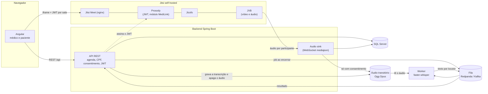
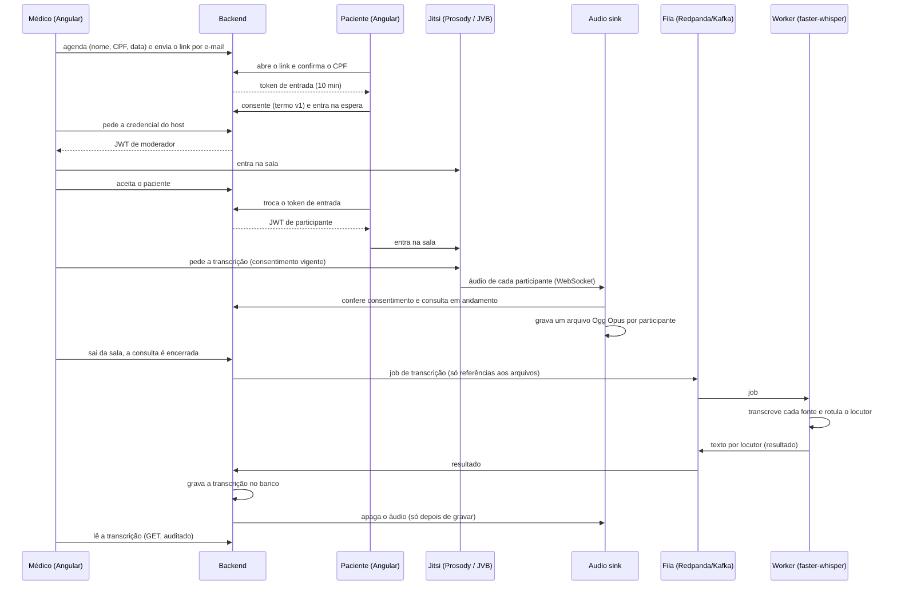

# MediLink

Plataforma de **telemedicina self-hosted** sobre o [Jitsi Meet](https://jitsi.org/): o médico agenda a consulta e envia um link ao paciente; o paciente confirma a identidade por CPF, consente com a captação do áudio e aguarda o aceite do médico; a consulta acontece por vídeo; o áudio é capturado no servidor para ser transcrito e a transcrição vai para o prontuário. Nenhum dado sensível sai da infraestrutura própria.


> **Aviso.** Os trechos sobre LGPD e sigilo médico são orientação de engenharia, não aconselhamento jurídico. O termo de consentimento é uma minuta. Tudo isso precisa ser validado pelo jurídico e pelo encarregado de dados (DPO) antes do uso real.

## Sumário

- [Status do projeto](#status-do-projeto)
- [Funcionalidades](#funcionalidades)
- [Arquitetura](#arquitetura)
- [Stack](#stack)
- [Estrutura do repositório](#estrutura-do-repositório)
- [Pré-requisitos](#pré-requisitos)
- [Como executar](#como-executar)
- [Configuração](#configuração)
- [API](#api)
- [Segurança e privacidade](#segurança-e-privacidade)
- [Testes](#testes)
- [Decisões de arquitetura](#decisões-de-arquitetura)
- [Limitações conhecidas](#limitações-conhecidas)
- [Roadmap](#roadmap)
- [Documentação](#documentação)
- [Contribuindo](#contribuindo)
- [Licença](#licença)

## Status do projeto

O projeto segue **SDD (Spec-Driven Development)**: especificação → plano técnico → tarefas verificáveis. Cada tarefa só é dada como pronta com o critério de aceite satisfeito.

| Fase | Tarefa | Estado |
| --- | --- | --- |
| Fundação | **T01** Jitsi self-hosted (Meet, Prosody, Jicofo, JVB) | Pronta |
| Fundação | **T02** Autenticação por JWT no Jitsi | Pronta |
| Agendamento | **T03** Modelo de dados e migrações | Pronta |
| Agendamento | **T04** Agendamento com link predefinido | Pronta |
| Agendamento | **T05** Envio do link por e-mail | Pronta |
| Acesso | **T06** Tela de acesso e validação de CPF (desativável) | Pronta |
| Acesso | **T07** JWT do médico (moderador) e do paciente | Pronta |
| Consulta | **T08** Aceite do paciente pelo médico | Pronta |
| Consulta | **T09** Consentimento antes da captura | Pronta |
| Consulta | **T10** Frontend Angular e encerramento da consulta | Pronta (ver [limitações](#limitações-conhecidas)) |
| Transcrição | **T11** Audio sink (captura do áudio no servidor) | Pronta |
| Transcrição | **T12** Fila e worker de transcrição (faster-whisper) | Pronta |
| Transcrição | **T13** Gravar a transcrição e descartar o áudio | Pronta |
| Compliance | **T14** Criptografia em repouso, auditoria de leitura, retenção | Pronta |
| Escala | **T15** Vários JVBs, autoscaling e teste de carga (até 1.000 salas) | Mapeada, não iniciada |

O estado detalhado de cada tarefa, com o que foi e o que **não** foi verificado, está em [`docs/tasks.md`](docs/tasks.md).

## Funcionalidades

| Requisito | Descrição | Situação |
| --- | --- | --- |
| RF-01 | O médico agenda informando paciente, CPF, e-mail (opcional), data/hora e se a validação de CPF está ativa; o sistema gera um link único e persistente | Feito |
| RF-02 | O link aponta para uma sala fixa; o médico é o host (moderador) | Feito |
| RF-03 | Envio do link ao paciente por e-mail, com registro | Feito |
| RF-04 | O paciente confirma o CPF (desativável pelo médico); limite de tentativas e resposta genérica para não revelar o que existe | Feito |
| RF-05 | O paciente aguarda e só recebe a credencial da sala depois do aceite explícito do médico | Feito |
| RF-06 | O áudio é capturado durante a consulta e transcrito de forma assíncrona após o encerramento | Feito (captura na T11; fila e transcrição na T12) |
| RF-07 | A transcrição é gravada no banco e o arquivo de áudio é descartado | Feito (T13): o áudio só é apagado depois de a transcrição estar gravada; falha mantém o áudio |
| RF-08 | O consentimento é coletado e registrado (com a versão do termo) antes da captura | Feito |

Também implementado: bloqueio do acesso direto à interface do Jitsi (só carrega dentro do MediLink), restrições de sala (sem chat, compartilhamento de tela, convites etc.), supressão de ruído e qualidade de vídeo no nível 2. Veja [`docs/plan.md`](docs/plan.md).

## Arquitetura



### Fluxo de uma consulta



Os fluxos e as decisões estão detalhados em [`docs/plan.md`](docs/plan.md).

## Stack

| Camada | Tecnologia |
| --- | --- |
| Backend | Java 25, Spring Boot 4.1 (Web MVC, Security, Data JPA, Validation, WebSocket, Mail, Actuator), Flyway, Maven Wrapper |
| Banco | SQL Server 2019 ou superior (driver `mssql-jdbc`) |
| Frontend | Angular 21 (standalone, zoneless, signals), Vitest, IFrame External API do Jitsi |
| Vídeo | Jitsi Meet self-hosted (imagens oficiais `ghcr.io/jitsi`), Docker ou Podman |
| Captura de áudio | Sink WebSocket no backend (protocolo `mediajson`), gravador Ogg Opus próprio |
| Transcrição | Worker Python 3.12 com `faster-whisper` (modelo `turbo`, CPU `int8`), fila Redpanda (dev) / Kafka (produção) |

## Estrutura do repositório

```text
MediLink/
├── backend/                       API Spring Boot e audio sink
│   ├── src/main/java/br/com/medilink/
│   │   ├── domain/                entidades (Medico, Agendamento, Consulta, Transcricao, AuditLog...)
│   │   ├── repository/            repositórios Spring Data
│   │   ├── service/               regras: agenda, CPF, consentimento, JWT, e-mail, aceite
│   │   ├── web/                   controllers REST e DTOs
│   │   ├── security/              configuração de segurança e perfil de desenvolvimento
│   │   └── sink/                  audio sink: WebSocket, gravador Ogg Opus, portão do consentimento
│   ├── src/main/resources/db/migration/   migrações Flyway (V1 a V4)
│   ├── config/local.env.example   modelo da conexão com o SQL Server local
│   └── run-mssql.sh               roda testes e a aplicação contra o SQL Server local
├── frontend/                      Angular 21 (telas do médico e do paciente)
├── worker/                        worker de transcrição (Python, faster-whisper, consumidor Kafka)
├── infra/
│   ├── jitsi/                     Jitsi self-hosted: compose, .env, regras de nginx, módulo Prosody, config do Jicofo
│   │   └── e2e/                   verificação ponta a ponta (Chrome headless com microfone falso)
│   └── dev/                       smtp_sink.py (SMTP de desenvolvimento) e redpanda.sh (broker de desenvolvimento)
└── docs/
    ├── spec.md                    especificação (o quê e por quê)
    ├── plan.md                    plano técnico e registro de decisões (o como)
    └── tasks.md                   tarefas, estado e backlog mapeado
```

## Pré-requisitos

| Item | Versão / observação |
| --- | --- |
| JDK | 25 (com `javac`, não apenas JRE) |
| Node.js | 20.19 ou superior (Angular 21); o CLI 22 exige Node 22+ |
| SQL Server | 2019 ou superior, acessível em `localhost:1433` |
| Docker ou Podman | para o Jitsi; com Podman rootless é preciso o socket do usuário (`systemctl --user start podman.socket`) e o `docker-compose` |
| Python | 3.12 com `venv` (worker de transcrição) |
| Google Chrome | só para a verificação ponta a ponta (`infra/jitsi/e2e`) |

## Como executar

Todos os comandos partem da raiz do repositório.

### 1. Banco de dados

Crie dois bancos vazios no SQL Server (o Flyway cria as tabelas):

```sql
CREATE DATABASE medilink_dev;
CREATE DATABASE medilink_test;
```

Copie o modelo da conexão e preencha a senha. O arquivo `config/local.env` **não é versionado**.

```bash
cd backend
cp config/local.env.example config/local.env
# edite config/local.env: MEDILINK_DB_USER e MEDILINK_DB_PASSWORD, e gere a MEDILINK_DATA_KEY (openssl rand -base64 32)
```

### 2. Jitsi self-hosted

```bash
cd infra/jitsi
./dev.sh init   # cria o .env com segredos aleatórios e as pastas de configuração
./dev.sh up     # instala as regras do MediLink e sobe web, prosody, jicofo e jvb
```

Em desenvolvimento o Jitsi usa um certificado autoassinado. Abra `https://localhost:8443` uma vez no navegador e aceite o certificado; a página mostra "Acesso direto bloqueado", que é o esperado (a interface só carrega dentro do MediLink).

Para parar: `./dev.sh down`. Outros comandos: `./dev.sh logs`, `./dev.sh env`.

### 3. Backend

```bash
cd backend
eval "$(../infra/jitsi/dev.sh env)"   # exporta os segredos do Jitsi e do sink
./run-mssql.sh dev                    # sobe em http://localhost:8090 (perfil dev, banco medilink_dev)
```

O perfil `dev` cria um médico de exemplo cujas credenciais estão em `backend/src/main/resources/application-dev.properties`. **Nunca use esse perfil fora do desenvolvimento.**

### 4. Servidor SMTP de desenvolvimento (opcional)

```bash
python3 infra/dev/smtp_sink.py 1025 infra/dev/mails
```

Recebe os e-mails do link e os grava como `.eml` em `infra/dev/mails/`.

### 5. Fila e worker de transcrição

```bash
infra/dev/redpanda.sh up                          # broker em localhost:9092 e os dois tópicos (imagem ~120 MB)
cd worker
python3 -m venv .venv && .venv/bin/pip install -r requirements-dev.txt
.venv/bin/python -m medilink_worker               # a 1ª execução baixa o modelo Whisper turbo (~1,6 GB)
```

Detalhes e configuração em [`worker/README.md`](worker/README.md). Sem o broker o backend continua funcionando: o job fica pendente e é reenviado quando ele voltar.

### 6. Frontend

```bash
cd frontend
npm install        # o .npmrc usa legacy-peer-deps (bug do npm 10.8.2 com peer deps)
npx ng serve       # http://localhost:4200, com proxy de /api para o backend em :8090
```

- Médico: `http://localhost:4200/medico`
- Paciente: o link gerado no agendamento (`http://localhost:4200/sala/{roomName}`)

### 7. Roteiro de teste manual

1. Entre como médico, crie um agendamento (data futura) e clique em **Entrar na sala**.
2. Abra o link do paciente em outra aba ou navegador, confirme o CPF e aceite o termo.
3. Como médico, clique em **Aceitar paciente**. O paciente entra na mesma sala.
4. O médico sai da sala (botão de desligar): a consulta deve ser encerrada.
5. Os arquivos de áudio ficam em `${MEDILINK_SINK_DIR:-/tmp/medilink-audio}/{consultaId}/`.
6. Com o worker no ar, o texto da consulta (por locutor) aparece no tópico `medilink.transcricao.resultados` (`podman exec medilink-redpanda rpk topic consume medilink.transcricao.resultados -n 1`).

## Configuração

### Backend (variáveis de ambiente)

| Variável | Obrigatória | Descrição |
| --- | --- | --- |
| `MEDILINK_DB_URL`, `MEDILINK_DB_USER`, `MEDILINK_DB_PASSWORD` | sim | Conexão JDBC com o SQL Server |
| `MEDILINK_CPF_HMAC_KEY` | sim | Segredo do HMAC-SHA256 com que o CPF é guardado |
| `MEDILINK_JITSI_APP_SECRET` | sim | Segredo HS256 do JWT do Jitsi (mínimo 32 caracteres); igual ao `JWT_APP_SECRET` do Jitsi |
| `MEDILINK_JITSI_APP_ID`, `MEDILINK_JITSI_AUDIENCE`, `MEDILINK_JITSI_XMPP_DOMAIN` | não | Padrões `medilink`, `jitsi`, `meet.jitsi`; devem casar com o `.env` do Jitsi |
| `MEDILINK_SINK_TOKEN` | sim | Segredo que o Jicofo envia ao sink (`SINK_TOKEN` do Jitsi) |
| `MEDILINK_DATA_KEY` | sim | Chave mestra AES-256 (32 bytes em Base64: `openssl rand -base64 32`) da cifra em repouso. **Perdê-la torna as transcrições ilegíveis.** O worker precisa da mesma chave |
| `MEDILINK_DATA_KEY_ID`, `MEDILINK_DATA_KEYS_ANTERIORES` | não | Id da chave ativa (padrão `k1`) e, para rotação, chaves aposentadas (`id:base64,…` no worker; `medilink.crypto.chaves-anteriores.<id>` no backend) |
| `MEDILINK_SINK_DIR` | não | Pasta dos arquivos de áudio transitórios (padrão `${java.io.tmpdir}/medilink-audio`) |
| `MEDILINK_KAFKA_BOOTSTRAP` | não | Broker da fila de transcrição (padrão `localhost:9092`) |
| `MEDILINK_PUBLIC_BASE_URL` | não | Base do link enviado ao paciente (padrão `http://localhost:4200`) |
| `MEDILINK_MAIL_HOST`, `MEDILINK_MAIL_PORT`, `MEDILINK_MAIL_USER`, `MEDILINK_MAIL_PASSWORD`, `MEDILINK_MAIL_FROM` | não | Relay SMTP (padrão `localhost:1025`) |

A aplicação **não sobe** sem os segredos obrigatórios: não há valor padrão para eles.

### Jitsi (`infra/jitsi/.env`)

O `./dev.sh init` gera o arquivo a partir de `.env.example`. Principais chaves:

| Chave | Efeito |
| --- | --- |
| `AUTH_TYPE=jwt`, `ENABLE_GUESTS=0` | Só entra em sala quem tem JWT válido |
| `JWT_APP_ID`, `JWT_APP_SECRET`, `JWT_ACCEPTED_ISSUERS`, `JWT_ACCEPTED_AUDIENCES` | Validação do JWT emitido pelo backend |
| `XMPP_MUC_MODULES` | Módulos do componente MUC: `token_affiliation` (papel de moderador pelo token) e `medilink_transcription` |
| `ENABLE_P2P=0` | Toda a mídia passa pelo JVB (necessário para a captura no servidor) |
| `CSP_HEADER` | Quem pode embutir a interface do Jitsi (a origem do MediLink) |
| `SINK_WS_URL`, `SINK_TOKEN` | Destino e segredo da exportação de áudio |

Para a lista completa de restrições da sala, veja `infra/jitsi/custom-config.js` e a seção "Configuração da sala" de [`docs/plan.md`](docs/plan.md).

## API

Rotas do **médico** exigem autenticação (HTTP Basic provisório); as do **paciente** são públicas e se protegem pelo link não adivinhável, pelo CPF e pelo token de entrada.

| Método | Rota | Quem | Função |
| --- | --- | --- | --- |
| `POST` | `/api/agendamentos` | médico | Cria o agendamento e retorna o link |
| `GET` | `/api/agendamentos/{id}` | médico | Consulta o agendamento (só o dono) |
| `POST` | `/api/agendamentos/{id}/enviar-email` | médico | Envia o link ao paciente |
| `POST` | `/api/agendamentos/{id}/token-jitsi` | médico | JWT de moderador para a sala |
| `GET` | `/api/me` | médico | Nome e e-mail do médico autenticado |
| `GET` | `/api/consultas/{id}` | médico | Estado da consulta e se há paciente aguardando |
| `GET` | `/api/consultas/{id}/transcricao` | médico | Transcrição com falantes e tempos (`200`); `202` enquanto processa; `409` consulta aberta ou transcrição falhou; `404` de outro médico ou sem áudio. Cada leitura é auditada |
| `POST` | `/api/consultas/{id}/aceite` | médico | Admite o paciente (idempotente) |
| `POST` | `/api/consultas/{id}/encerrar` | médico | Encerra a consulta em andamento (idempotente) e cria o job de transcrição |
| `POST` | `/api/consultas/{id}/participante` | médico ou paciente | O cliente informa o próprio endpoint do Jitsi; o papel vem da autenticação (médico autenticado; paciente com o token de entrada no corpo) |
| `GET` | `/api/salas/{roomName}/acesso` | paciente | Dados mínimos da tela de acesso |
| `POST` | `/api/salas/{roomName}/validar-cpf` | paciente | Valida o CPF e devolve o token de entrada |
| `POST` | `/api/salas/{roomName}/token` | paciente | `202` enquanto aguarda o aceite; `200` com o JWT depois |
| `GET` | `/api/termo-consentimento` | paciente | Termo vigente (versão e texto) |
| `POST` | `/api/consultas/{id}/consentimento` | paciente | Registra, recusa ou retira o consentimento |
| `WS` | `/api/audio-sink/{meetingId}?sala={roomName}` | JVB | Recebe o áudio (autenticado por `Authorization: Bearer`) |
| `GET` | `/actuator/health` | público | Saúde da aplicação |

Os erros seguem RFC 9457 (`ProblemDetail`), sem repetir valores informados (por exemplo, o CPF).

## Segurança e privacidade

- **CPF**: guardado apenas como **HMAC-SHA256** com segredo do servidor (um hash simples seria revertido por força bruta em 11 dígitos), comparado em tempo constante, e nunca em log, URL ou resposta. A validação tem limite de **5 falhas em 15 minutos** por agendamento e devolve a mesma resposta para CPF errado, sala inexistente ou agendamento cancelado.
- **Link e sala**: nome da sala com 128 bits aleatórios; um JWT HS256 por sala, com expiração; o paciente nunca recebe moderação.
- **Aceite no backend**: a credencial do Jitsi do paciente só é emitida depois do aceite do médico. Como a sala do Jitsi nasce aberta, esse portão fica no backend, e sem JWT ninguém entra.
- **Interface do Jitsi não exposta**: navegação direta (`Sec-Fetch-Dest: document`) recebe 403 e só o iframe do MediLink carrega a interface; `frame-ancestors` restringe quem pode embutir. É uma camada de ocultação; **a fronteira de segurança é o JWT**.
- **Consentimento**: termo versionado, com a versão gravada junto da data; o paciente pode recusar ou retirar. O **audio sink confere o consentimento por conta própria** a cada segundo e descarta o áudio sem ele, independentemente de quem pediu a exportação.
- **Fila e worker**: o job só tem referências (nada de áudio, texto, CPF ou nome); o worker valida o caminho do arquivo, nunca registra o texto em log e, em falha, devolve só o tipo do erro. O **resultado carrega o texto da consulta** (dado sensível de saúde): o tópico precisa de controle de acesso e cifragem (T14).
- **Cifragem em repouso (AES-256-GCM)**: o áudio é gravado já cifrado (`.opus.enc`) e o worker o decifra só em memória; as colunas da transcrição guardam `enc:…`. Um dump do banco ou um `cat` no disco não mostram a consulta. Chave mestra fora do git e do banco; formato e rotação em [`docs/plan.md`](docs/plan.md).
- **Retenção**: tentativas de CPF (24 h), teto de guarda do áudio mesmo de job que falhou (7 dias), prazo opcional da transcrição e tópicos da fila (24 h). Prazos são de partida; a decisão final é do jurídico.
- **Em produção, TLS é obrigatório**: no perfil `prod` a aplicação não sobe com banco sem `encrypt=true`/certificado verificado, sem HTTPS/WSS ou com a fila sem SSL.
- **Descarte do áudio**: só depois de a transcrição estar gravada no banco; se o disco falhar, o texto fica salvo e o descarte é repetido até concluir. Falha do worker mantém o áudio. Ordem e garantias em [`docs/plan.md`](docs/plan.md).
- **Auditoria**: criação, aceite, consentimento, emissão de token, e-mail, captura, gravação da transcrição, descarte do áudio, **leitura da transcrição e tentativas negadas** são registrados sem dado sensível. A tabela é **somente de inserção** no SQL Server (gatilho).
- **Criptografia de ponta a ponta (E2EE)**: **desligada por padrão**, por decisão registrada em [`docs/plan.md`](docs/plan.md). A captura do áudio no servidor é incompatível com E2EE; a mídia continua cifrada em trânsito (DTLS-SRTP e TLS) até o servidor de vídeo, que é da própria clínica. Existe um flag no frontend para ligá-la, ao custo de a captura deixar de funcionar.
- **Segredos**: nenhum valor secreto é versionado (`infra/jitsi/.env` e `backend/config/local.env` ficam fora do git).

## Testes

O banco dos testes é **sempre o SQL Server local** (`medilink_test`); não há banco em memória.

```bash
# backend: 163 testes (unitários e de integração: audio sink com servidor real e fila no Redpanda local)
cd backend && ./run-mssql.sh test
./run-mssql.sh test -Dtest=ConsultaAceiteApiTest    # só uma classe

# worker de transcrição: 39 testes (sem modelo e sem broker)
cd worker && .venv/bin/python -m pytest -q

# frontend: 38 testes (Vitest)
cd frontend && npx ng test --watch=false

# ponta a ponta com Jitsi real (pare o ng serve antes: a porta 4200 precisa estar livre)
python3 -I infra/jitsi/e2e/verify_t11.py 'medico@medilink.local:dev-only-change-me'

# ponta a ponta da transcrição: fala em português pelo Jitsi até o texto no tópico (veja os pré-requisitos no cabeçalho)
worker/.venv/bin/python infra/jitsi/e2e/verify_t12.py 'medico@medilink.local:dev-only-change-me' medico.wav paciente.wav

# ponta a ponta da gravação: o backend (em dev, na :8090) consome o resultado; a API entrega a transcrição e o áudio some do disco
worker/.venv/bin/python infra/jitsi/e2e/verify_t13.py 'medico@medilink.local:dev-only-change-me' medico.wav paciente.wav
```

Scripts de verificação contra o Prosody real (precisam do Jitsi e do backend em dev no ar):

| Script | O que prova |
| --- | --- |
| `infra/jitsi/verify_auth.py` | Sem token, com token inválido, adulterado ou de outra sala não entra |
| `infra/jitsi/verify_t07.py` | Médico entra como moderador e paciente sem moderação |
| `infra/jitsi/verify_t08.py` | O paciente só entra depois do aceite, mesmo chegando antes do médico |
| `infra/jitsi/e2e/verify_t11.py` | Com consentimento grava um Ogg Opus válido por participante, nada antes do aceite; sem consentimento, nada |
| `infra/jitsi/e2e/verify_t12.py` | Médico e paciente falam trechos diferentes em português; o texto chega ao tópico com o locutor certo e na ordem certa; sem consentimento nada é transcrito |
| `infra/jitsi/e2e/verify_t13.py` | O backend grava a transcrição do resultado; `GET /transcricao` devolve cada fala com o papel certo; a pasta de áudio da consulta é apagada; sem consentimento, `404` e nenhum arquivo |

## Decisões de arquitetura

As decisões e o raciocínio estão em [`docs/plan.md`](docs/plan.md). As principais:

| Decisão | Resumo |
| --- | --- |
| SQL Server em todos os ambientes | Sem H2; migrações com tipos nativos (`UNIQUEIDENTIFIER`, `NVARCHAR`, `DATETIMEOFFSET`) |
| CPF como HMAC | Protege contra força bruta; o sistema nunca precisa exibir o CPF |
| Aceite no backend, não no lobby do Jitsi | A sala do Jitsi nasce aberta; evita aceite em duas etapas |
| Captura de áudio no servidor, sem E2EE | O upload não pode ficar sob responsabilidade do cliente; P2P desligado para a mídia passar pelo JVB |
| Módulo Prosody próprio | A versão aberta do Jitsi não liga a exportação de áudio sozinha |
| Frontend em Angular 21 | O CLI mais recente exige Node 22+; o ambiente usa Node 20 |

## Limitações conhecidas

- O **gatilho da captura** é a página do médico. O consentimento é garantido no sink, mas se a aba do médico cair antes de pedir, nada é gravado.
- Fechar a aba sem sair da conferência **não encerra** a consulta. Encerrar ao sair da sala foi testado com um Jitsi simulado e no backend; o evento real `videoConferenceLeft` disparando o encerramento pelo app Angular ainda não foi exercitado.
- O texto transcrito passa pelo tópico de resultados (retenção de 24 h; TLS e ACL do broker não foram exercitados aqui). Nome do paciente e metadados estão **em claro** no banco; TDE/backup cifrado, KMS e uma rotina que recifre o histórico depois de rotacionar a chave ficam para a infraestrutura.
- Job que falhou (`FALHA_NO_ENVIO`, `FALHA_NO_WORKER`) mantém o áudio (cifrado) até o teto de 7 dias e **não é reprocessado sozinho**; falta o reenvio.
- Ao carregar o modelo, o worker consulta o huggingface.co (sem dado de paciente); com o modelo já baixado, `HF_HUB_OFFLINE=1` evita isso.
- A transcrição custa ≈ 2× o tempo real por fonte em CPU (8 núcleos); o worker roda no host e o vocabulário médico não foi avaliado.
- O mapa de quem é médico e quem é paciente é informado pelo cliente (o papel vem da autenticação, o endpoint vem do navegador).
- O login do médico é **HTTP Basic provisório**; o mecanismo definitivo está em aberto.
- Não há listagem, edição ou cancelamento de agendamentos na interface.
- O token de entrada do paciente dura 10 minutos; se o aceite demorar mais, ele repete o CPF.
- Vídeo e áudio foram verificados com um Chrome de teste e microfone falso, **não** com pessoas reais; o efeito do nível de desempenho 2, da supressão de ruído e do P2P desligado não foi confirmado.
- Desenvolvimento usa `ws://`, certificado autoassinado e `trustServerCertificate=true`; **nada disso serve para produção**.
- O banco foi validado no SQL Server 2022 Express; falta rodar em uma instância 2019.

A lista completa, com os pontos de atenção de cada item, está em [`docs/tasks.md`](docs/tasks.md#backlog-mapeado-para-a-próxima-sequência).

## Roadmap

Etapas mapeadas, **ainda não iniciadas**, para a próxima sequência:

1. **T15** Escala: vários JVBs, autoscaling dos workers (ou GPU) e teste de carga de 100 a 1.000 salas.
2. **Endurecimentos:** gatilho da captura no servidor, encerramento por inatividade, login definitivo do médico, renovação do token de entrada, relay de e-mail de produção, container do worker e verificação com pessoas reais.

## Documentação

| Documento | Conteúdo |
| --- | --- |
| [`docs/spec.md`](docs/spec.md) | Requisitos funcionais, critérios de aceite, domínio e compliance |
| [`docs/plan.md`](docs/plan.md) | Arquitetura, decisões, contratos de API, configuração da sala, captura de áudio |
| [`docs/tasks.md`](docs/tasks.md) | Backlog, estado de cada tarefa e pendências |
| [`infra/jitsi/README.md`](infra/jitsi/README.md) | Operação do Jitsi de desenvolvimento |

## Contribuindo

1. Trabalhe em uma tarefa por vez e só a considere pronta com o critério de aceite satisfeito e testes passando.
2. Rode a suíte do backend (`./run-mssql.sh test`) e a do frontend antes de abrir qualquer pedido de integração.
3. Não versione segredos: `.env`, `config/local.env` e arquivos de áudio ficam fora do repositório.
4. Mensagens de commit em português, no formato [Conventional Commits](https://www.conventionalcommits.org/pt-br/) (`feat:`, `fix:`, `docs:`, `test:`, `chore:`).

## Licença

Distribuído sob a **licença MIT**. O texto completo está em [`LICENSE`](LICENSE).

Arquivos de terceiros mantêm a própria licença e **não** são cobertos pela MIT deste projeto:

| Arquivo | Origem | Licença |
| --- | --- | --- |
| `infra/jitsi/docker-compose.yml` | [docker-jitsi-meet](https://github.com/jitsi/docker-jitsi-meet), sem alterações | Apache-2.0 |
| `backend/mvnw`, `backend/mvnw.cmd`, `backend/.mvn/` | Maven Wrapper | Apache-2.0 (cabeçalho nos próprios arquivos) |

As dependências (Spring, Angular, driver do SQL Server e demais bibliotecas) e as imagens do Jitsi são obtidas dos seus projetos e seguem as licenças deles.
