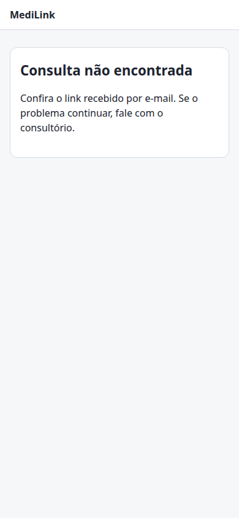
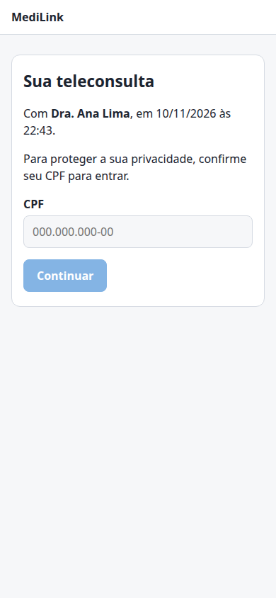
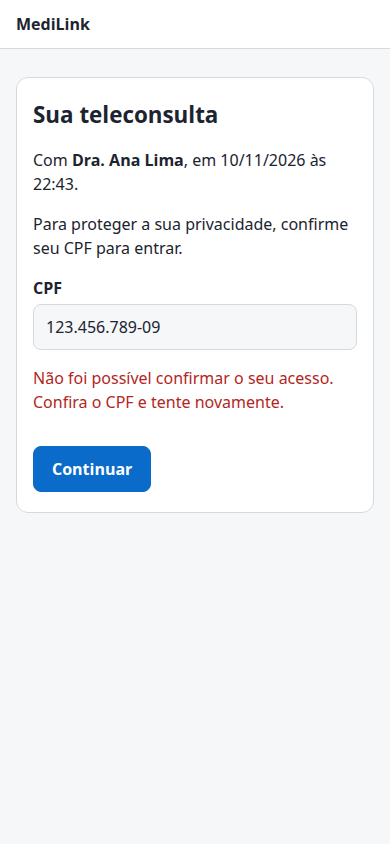
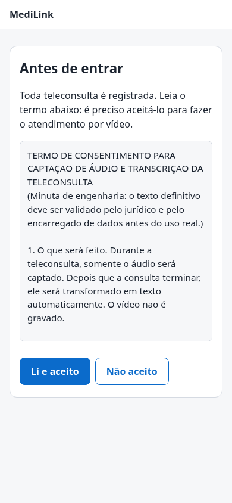
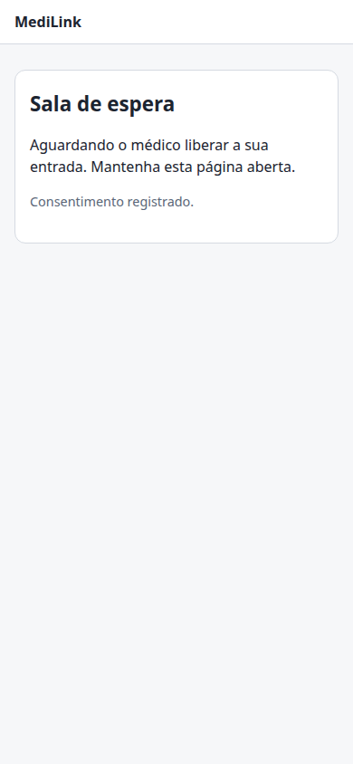
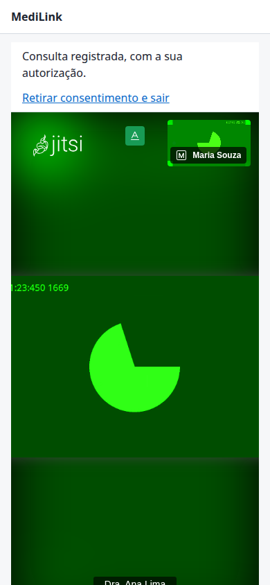

# Capítulo 1: Paciente

[← Índice](README.md) · [Capítulo 2: Médico →](02-medico.md)

Este capítulo é para quem vai **ser atendido** por vídeo. Você não precisa instalar nada nem criar conta: basta o **link da consulta**, que chega por e-mail ou pelo consultório.

**Neste capítulo**

1. [Antes da consulta](#1-antes-da-consulta)
2. [Abrir o link](#2-abrir-o-link)
3. [Confirmar o CPF](#3-confirmar-o-cpf)
4. [Ler e aceitar o termo](#4-ler-e-aceitar-o-termo)
5. [Aguardar na sala de espera](#5-aguardar-na-sala-de-espera)
6. [Durante a consulta](#6-durante-a-consulta)
7. [Retirar o consentimento ou sair](#7-retirar-o-consentimento-ou-sair)
8. [Perguntas frequentes](#8-perguntas-frequentes)

---

## 1. Antes da consulta

- Tenha o **link** em mãos (e-mail ou mensagem do consultório). Ele é só seu: **não compartilhe**.
- Se o consultório pediu a confirmação do CPF, tenha o seu CPF à mão.
- Use um navegador atualizado, no computador ou no celular, e um lugar com boa internet e pouco barulho.
- Na primeira vez o navegador pergunta se o site pode usar **câmera e microfone**: escolha **Permitir**. Sem isso o médico não vê nem ouve você.
- Entre alguns minutos antes do horário. Quem chega cedo fica na sala de espera.

## 2. Abrir o link

Toque ou clique no link recebido. O endereço tem o formato `https://…/sala/consulta-…`.

Se aparecer a mensagem abaixo, o link está errado, foi cortado ao copiar ou a consulta foi cancelada. Confira o link na mensagem original ou fale com o consultório.

 Figura 1. Link inválido ou consulta cancelada.

## 3. Confirmar o CPF

Para proteger a sua privacidade, o sistema pode pedir o seu **CPF** antes de deixar você entrar. A tela mostra o nome do médico, o dia e a hora da consulta.

 Figura 2. Confirmação do CPF.

1. Digite os 11 números do CPF (com ou sem pontos e traço).
2. Toque em **Continuar**.

Se o CPF não conferir, aparece uma mensagem de aviso e você pode tentar de novo:

 Figura 3. CPF não confirmado.

> **Importante.** Por segurança, a mensagem é sempre a mesma, seja o CPF errado, seja o link de outra pessoa. Depois de **5 tentativas erradas em 15 minutos** o acesso é pausado por alguns minutos (“Muitas tentativas. Aguarde alguns minutos e tente novamente.”). Se você tem certeza de que digitou certo e continua sem entrar, fale com o consultório: o CPF cadastrado na consulta pode estar diferente.

Se o consultório não exigir o CPF, esta etapa não aparece e você vai direto ao termo.

## 4. Ler e aceitar o termo

Toda teleconsulta é **registrada**. Antes de entrar, você lê o **termo de consentimento** e decide.

 Figura 4. Termo de consentimento (role o texto para ler tudo).

O termo explica, em linguagem simples:

- **O que é captado:** somente o **áudio**. O **vídeo não é gravado**.
- **Para que serve:** depois da consulta o áudio vira texto, que documenta o atendimento e faz parte do seu prontuário.
- **O que acontece com o áudio:** assim que o texto estiver salvo, o arquivo de áudio é **apagado**. Só o texto é mantido.
- **Quem acessa:** o profissional responsável pelo seu atendimento. O processamento ocorre na infraestrutura do próprio serviço, sem enviar áudio ou texto a terceiros.
- **Prazo de guarda:** o texto integra o prontuário e é mantido pelo prazo da legislação.
- **Sua escolha:** você pode **retirar o consentimento a qualquer momento**.

| Botão | O que acontece |
| --- | --- |
| **Li e aceito** | O consentimento é registrado e você segue para a sala de espera. |
| **Não aceito** | A consulta **por vídeo não pode ser feita**, porque toda consulta é registrada. Você vê uma tela explicando isso e pode **ler o termo novamente** se mudar de ideia. Entre em contato com o consultório para combinar outra forma de atendimento. |

> O texto do termo pode ser atualizado pela clínica. Se aparecer “O termo foi atualizado. Recarregue a página para lê-lo.”, recarregue a página e leia a nova versão.

## 5. Aguardar na sala de espera

Depois de aceitar, você fica na **sala de espera** até o médico liberar a sua entrada.

 Figura 5. Sala de espera.

- **Mantenha a página aberta.** Ela avisa sozinha quando o médico aceitar você; não precisa atualizar.
- Se o seu celular bloquear a tela por muito tempo, volte à página para continuar.
- O médico só vê você na lista depois que você aceita o termo.

## 6. Durante a consulta

Quando o médico aceita, a sala de vídeo abre. No alto da tela aparece o aviso **“Consulta registrada, com a sua autorização”** e o link **Retirar consentimento e sair**.

 Figura 6. Sala de vídeo (a imagem é o vídeo de teste do navegador).

A barra de botões da sala (ela aparece ao tocar ou mover o mouse sobre o vídeo) tem:

| Botão | Para que serve |
| --- | --- |
| **Microfone** | Liga e desliga o seu som. Fique com ele ligado: é o seu áudio que o médico precisa ouvir. |
| **Câmera** | Liga e desliga a sua imagem. |
| **Supressão de ruído** | Reduz barulhos de fundo. |
| **Desempenho** | Ajusta a qualidade do vídeo se a sua internet estiver lenta. |
| **Grade** | Muda a forma de ver os participantes. |
| **Tela cheia** | Expande o vídeo. |
| **Desligar** | Sai da sala. |

Dicas:

- Se a imagem travar, tente desligar a câmera por um instante ou reduzir a qualidade em **Desempenho**.
- Fale em ritmo natural e uma pessoa por vez: isso melhora o texto da transcrição.
- Não há chat, compartilhamento de tela nem convite de outras pessoas: a sala é só entre você e o médico.

## 7. Retirar o consentimento ou sair

- **Sair da sala sem encerrar:** use o botão **Desligar**. Você vê “Você saiu da consulta” e pode tocar em **Voltar para a sala** enquanto a consulta estiver aberta.
- **Retirar o consentimento:** toque em **Retirar consentimento e sair**. A captação do áudio é **interrompida** e a sua participação na consulta é encerrada. Você vê a tela “Consentimento retirado”. O que já foi registrado até esse momento é mantido pelo prazo legal. Entre em contato com o consultório para combinar a continuidade do atendimento.
- **Sessão expirada:** se você ficar muito tempo parado antes de entrar (cerca de 10 minutos), pode aparecer “Sessão expirada”. Toque em **Confirmar novamente** e repita o CPF.
- **Quando o médico encerra a consulta**, a sala fecha. Pode fechar a página.

## 8. Perguntas frequentes

**O vídeo é gravado?** Não. Só o áudio é captado, e é apagado depois que vira texto.

**Preciso criar conta ou instalar aplicativo?** Não. O link e um navegador bastam.

**O que faço se o microfone ou a câmera não funcionam?** Confira se você tocou em **Permitir** quando o navegador perguntou. Se negou sem querer, toque no cadeado ao lado do endereço do site, libere câmera e microfone e recarregue a página. Feche outros aplicativos que estejam usando a câmera (outro vídeo, outro navegador).

**Posso usar o celular?** Sim. As telas se adaptam ao celular. Prefira deixá-lo apoiado, com a página aberta e a tela ligada.

**O médico não me aceita.** Confira se aparece “Sala de espera”. Se sim, o médico ainda não liberou a sua entrada: aguarde, e se passar do horário, fale com o consultório. Se você parou em outra tela, volte ao link da consulta e refaça as etapas.

**Perdi o link.** Peça um novo ao consultório. Cada consulta tem um link único, e ele deixa de valer depois de passado um dia do horário marcado se a consulta não começou.

**Quem vê o que eu falei?** O profissional responsável pelo seu atendimento, por meio da transcrição. Você pode pedir ao consultório informações sobre o tratamento dos seus dados.

---

[← Índice](README.md) · [Capítulo 2: Médico →](02-medico.md)
