# Capítulo 2: Médico

[← Capítulo 1: Paciente](01-paciente.md) · [Índice](README.md) · [Capítulo 3: Administrador →](03-administrador.md)

Este capítulo é para quem **atende** pela plataforma. Há duas formas de entrar; qual delas você usa depende de como a sua clínica configurou o sistema:

| Forma de entrar | Como é | O que você vê |
| --- | --- | --- |
| **Com e-mail e senha** | O administrador cadastra você e lhe passa a senha inicial. | Todas as suas consultas, a agenda e as transcrições. |
| **Pelo link de uso único** | O sistema de agenda ou prontuário da clínica gera um link na hora de iniciar a consulta. | Só aquela consulta (sala e transcrição). |

**Neste capítulo**

1. [Entrar com e-mail e senha](#1-entrar-com-e-mail-e-senha)
2. [Autenticador (TOTP), quando exigido](#2-autenticador-totp-quando-exigido)
3. [Minhas consultas](#3-minhas-consultas)
4. [Agendar uma consulta](#4-agendar-uma-consulta)
5. [Atender: sala, aceite e consentimento](#5-atender-sala-aceite-e-consentimento)
6. [Encerrar a consulta](#6-encerrar-a-consulta)
7. [Ver a transcrição](#7-ver-a-transcrição)
8. [Entrar pelo link de uso único](#8-entrar-pelo-link-de-uso-único)
9. [Boas práticas e segurança](#9-boas-práticas-e-segurança)
10. [Problemas comuns](#10-problemas-comuns)

---

## 1. Entrar com e-mail e senha

Abra o endereço da plataforma (por exemplo `https://app.suaclinica.com.br/medico`).

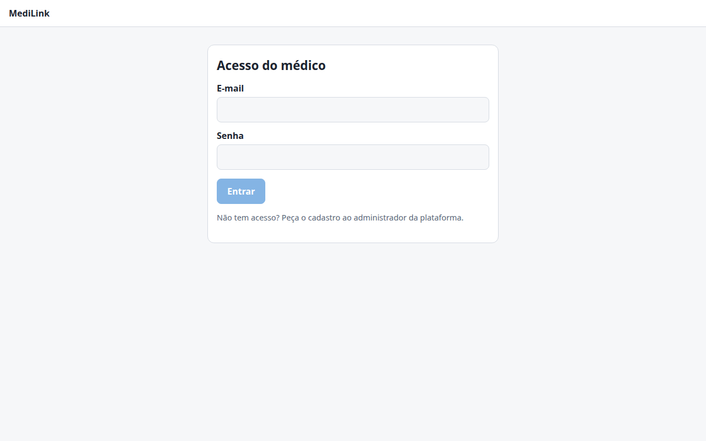 Figura 1. Acesso do médico.

1. Digite o **e-mail** que o administrador cadastrou para você.
2. Digite a **senha**.
3. Clique em **Entrar**.

Se o e-mail ou a senha não conferirem, aparece uma mensagem de erro. Por segurança ela é sempre a mesma, tanto para senha errada quanto para e-mail não cadastrado.

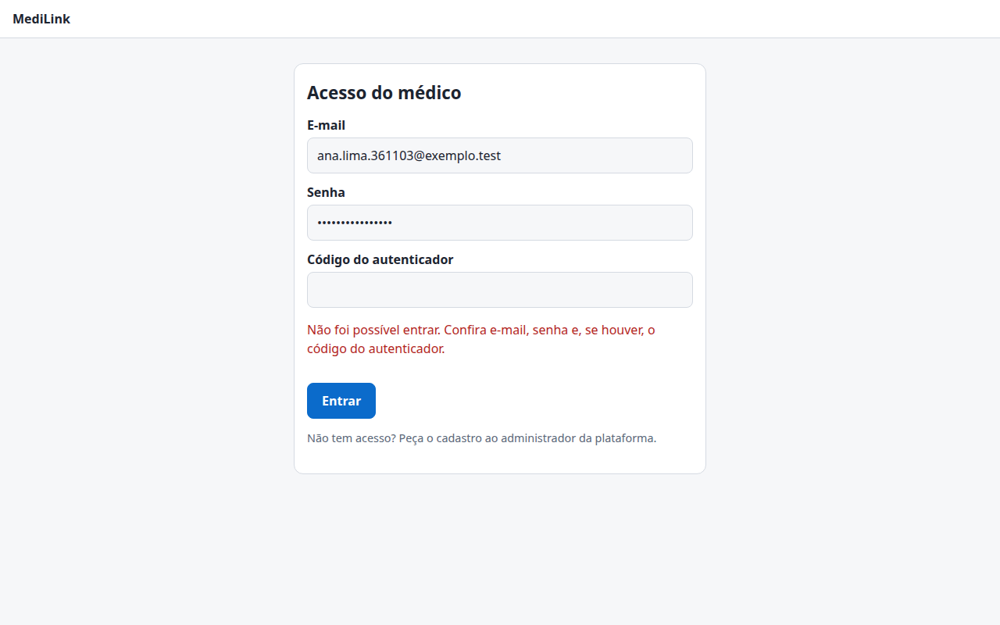 Figura 2. Não foi possível entrar.

> **Atenção.** Depois de **5 tentativas erradas** o acesso é bloqueado por cerca de 15 minutos (“Muitas tentativas. Aguarde alguns minutos.”). Se esqueceu a senha, peça ao administrador para **redefinir**: não há “esqueci minha senha” por e-mail. A sua sessão dura cerca de 8 horas; depois disso é preciso entrar de novo.

Quando o login dá certo você vai direto para [Minhas consultas](#3-minhas-consultas).

## 2. Autenticador (TOTP), quando exigido

O administrador pode exigir um **código do aplicativo autenticador** além da senha. Nesse caso:

**No primeiro acesso**, depois de digitar e-mail e senha, a tela mostra um **segredo** para cadastrar no autenticador:

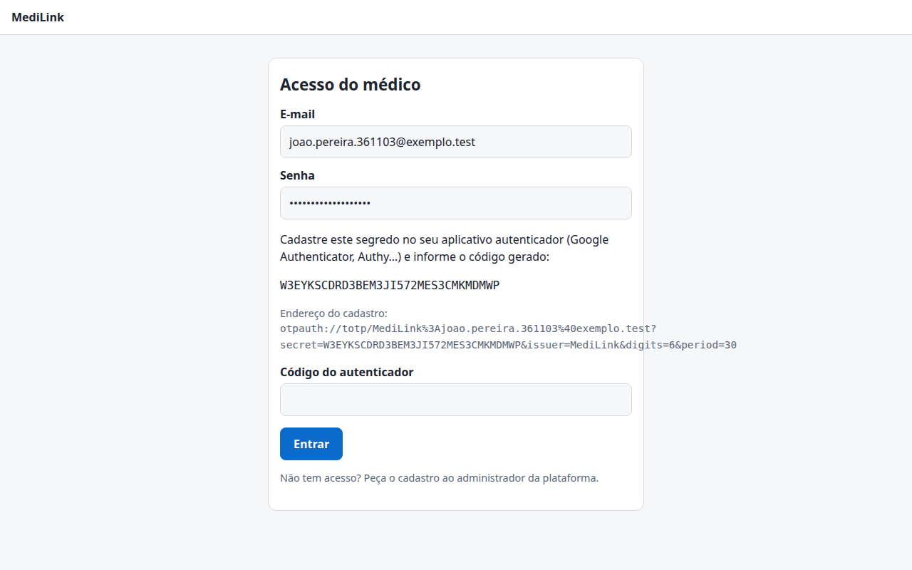 Figura 3. Primeiro acesso com TOTP: cadastre o segredo no aplicativo.

1. No celular, abra o aplicativo autenticador e escolha **adicionar conta** (tipo “baseado em tempo”, 6 dígitos).
2. Informe o segredo mostrado na tela (ou use o endereço `otpauth://…` para gerar um QR Code, se preferir).
3. O aplicativo passa a mostrar um **código de 6 dígitos** que muda a cada 30 segundos.
4. Digite o código no campo **Código do autenticador** e clique em **Entrar**.

**Nos próximos acessos**, informe e-mail, senha **e** o código do momento. Cada código só vale uma vez: se o login falhar, espere o código seguinte.

| Situação | O que fazer |
| --- | --- |
| Troquei de celular ou perdi o aplicativo | Peça ao administrador **Refazer cadastro do TOTP**. No próximo acesso aparece um segredo novo. |
| O código “não bate” | Confira se o relógio do celular está no automático. Use sempre o código atual. |
| Não vejo o campo do código | Depois de uma tentativa recusada o campo aparece. Se o seu TOTP é exigido, informe o código ao entrar. |

## 3. Minhas consultas

É a sua tela inicial: lista as consultas **só suas**, da mais recente para a mais antiga.

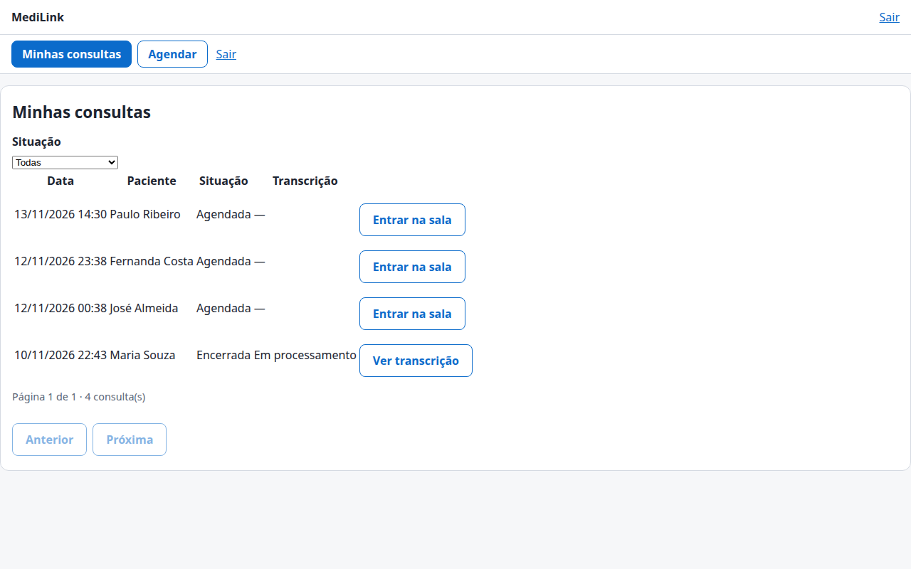 Figura 4. Minhas consultas.

| Coluna | O que mostra |
| --- | --- |
| **Data** | Dia e hora marcados. |
| **Paciente** | Nome do paciente. |
| **Situação** | **Agendada**, **Paciente aguardando**, **Em andamento** ou **Encerrada**. |
| **Transcrição** | **—** (ainda não se aplica), **Em processamento**, **Disponível**, **Sem áudio**, **Falhou** ou **Expirada**. |

Botões da linha:

- **Entrar na sala:** para consultas agendadas, com paciente aguardando ou em andamento.
- **Ver transcrição:** para consultas com transcrição disponível ou em processamento. O botão só aparece se a clínica habilitou a leitura de transcrições na plataforma; caso contrário a tela avisa “A leitura de transcrições por esta plataforma não está habilitada”.

Outros controles: o filtro **Situação** (mostra só um tipo de consulta), os botões **Anterior** e **Próxima** (20 consultas por página) e o menu do alto: **Minhas consultas**, **Agendar** e **Sair**.

> A lista **nunca** mostra o texto da transcrição nem o CPF: ela só informa a situação. O texto abre na tela de transcrição e cada leitura é registrada em auditoria.

## 4. Agendar uma consulta

Clique em **Agendar** no menu do alto.

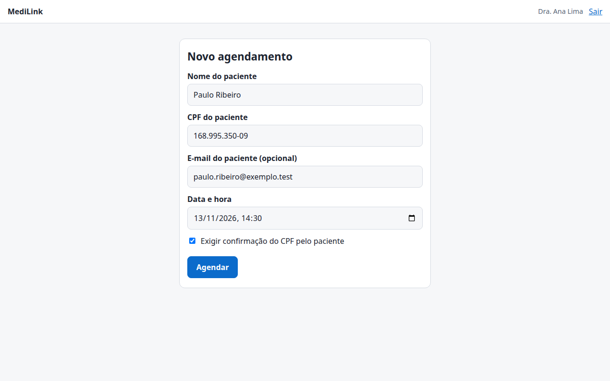 Figura 5. Novo agendamento.

| Campo | Observação |
| --- | --- |
| **Nome do paciente** | Obrigatório. |
| **CPF do paciente** | Obrigatório neste formulário. |
| **E-mail do paciente** | Opcional. Com ele você pode enviar o link por e-mail com um clique. |
| **Data e hora** | Obrigatório. Use data e horário futuros. |
| **Exigir confirmação do CPF pelo paciente** | Marcado: o paciente precisa digitar o CPF para entrar. Desmarcado: ele entra direto no termo. |

Clique em **Agendar**. A tela passa a mostrar o **link da consulta**:

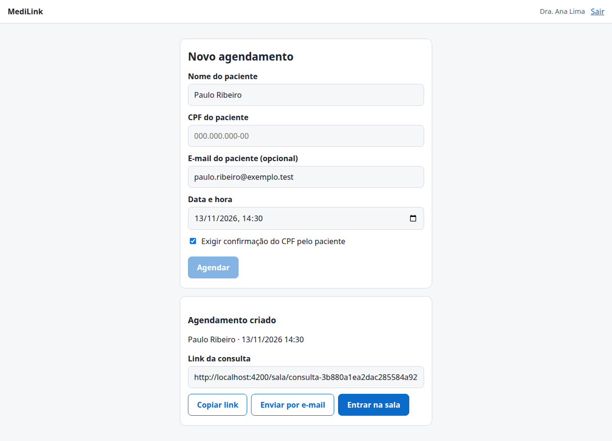 Figura 6. Agendamento criado.

- **Copiar link:** copia o endereço para você enviar ao paciente por onde preferir.
- **Enviar por e-mail:** envia o link ao e-mail do paciente (ativo se você informou o e-mail).
- **Entrar na sala:** abre a sala dessa consulta.

O link é único e fixo: você pode reutilizá-lo no mesmo dia, e ele deixa de valer 24 horas depois do horário se a consulta não tiver começado.

> **Para voltar à lista.** Esta tela e a de “Consulta encerrada” ainda não têm um botão para **Minhas consultas**: use o botão **Voltar** do navegador ou abra o endereço `…/medico/consultas`.

> Em clínicas que agendam pelo sistema de agenda integrado, este formulário pode não estar em uso: as consultas já chegam à sua lista.

## 5. Atender: sala, aceite e consentimento

Na lista, clique em **Entrar na sala**. A tela mostra a sala de vídeo e uma **barra de estado** no alto.

**Paciente na espera.** Quando o paciente confirma o CPF e **aceita o termo**, a barra mostra **“Paciente aguardando”** e o botão **Aceitar paciente**:

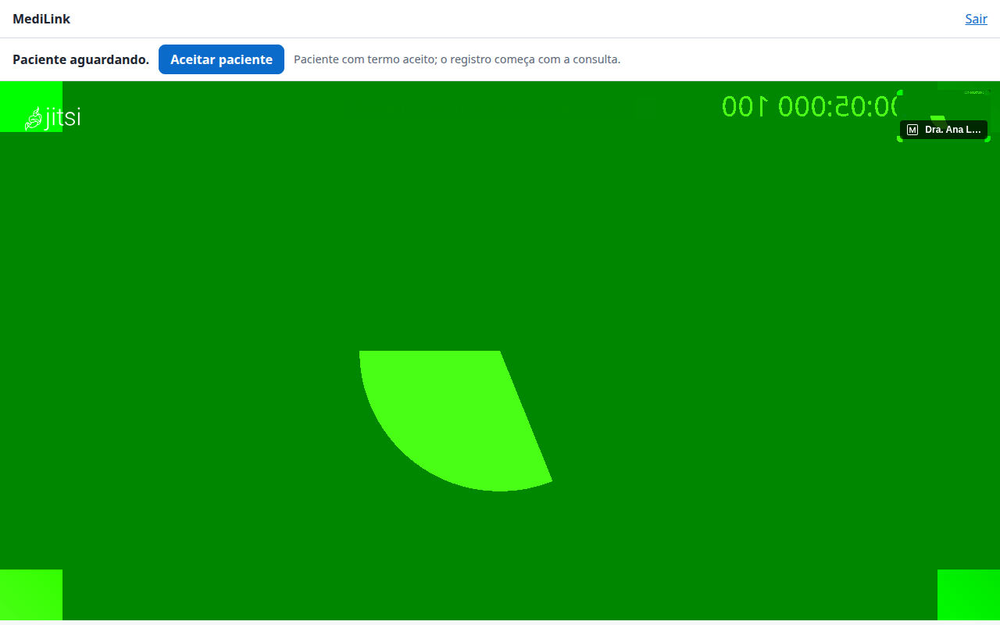 Figura 7. Paciente aguardando.

1. Aguarde o botão ficar ativo (enquanto a sala se prepara ele aparece desabilitado com “Preparando a sala…”).
2. Clique em **Aceitar paciente**. O paciente entra na sala.

**Consulta em andamento.** A barra passa a mostrar **“Consulta em andamento”** e **“Consulta sendo registrada, com o consentimento do paciente”**. O registro do áudio começa sozinho; você não precisa fazer nada.

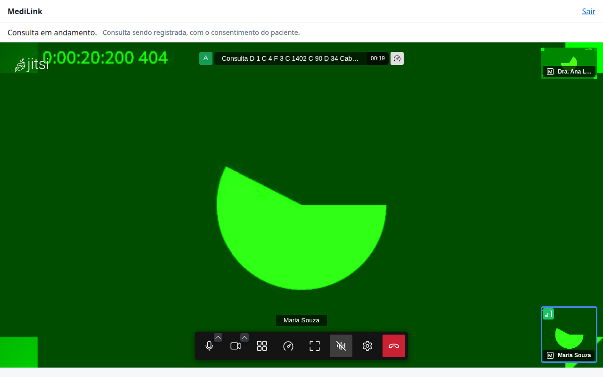 Figura 8. Consulta em andamento (vídeo de teste). A barra de botões aparece ao mover o mouse.

A barra de botões tem **microfone**, **câmera**, **supressão de ruído**, **desempenho** (qualidade do vídeo), **grade**, **tela cheia**, **configurações** e **desligar**. Não há chat nem compartilhamento de tela.

**Avisos que você pode ver**

| Mensagem | Significa | O que fazer |
| --- | --- | --- |
| **Paciente aguardando** | O paciente aceitou o termo e espera. | Clique em **Aceitar paciente**. |
| **Aguardando o paciente chegar…** | Ninguém na espera ainda. | Aguarde. Você não consegue aceitar quem ainda não chegou. |
| **Paciente com termo aceito; o registro começa com a consulta** | Antes de aceitar. | Aceite o paciente. |
| **Atenção: esta consulta não está sendo registrada (o paciente retirou o consentimento). Encerre a consulta.** | O paciente retirou o consentimento: a captação do áudio parou e ele saiu da consulta. | Encerre a consulta. Como toda consulta é registrada, não continue o atendimento por vídeo. |

> **Importante.** Você **não** consegue aceitar um paciente que não aceitou o termo. É uma regra da plataforma: sem consentimento não há consulta por vídeo.

## 6. Encerrar a consulta

Clique no botão vermelho **Desligar** da barra. Como você é o médico, o Jitsi abre um menu:

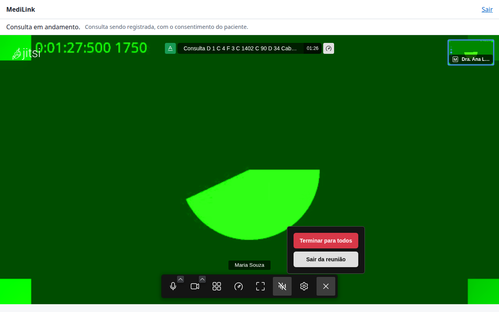 Figura 9. Menu do botão desligar.

- **Terminar para todos:** encerra a conferência para todos. É a opção indicada ao final do atendimento.
- **Sair da reunião:** só você sai da sala; o paciente pode continuar nela até sair. Em ambos os casos a plataforma encerra a consulta quando você deixa a sala.

Depois de sair, a tela mostra **“Consulta encerrada”**:

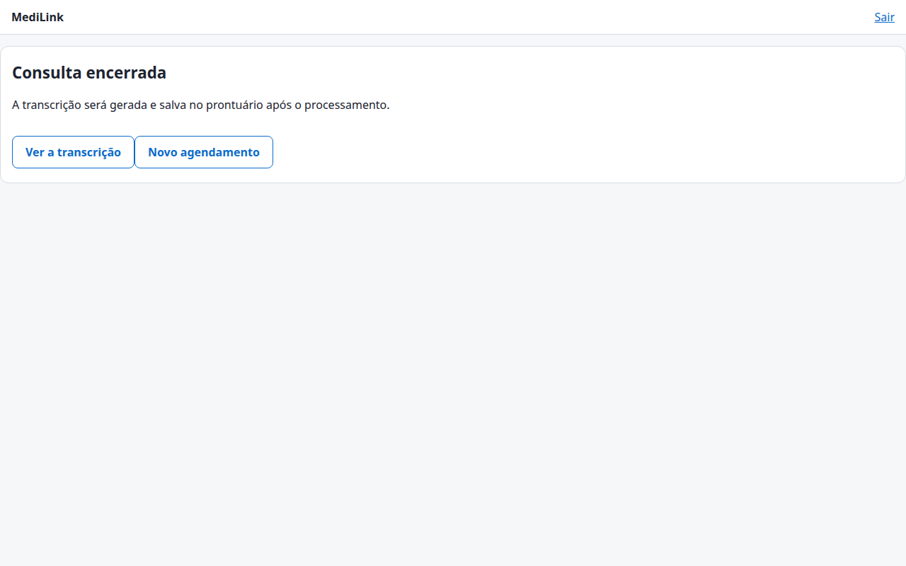 Figura 10. Consulta encerrada.

- **Ver a transcrição:** abre a transcrição (disponível quando o processamento terminar).
- **Novo agendamento:** volta ao formulário de agendamento.
- **Reabrir a consulta:** aparece **por alguns minutos** (padrão: 10) depois do encerramento, se você encerrou por engano ou a conexão caiu. Voltando à mesma consulta, o consentimento é mantido e o áudio já captado continua valendo.

**Se a sua conexão cair ou você fechar a aba** sem encerrar, a plataforma encerra a consulta sozinha depois de cerca de **5 minutos** sem sinal seu. Você ainda pode **reabri-la** dentro da janela de reabertura.

> **A transcrição demora.** Por causa da janela de reabertura, o processamento só começa cerca de **10 minutos** depois do encerramento, e leva ainda um tempo (aproximadamente o dobro da duração da conversa, em média). Volte à lista mais tarde: a coluna **Transcrição** passa de “Em processamento” para “Disponível”.

## 7. Ver a transcrição

Na lista, clique em **Ver transcrição** (ou, logo depois de encerrar, em **Ver a transcrição**).

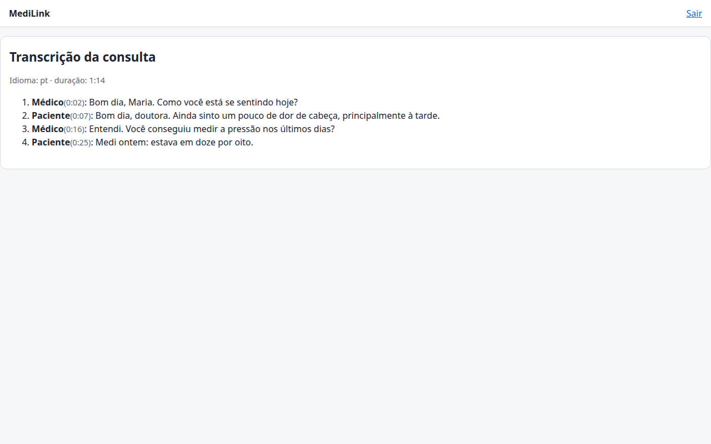 Figura 11. Transcrição da consulta (texto de exemplo ilustrativo).

A tela mostra o idioma, a duração e as **falas em ordem**, cada uma com o **papel** (Médico ou Paciente) e o **instante** em que começou (minuto:segundo).

Estados possíveis:

| Mensagem | Significado |
| --- | --- |
| “A transcrição ainda está sendo gerada. Esta página se atualiza sozinha.” | O processamento está em curso. Pode deixar a página aberta. |
| “A consulta ainda não foi encerrada.” | A transcrição só existe depois do encerramento. |
| “Esta consulta não teve áudio capturado: não há transcrição.” | A captação não ocorreu (por exemplo, falha técnica). A plataforma registra o caso e o administrador investiga. |
| “A transcrição falhou e está sob análise.” | O processamento falhou. O áudio é mantido por um prazo limitado e o administrador pode reprocessar. |
| “A transcrição desta consulta não está mais disponível (prazo de retenção).” | Passou o prazo de guarda definido pela clínica. |
| “A leitura de transcrições por esta plataforma não está habilitada.” | A leitura pela tela está desligada na configuração do servidor. Procure o administrador do sistema. |
| “Você não tem acesso a esta consulta, ou o link expirou.” | A consulta é de outro médico ou a sua sessão por link venceu. |

> A transcrição é automática e pode conter erros (nomes, termos técnicos, números, sotaques). Confira o que for importante antes de usar. O texto fica **cifrado** no servidor e só você, como médico da consulta, o lê. Cada leitura fica registrada.

## 8. Entrar pelo link de uso único

Em clínicas com sistema de agenda ou prontuário integrado, o sistema entrega a você um **link na hora de iniciar a consulta**, no formato `https://…/medico/acesso#t=…`.

- Clique no link: você entra direto na **sala daquela consulta**, sem digitar senha.
- O link vale **uma vez** e por **poucos minutos** (5, por padrão). Só funciona perto do horário (de 30 minutos antes até 12 horas depois).
- Com o link você vê **só aquela consulta**. Para ver outras, use o login com e-mail e senha, se tiver um.
- Se a página recarregar ou você voltar depois de uma queda, a sessão aberta pelo link continua valendo na mesma aba. Se fechar a aba, peça um **novo link** ao sistema.

Se o link já foi usado, venceu ou está errado, aparece:

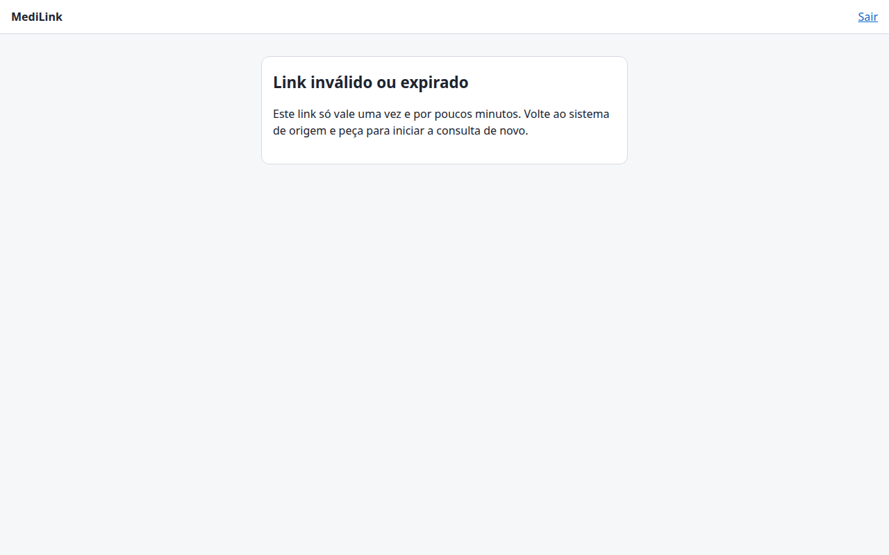 Figura 12. Link inválido ou expirado.

Volte ao sistema de origem e peça para **iniciar a consulta de novo**: ele gera outro link. Não precisa reagendar.

## 9. Boas práticas e segurança

- **Senha:** de 12 a 128 caracteres, exclusiva para esta plataforma. Não a compartilhe.
- **Computador compartilhado:** clique em **Sair** ao terminar. O login com senha vale por cerca de 8 horas, e a sessão do link vale só para aquela consulta.
- **Links:** o link do paciente e o seu link de uso único são pessoais. Não os envie por canais abertos.
- **Privacidade:** atenda em local reservado e com fones de ouvido; o paciente consentiu apenas com a captação de **áudio** da consulta.
- **TOTP:** guarde o aplicativo autenticador. Ao trocar de celular, peça o **Refazer cadastro do TOTP** ao administrador antes de apagar o aplicativo antigo.

## 10. Problemas comuns

| Problema | O que fazer |
| --- | --- |
| Não consigo entrar | Confira e-mail e senha. Se bloqueou, aguarde cerca de 15 minutos. Se esqueceu a senha, peça ao administrador para redefinir. |
| O botão **Aceitar paciente** está desabilitado | A sala ainda está sendo preparada (“Preparando a sala…”). Aguarde alguns segundos. |
| O paciente não aparece | Ele precisa abrir o link, confirmar o CPF **e aceitar o termo**. Se recusou o termo, a consulta por vídeo não pode ser feita. |
| A câmera ou o microfone não funcionam | Libere a permissão no cadeado ao lado do endereço e recarregue a página. Feche outros aplicativos que usem a câmera. |
| A consulta foi encerrada por engano | Clique em **Reabrir a consulta** em até 10 minutos. |
| A transcrição não aparece | Veja o estado na coluna **Transcrição**. Em processamento, aguarde (no mínimo cerca de 10 minutos). Sem áudio ou com falha, avise o administrador. |
| Mensagem de leitura de transcrições não habilitada | A função está desligada no servidor. Fale com o administrador do sistema. |

---

[← Capítulo 1: Paciente](01-paciente.md) · [Índice](README.md) · [Capítulo 3: Administrador →](03-administrador.md)
