# Capítulo 3: Administrador

[← Capítulo 2: Médico](02-medico.md) · [Índice](README.md) · [Capítulo 4: Integração, dúvidas e problemas →](04-integracao-e-suporte.md)

Este capítulo é para quem **administra a plataforma** na clínica: cadastra os médicos, libera sistemas externos, mantém o termo de consentimento e acompanha se tudo está funcionando. A área administrativa **não mostra dados de pacientes**: só contagens e estados.

**Neste capítulo**

1. [Entrar na administração](#1-entrar-na-administração)
2. [Painel: Andamento](#2-painel-andamento)
3. [Médicos](#3-médicos)
4. [Sistemas e keys](#4-sistemas-e-keys)
5. [Termo de consentimento](#5-termo-de-consentimento)
6. [Webhooks](#6-webhooks)
7. [Outros administradores](#7-outros-administradores)
8. [Rotinas recomendadas](#8-rotinas-recomendadas)
9. [Segurança da conta](#9-segurança-da-conta)
10. [Problemas comuns](#10-problemas-comuns)

---

## 1. Entrar na administração

Abra `https://app.suaclinica.com.br/admin`. O acesso exige **e-mail, senha e o código do aplicativo autenticador (TOTP)**.

<p align="center">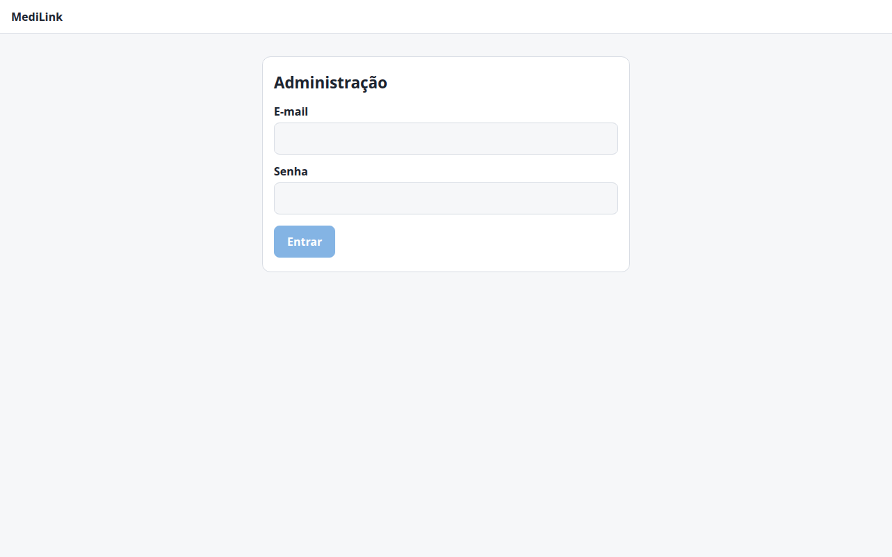<br><sub>Figura 1. Login da administração.</sub></p>

**Primeiro acesso.** Você recebe o e-mail e a senha de quem instalou o sistema (ou de outro administrador). Digite-os e clique em **Entrar**. Como o autenticador ainda não foi cadastrado, a tela mostra o segredo:

<p align="center">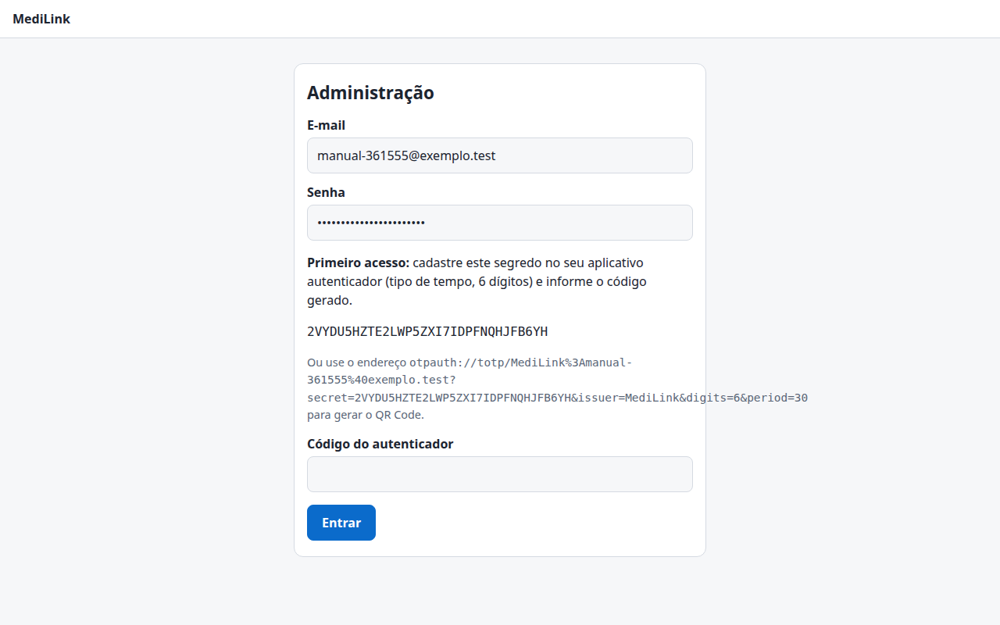<br><sub>Figura 2. Primeiro acesso: cadastre o segredo no autenticador.</sub></p>

1. No celular, abra o aplicativo autenticador (Google Authenticator, Microsoft Authenticator, Authy…) e adicione uma conta **baseada em tempo**, com 6 dígitos.
2. Informe o **segredo** mostrado na tela, ou use o endereço `otpauth://…` para gerar um QR Code.
3. Digite o **código de 6 dígitos** do aplicativo no campo **Código do autenticador** e clique em **Entrar**.

**Próximos acessos:** e-mail, senha e o código do momento. Cada código só vale uma vez: se o login falhar, espere o próximo.

| Regra | Detalhe |
| --- | --- |
| Bloqueio | **5 tentativas erradas** bloqueiam a conta por **15 minutos**. |
| Mensagem de erro | Sempre a mesma (“Não foi possível autenticar”), para não revelar se o e-mail existe. |
| Duração da sessão | **30 minutos**. A sessão fica só na memória da página: **recarregar a página (F5) ou fechar a aba exige entrar de novo**. |
| Desativação | Se outro administrador desativar a sua conta, o acesso cai na hora. |

Depois de entrar você vê o painel, com cinco seções no menu do alto: **Andamento**, **Médicos**, **Sistemas e keys**, **Termo de consentimento** e **Webhooks**. O link **Sair** encerra a sessão.

## 2. Painel: Andamento

Mostra, em números, o que está acontecendo na plataforma. Escolha o **Período** (em dias) e clique em **Atualizar**.

<p align="center">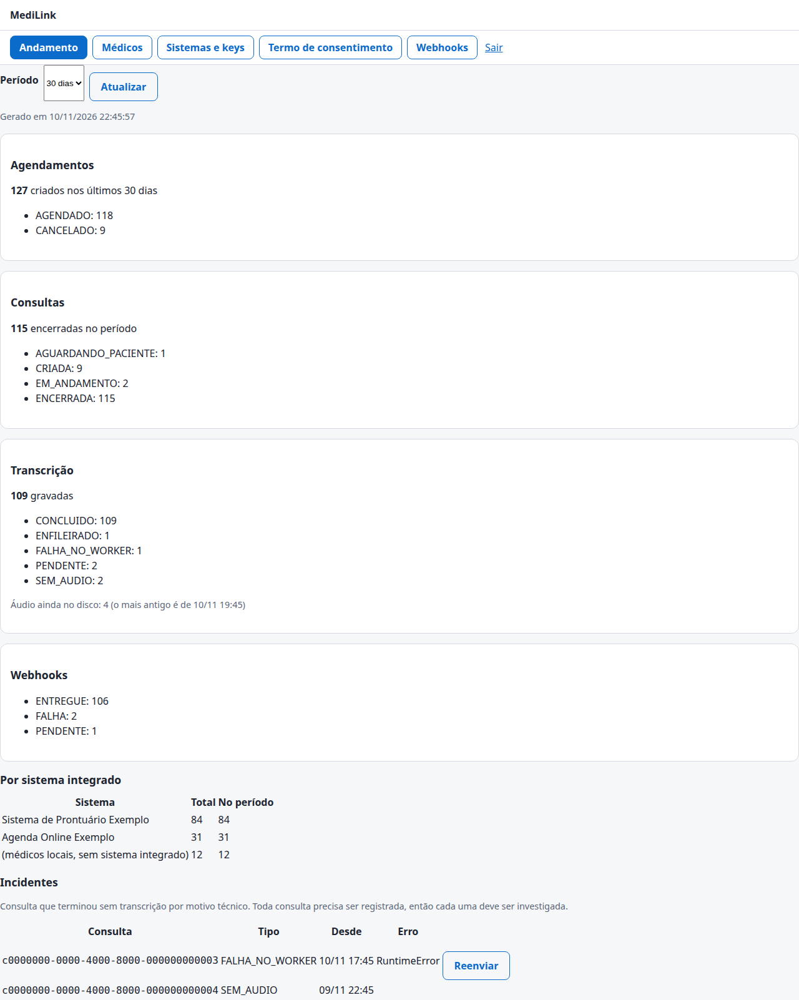<br><sub>Figura 3. Andamento (dados de exemplo).</sub></p>

| Bloco | O que mostra |
| --- | --- |
| **Agendamentos** | Quantos foram criados no período e quantos estão **agendados** ou **cancelados**. |
| **Consultas** | Quantas **encerraram** no período e quantas estão em cada situação (criada, paciente aguardando, em andamento, encerrada). |
| **Transcrição** | Quantas transcrições foram gravadas e a situação dos trabalhos (**pendente**, **enfileirado**, **concluído**, **sem áudio**, **falha**). Mostra também **quantos arquivos de áudio ainda estão no disco** e a data do mais antigo. |
| **Webhooks** | Entregas por situação (**entregue**, **pendente**, **falha**). |
| **Por sistema integrado** | Total e quantidade no período de agendamentos de cada sistema. “Médicos locais” são os que agendam direto na plataforma. |
| **Incidentes** | Consultas que terminaram **sem transcrição por motivo técnico**. Toda consulta deve ser registrada, então **cada incidente deve ser investigado**. |

**Como ler os sinais de alerta**

| Sinal | Pode significar | O que fazer |
| --- | --- | --- |
| **Áudio ainda no disco** crescendo ou com data antiga | O serviço de transcrição está parado ou com falha. | Avise o responsável técnico. O áudio é apagado sozinho no máximo em 7 dias, mas a transcrição não será gerada. |
| Incidente **SEM_AUDIO** | A captação não ocorreu (a página do médico não pediu o registro, queda de conexão ou falha do vídeo). | Contate o médico e registre o caso. Não há como recuperar o áudio. |
| Incidente **FALHA_NO_WORKER** ou **FALHA_NO_ENVIO** | O processamento ou o envio do trabalho falhou. O áudio foi mantido. | Clique em **Reenviar** na linha: o trabalho volta à fila. |
| Incidente **EXPIRADO** | O áudio expirou sem ser transcrito. | Não há mais o que reprocessar; avise o responsável. |
| Webhooks com **FALHA** | O sistema de destino não respondeu corretamente. | Veja a seção [Webhooks](#6-webhooks). |

## 3. Médicos

Aqui você cadastra e mantém os médicos que entram com **e-mail e senha**.

<p align="center">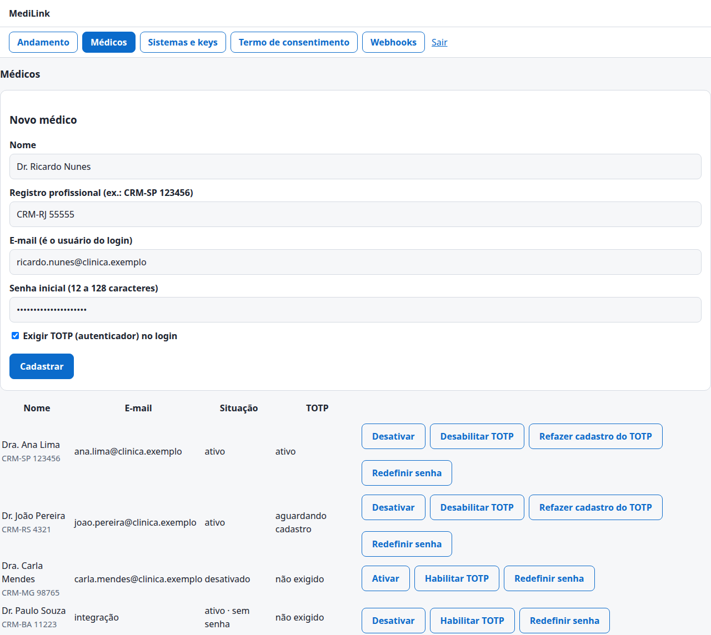<br><sub>Figura 4. Novo médico.</sub></p>

**Cadastrar um médico**

| Campo | Observação |
| --- | --- |
| **Nome** | Nome de exibição (aparece para o paciente). |
| **Registro profissional** | Por exemplo, `CRM-SP 123456`. |
| **E-mail** | É o **usuário do login**. Não pode repetir. |
| **Senha inicial** | De **12 a 128 caracteres**. Entregue ao médico por um canal seguro. |
| **Exigir TOTP (autenticador) no login** | Decisão sua, médico a médico. Marcado: o médico precisa do código do aplicativo para entrar. |

Clique em **Cadastrar**. O médico passa a aparecer na lista:

<p align="center">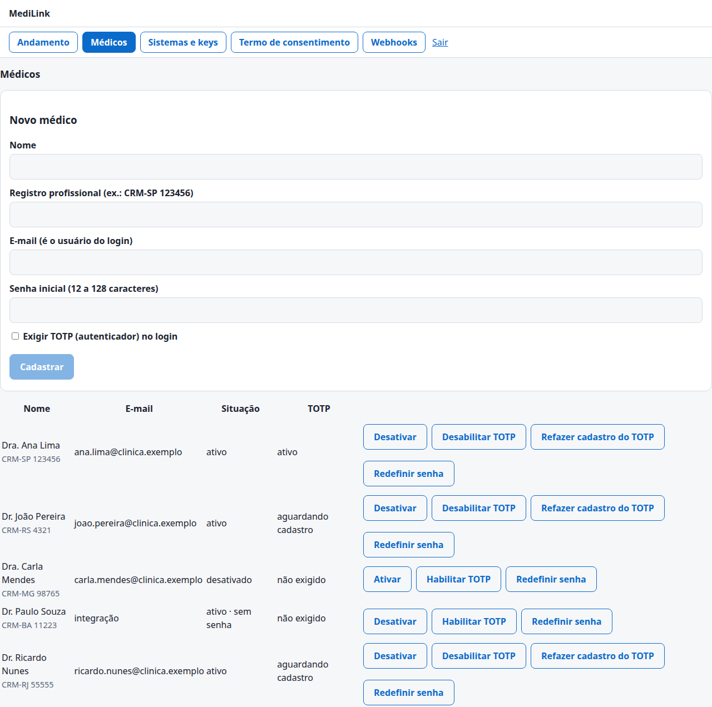<br><sub>Figura 5. Lista de médicos.</sub></p>

| Coluna | Valores |
| --- | --- |
| **E-mail** | O e-mail de login, ou **integração** para médicos criados automaticamente por um sistema integrado. |
| **Situação** | **ativo** ou **desativado**; **sem senha** indica um médico que ainda não pode entrar com senha. |
| **TOTP** | **não exigido**, **aguardando cadastro** (exigido, mas o médico ainda não cadastrou) ou **ativo**. |

**Ações de cada linha**

| Botão | Efeito |
| --- | --- |
| **Desativar / Ativar** | Desativar corta o acesso **na hora**, inclusive de quem já estava logado e de links de uso único. Os dados são mantidos. |
| **Habilitar TOTP / Desabilitar TOTP** | Liga ou desliga a exigência do código. Ao ligar, o médico cadastra o autenticador no próximo login. |
| **Refazer cadastro do TOTP** | Aparece com o TOTP habilitado. Zera o segredo atual: use quando o médico **trocou de celular** ou perdeu o aplicativo. |
| **Redefinir senha** | Define uma nova senha (12 a 128 caracteres) e também **libera um bloqueio** por tentativas. |

<p align="center">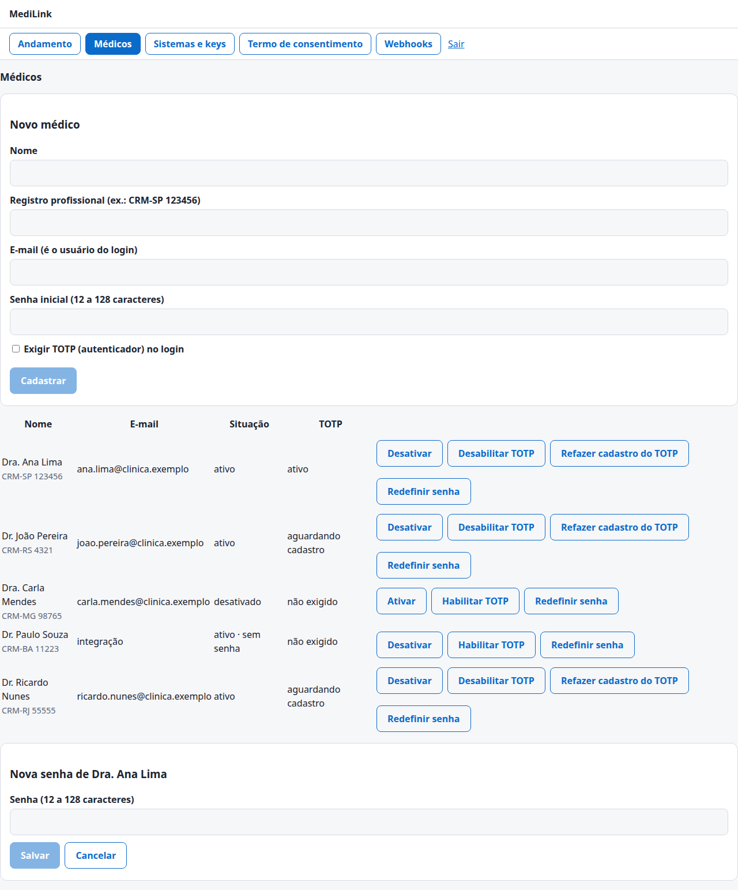<br><sub>Figura 6. Redefinir a senha de um médico.</sub></p>

> **Dicas.** Médicos que vêm de um sistema integrado são criados sozinhos na primeira consulta e **não têm senha**: entram só pelo link de uso único do sistema. Para dar a um deles acesso por e-mail e senha à lista de consultas, use **Redefinir senha**. Médico **não** liga nem desliga o próprio TOTP: essa decisão é sua.

## 4. Sistemas e keys

Um **sistema integrado** é um programa externo (agenda, prontuário) que cria consultas e recebe transcrições. Cada um tem **API keys** e, opcionalmente, um **webhook**.

<p align="center">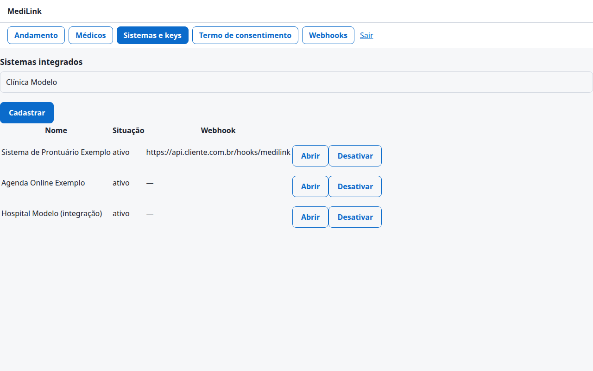<br><sub>Figura 7. Sistemas integrados (dados de exemplo).</sub></p>

**Cadastrar um sistema.** Digite o nome no campo e clique em **Cadastrar**. O nome precisa ser único.

**Abrir** um sistema mostra as **API keys** e o **webhook** dele. O botão **Desativar** (e **Ativar**) liga e desliga o sistema inteiro: desativado, nenhuma key dele funciona.

**Gerar uma API key**

1. Abra o sistema e digite um nome para a key (por exemplo, `produção`).
2. Marque os **escopos** que ela pode usar:

| Escopo | Permite ao sistema |
| --- | --- |
| `agendamento:escrever` | Criar, alterar e cancelar consultas. |
| `agendamento:ler` | Consultar o estado de uma consulta (sem dados do paciente). |
| `sala:iniciar` | Pedir o **link de uso único** para o médico entrar na sala. |

3. Clique em **Gerar key**. A tela mostra a key **uma única vez**:

<p align="center">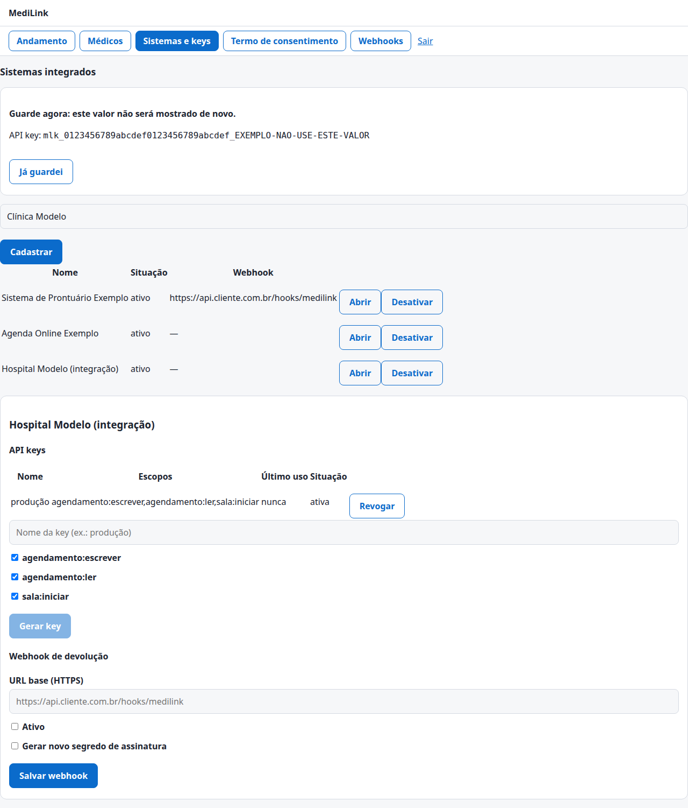<br><sub>Figura 8. Key criada (o valor da imagem é um exemplo).</sub></p>

> **Guarde agora.** A key **não será mostrada de novo**: copie-a e entregue ao responsável técnico do sistema por um canal seguro. Se perder, gere outra e **revogue** a antiga. A key é um segredo: quem a tem age como aquele sistema.

**Revogar** uma key (botão na linha dela) a invalida imediatamente. Faça isso quando alguém sair da equipe, houver suspeita de vazamento ou ao trocar a key por uma nova.

**Webhook de devolução.** Na parte de baixo do sistema aberto:

<p align="center">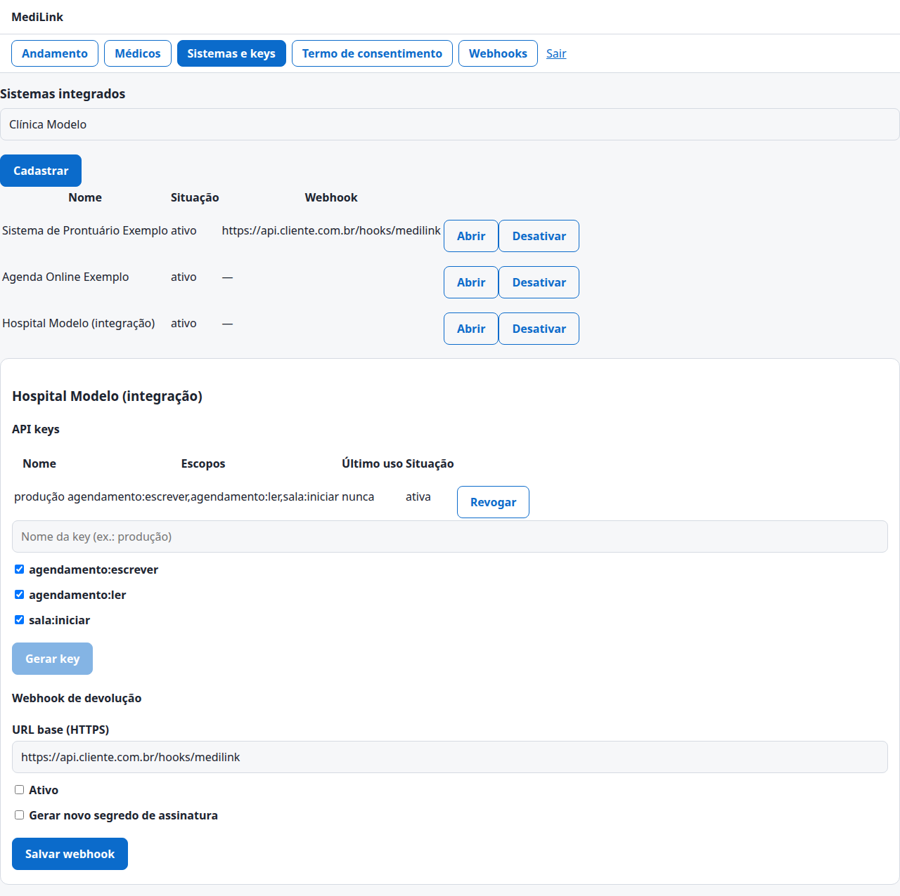<br><sub>Figura 9. Webhook de devolução.</sub></p>

| Campo | O que fazer |
| --- | --- |
| **URL base (HTTPS)** | Endereço do sistema que vai receber as transcrições, por exemplo `https://api.cliente.com.br/hooks/medilink`. Só **HTTPS** com certificado válido; endereços internos não são aceitos. Cada consulta acrescenta o seu próprio **caminho**. |
| **Ativo** | Liga ou desliga os envios deste sistema. |
| **Gerar novo segredo de assinatura** | Gera o segredo com que o MediLink **assina** cada envio. É mostrado **uma única vez**: passe-o ao responsável pelo sistema receptor, que o usa para conferir que a mensagem veio do MediLink. Marque também para trocar o segredo de tempos em tempos. |

Clique em **Salvar webhook**. Se o sistema não tiver webhook, o fluxo segue normalmente: a transcrição fica só na plataforma.

## 5. Termo de consentimento

O termo é o texto que o paciente **precisa aceitar** para a consulta acontecer. Você o mantém aqui, **sem precisar reinstalar nada**.

<p align="center">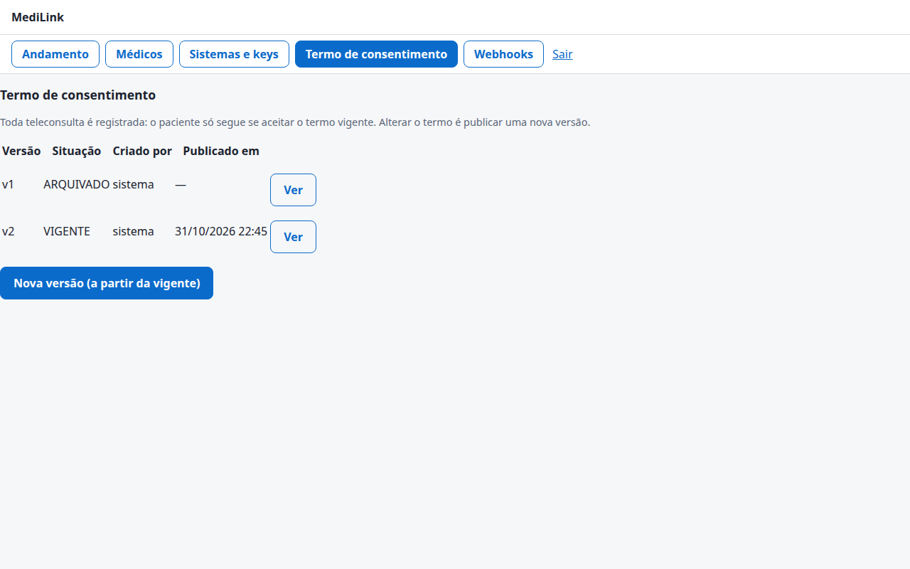<br><sub>Figura 10. Versões do termo.</sub></p>

| Situação | Significado |
| --- | --- |
| **VIGENTE** | A versão que os pacientes veem agora. Só existe **uma**. |
| **RASCUNHO** | Versão em edição. Ainda não vale para ninguém. |
| **ARQUIVADO** | Versão antiga, mantida para prova do que cada paciente aceitou. |

**Publicar uma nova versão**

1. Clique em **Nova versão (a partir da vigente)**: cria um **rascunho** com o texto atual.
2. Edite o texto (texto puro, sem formatação).
3. Clique em **Salvar rascunho** quantas vezes quiser. **Excluir rascunho** descarta a versão.
4. Quando estiver pronto, clique em **Publicar como vigente**.

<p align="center">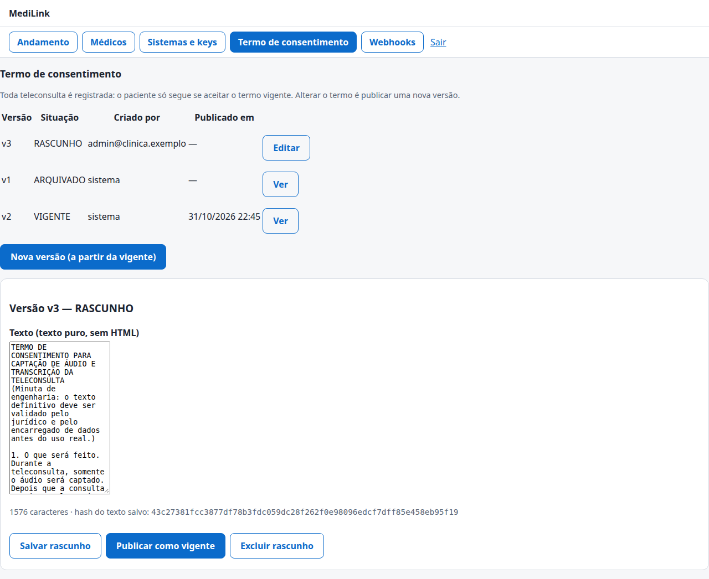<br><sub>Figura 11. Rascunho do termo.</sub></p>

**O que você precisa saber**

- **Versão publicada não muda mais.** Para alterar, publique outra. Assim, cada consentimento fica ligado à **versão e ao hash (impressão digital) do texto que o paciente de fato leu**.
- O paciente sempre vê a versão **vigente**. Se você publicar uma nova enquanto ele está na tela do termo, o sistema pede que ele recarregue e leia a nova.
- **Revise o texto com o jurídico e o encarregado de dados (DPO).** O texto que acompanha o sistema é uma **minuta**.
- Se a clínica usa **webhook**, o texto precisa informar que a transcrição é enviada ao sistema do cliente.
- Ajuste também prazos de guarda e a base legal conforme a sua política.

## 6. Webhooks

Mostra as **entregas** de transcrições ao sistema de cada cliente e permite refazê-las.

<p align="center">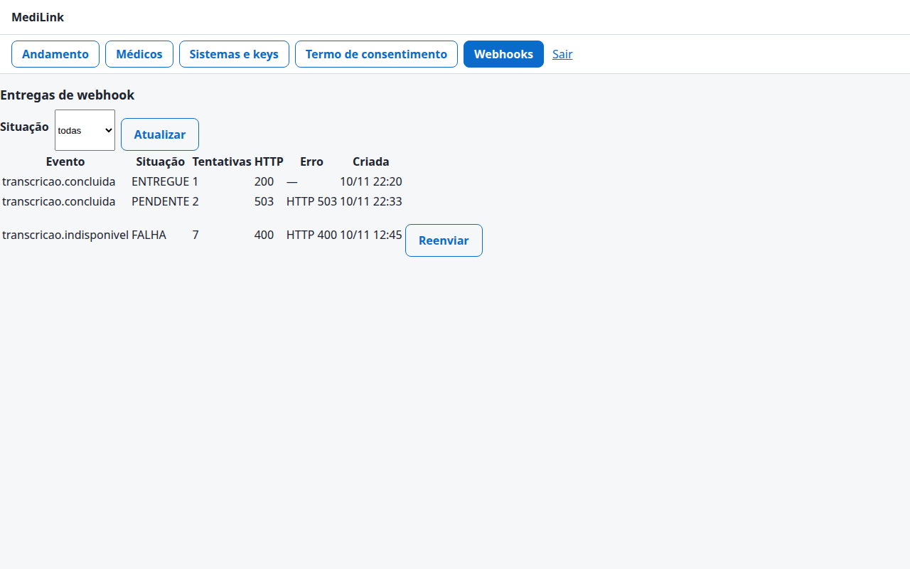<br><sub>Figura 12. Entregas de webhook (dados de exemplo).</sub></p>

| Coluna | O que mostra |
| --- | --- |
| **Evento** | `transcricao.concluida` (a transcrição está pronta) ou `transcricao.indisponivel` (não vai existir; o motivo aparece entre parênteses). |
| **Situação** | **PENDENTE** (aguardando envio ou nova tentativa), **ENTREGUE** ou **FALHA** (esgotou as tentativas ou foi recusada). |
| **Tentativas** | Quantas vezes o envio foi tentado. |
| **HTTP / Erro** | Resposta do sistema de destino e o motivo da falha. |
| **Criada** | Quando a entrega foi criada. |

Use o filtro **Situação** (pendentes, com falha, entregues) e **Atualizar**. Em uma entrega com **FALHA**, corrija a causa no sistema de destino (certificado, endereço, resposta de erro) e clique em **Reenviar**.

> **Como o envio tenta de novo.** Em caso de erro temporário do destino, a plataforma repete ao longo de cerca de 1 dia (1 min, 5 min, 30 min, 2 h, 6 h, 24 h). Respostas de erro definitivas (por exemplo, 400) e redirecionamentos encerram a entrega. A transcrição **não é apagada** enquanto não for entregue.

## 7. Outros administradores

A criação de novos administradores é feita pela **API** (não há tela). Quem tem acesso técnico faz, já autenticado como administrador:

```bash
curl -X POST https://app.suaclinica.com.br/api/admin/administradores \
  -H "Authorization: Bearer <sessão do administrador>" -H "Content-Type: application/json" \
  -d '{"email":"novo.admin@suaclinica.com.br","senha":"uma-senha-com-12-ou-mais-caracteres"}'
```

O novo administrador entra e cadastra o autenticador no primeiro acesso. Para desativar um administrador, a API tem `DELETE /api/admin/administradores/{id}` (você não consegue desativar a si mesmo). O **primeiro administrador** é criado pelo instalador do sistema.

## 8. Rotinas recomendadas

| Quando | O que fazer |
| --- | --- |
| **Todo dia** | Abra **Andamento**: confira incidentes, áudio no disco e entregas de webhook com falha. |
| **Ao contratar** | **Médicos** → **Cadastrar**; passe a senha inicial por canal seguro; marque **Exigir TOTP** conforme a política. |
| **Ao desligar alguém** | **Médicos** → **Desativar**; se for responsável por um sistema, **revogue** as keys dele. |
| **Troca de celular de um médico** | **Refazer cadastro do TOTP**. |
| **Médico esqueceu a senha** | **Redefinir senha**. |
| **A cada mudança no texto legal** | **Termo de consentimento** → nova versão → **Publicar como vigente**. |
| **A cada 6–12 meses** | Troque as API keys e o segredo de assinatura dos webhooks. |

## 9. Segurança da conta

- Use uma **senha longa e exclusiva** (12 a 128 caracteres) e guarde o aplicativo autenticador.
- Não compartilhe a conta: crie um administrador por pessoa. Todas as ações administrativas ficam **registradas**, com quem fez e quando.
- **Saia** ao terminar (a sessão já expira em 30 minutos).
- Não anote keys e segredos em e-mail ou mensagens abertas.
- A área administrativa nunca mostra dados de pacientes. Se alguém lhe pedir um CPF, nome ou transcrição por aqui, desconfie.

## 10. Problemas comuns

| Problema | O que fazer |
| --- | --- |
| Não consigo entrar | Confira e-mail e senha; o código muda a cada 30 s e cada código vale uma vez. Se bloqueou, aguarde 15 minutos. Peça a outro administrador (ou ao responsável técnico) para redefinir. |
| Fui “deslogado” | A sessão dura 30 minutos e é só em memória: recarregar a página exige novo login. |
| “Não foi possível cadastrar” um médico | O e-mail já existe ou a senha não tem de 12 a 128 caracteres. |
| O médico diz que o código TOTP não funciona | Use **Refazer cadastro do TOTP** e peça que ele cadastre o segredo de novo. Confira o relógio do celular. |
| A key foi perdida | Gere outra, atualize o sistema integrado e **revogue** a antiga. |
| Webhook em **FALHA** | Veja a coluna **Erro**/**HTTP**, corrija o destino e use **Reenviar**. |
| Incidente na lista | Veja a tabela da seção [Andamento](#2-painel-andamento). |

---

[← Capítulo 2: Médico](02-medico.md) · [Índice](README.md) · [Capítulo 4: Integração, dúvidas e problemas →](04-integracao-e-suporte.md)
