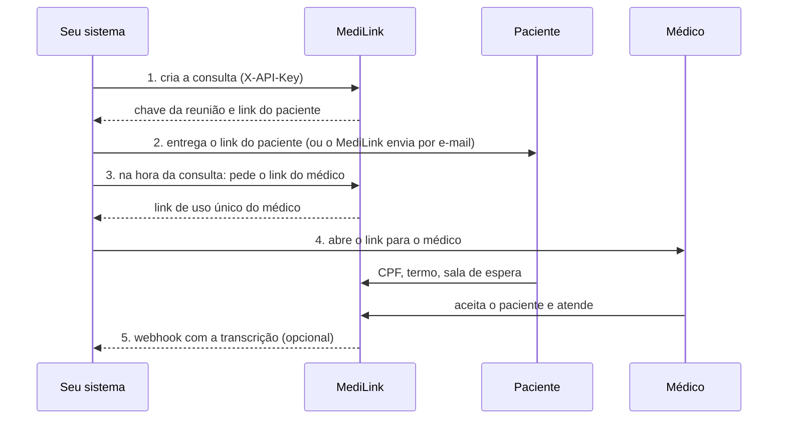

# Capítulo 4: Integração, dúvidas e problemas

[← Capítulo 3: Administrador](03-administrador.md) · [Índice](README.md)

Este capítulo reúne o que falta: um **guia rápido para quem integra** um sistema de agenda ou prontuário, as **perguntas frequentes** de cada perfil e a **solução de problemas**.

**Neste capítulo**

1. [Guia rápido para o sistema integrado](#1-guia-rápido-para-o-sistema-integrado)
2. [Perguntas frequentes](#2-perguntas-frequentes)
3. [Solução de problemas](#3-solução-de-problemas)
4. [Onde pedir ajuda](#4-onde-pedir-ajuda)

---

## 1. Guia rápido para o sistema integrado

Para o **responsável técnico** do sistema de agenda ou prontuário. O detalhe completo da API está no [README do projeto](../../README.md#api-de-integração-sistemas-externos-por-api-key).

| Passo | O que fazer |
| --- | --- |
| **Receber a key** | O [administrador](03-administrador.md#4-sistemas-e-keys) cadastra o seu sistema, gera a **API key** com os escopos necessários e entrega a você **uma única vez**. Guarde-a como um segredo (variável de ambiente ou cofre) e use-a **somente no servidor**: nunca em páginas ou aplicativos de usuário. |
| **Criar a consulta** | `POST /api/integracao/v1/agendamentos` com o cabeçalho `X-API-Key`. Informe médico (nome e chave), agendamento (chave sua, data e horário), paciente (nome; CPF e e-mail opcionais) e, se quiser, `notificar` (envia o link por e-mail) e `webhook`. A resposta traz a **chave da reunião** e o **link do paciente**. Repetir a mesma chave do agendamento devolve a consulta existente (não duplica). |
| **Alterar ou cancelar** | `PATCH` altera só o que for enviado; `DELETE` cancela (o link do paciente para de funcionar). Depois que a consulta começa, não dá mais para alterar nem cancelar. |
| **Iniciar a consulta** | `POST …/{chaveReuniao}/acesso-medico` com o nome e a chave do médico. Devolve o **link de uso único** do médico: abra-o para ele (vale uma vez, por 5 minutos, de 30 minutos antes até 12 horas depois do horário). Pode pedir de novo quantas vezes precisar: vale o último. |
| **Receber a transcrição** | Se o seu sistema tem **webhook** ativo e a consulta informou o caminho, o MediLink envia `POST` assinado quando a transcrição fica pronta (`transcricao.concluida`) ou quando não vai existir (`transcricao.indisponivel`). Valide a **assinatura**, responda `2xx` e **ignore repetições** pelo identificador do evento. |

**Dicas**

- Use um **identificador estável** do seu sistema como chave do agendamento: ele garante que repetir o pedido não cria consultas em duplicidade.
- O CPF é opcional. Informado, o paciente precisa confirmá-lo para entrar; sem CPF, a confirmação fica desligada.
- Se o paciente não tiver e-mail, entregue o link do paciente por outro canal (mensagem, impressão).
- Nunca registre a key, o link do médico nem o segredo de assinatura em log.
- O corpo do webhook **não** traz CPF, e-mail nem o nome cadastrado do paciente.

## 2. Perguntas frequentes

### Paciente

**O vídeo é gravado?** Não. Só o áudio é captado e é apagado depois que vira texto.

**Posso recusar o termo?** Pode, mas então a consulta por vídeo não é realizada: toda teleconsulta é registrada. Combine com o consultório outra forma de atendimento.

**Posso mudar de ideia depois de aceitar?** Sim. Durante a consulta, **Retirar consentimento e sair** interrompe a captação e encerra a sua participação.

**O link não abre.** Confira se foi copiado inteiro. Se continuar, peça um novo ao consultório.

### Médico

**Vejo só uma consulta, não a lista.** Você entrou por **link de uso único**: ele dá acesso só àquela consulta. Para ver todas, é preciso ter login com e-mail e senha: peça ao administrador.

**Esqueci a senha ou troquei de celular.** Peça ao administrador **Redefinir senha** ou **Refazer cadastro do TOTP**.

**Quanto tempo leva a transcrição?** Começa cerca de 10 minutos depois do encerramento (janela para reabrir a consulta) e leva aproximadamente o dobro da duração da conversa para ficar pronta.

**Posso ler a transcrição de outro médico?** Não. Você só vê as suas consultas.

**A transcrição tem erros.** É automática. Termos técnicos, nomes e números merecem conferência.

**Encerrei sem querer.** Em até 10 minutos, **Reabrir a consulta**.

### Administrador

**Como muda o termo?** Em **Termo de consentimento**: nova versão, edição e **Publicar como vigente**. Versões publicadas não mudam.

**O que acontece quando desativo um médico?** Ele perde o acesso na hora, inclusive de sessões abertas. Os dados e as transcrições são mantidos.

**Perdi a key de um sistema.** Gere outra, atualize o sistema e revogue a antiga.

**Dá para ver as conversas pela administração?** Não. A área administrativa não mostra dados de pacientes nem o conteúdo das transcrições.

## 3. Solução de problemas

| Quem | Sintoma | Causa provável | Solução |
| --- | --- | --- | --- |
| Paciente | “Consulta não encontrada” | Link incompleto, cancelado ou vencido | Peça um novo link. |
| Paciente | “Não foi possível confirmar o seu acesso” | CPF incorreto ou diferente do cadastrado | Confira os 11 números; se persistir, fale com o consultório. |
| Paciente | “Muitas tentativas” | 5 erros de CPF em 15 minutos | Aguarde alguns minutos. |
| Paciente | Fica na sala de espera | O médico ainda não aceitou | Aguarde com a página aberta; se passar do horário, contate o consultório. |
| Paciente ou médico | Sem imagem ou som | Permissão negada, outro programa usando a câmera, internet fraca | Libere câmera e microfone no cadeado do navegador, feche outros programas, reduza a qualidade em **Desempenho**. |
| Médico | Botão **Aceitar paciente** desabilitado | A sala ainda está sendo preparada | Aguarde alguns segundos. |
| Médico | “Paciente aguardando” não aparece | O paciente ainda não aceitou o termo | Peça que abra o link e aceite o termo. |
| Médico | “Esta consulta não está sendo registrada” | O paciente retirou o consentimento | Encerre a consulta e combine outra forma de atendimento. |
| Médico | “Link inválido ou expirado” | Link já usado, vencido ou incorreto | Peça ao sistema de origem para iniciar a consulta de novo. |
| Médico | Transcrição “Em processamento” por muito tempo | Janela de 10 minutos, fila cheia ou serviço de transcrição parado | Aguarde; se passar de uma hora, avise o administrador. |
| Médico | “Leitura de transcrições não habilitada” | Função desligada no servidor | Fale com o administrador do sistema. |
| Médico | Login bloqueado | 5 tentativas erradas | Aguarde cerca de 15 minutos ou peça redefinição de senha. |
| Administrador | Sessão caiu | Duração de 30 minutos, só em memória | Entre de novo. |
| Administrador | Webhook em **FALHA** | Destino fora do ar, certificado inválido ou resposta de erro | Corrija o destino e clique em **Reenviar**. |
| Administrador | Incidente **SEM_AUDIO** | A captação não ocorreu | Registre o caso e contate o médico. |
| Integração | `401` na API | Key ausente, errada ou revogada | Confira o cabeçalho `X-API-Key` e a key no painel. |
| Integração | `403` na API | A key não tem o escopo da rota | Gere uma key com o escopo necessário. |
| Integração | `404` ao consultar uma reunião | A reunião não é do seu sistema ou não existe | Confira a chave da reunião. |
| Integração | `409` ao alterar ou cancelar | A consulta já começou | Não é possível alterar depois do início. |
| Integração | `429` | Limite de requisições por minuto | Espere e reduza a frequência. |

## 4. Onde pedir ajuda

- **Paciente:** o consultório que marcou a consulta.
- **Médico:** o administrador da plataforma na sua clínica.
- **Administrador e integração:** o responsável técnico pela instalação (consulte o [README do projeto](../../README.md) para a implantação, a operação e a solução de problemas técnicos).

Ao pedir ajuda, informe **o que você fazia, a mensagem exibida, o horário** e, se for médico ou administrador, o **nome da consulta ou do sistema**. **Nunca** envie senha, código do autenticador, API key nem link de consulta por canais abertos.

---

[← Capítulo 3: Administrador](03-administrador.md) · [Índice](README.md)
