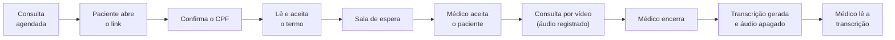

# Manual do usuário do MediLink

O MediLink é a plataforma de **teleconsulta** da sua clínica: o médico atende o paciente por vídeo, o **áudio** da conversa é transcrito automaticamente e a transcrição fica disponível para o médico. Este manual explica, passo a passo e com imagens, como cada pessoa usa a plataforma.

> **Sobre as imagens.** As capturas de tela foram geradas no ambiente de demonstração, com **dados fictícios** (pessoas, e-mails, CPFs de teste). O vídeo das salas é o padrão de teste do navegador, não uma pessoa. O texto da transcrição mostrada no [capítulo do médico](02-medico.md#7-ver-a-transcrição) é um exemplo ilustrativo. As listas do painel do administrador usam dados de exemplo enxutos. As cores e a posição de alguns botões podem mudar na sua instalação.

## Escolha o seu perfil

| Eu sou… | O que faço na plataforma | Vá para |
| --- | --- | --- |
| **Paciente** | Recebo o link da consulta, confirmo meu CPF, aceito o termo e converso com o médico por vídeo. | [Capítulo 1: Paciente](01-paciente.md) |
| **Médico** | Entro na plataforma, vejo minhas consultas, agendo, atendo por vídeo e leio a transcrição. | [Capítulo 2: Médico](02-medico.md) |
| **Administrador** | Cadastro médicos, sistemas integrados e API keys, mantenho o termo de consentimento e acompanho o funcionamento. | [Capítulo 3: Administrador](03-administrador.md) |
| **Responsável pelo sistema integrado** (agenda ou prontuário) | Crio as consultas por API e recebo a transcrição por webhook. | [Capítulo 4: Integração, dúvidas e problemas](04-integracao-e-suporte.md) |

## Como uma consulta acontece

Em uma frase: **sem o aceite do termo não há consulta por vídeo**, porque toda teleconsulta é registrada. O vídeo **não** é gravado; só o áudio é captado, transformado em texto e depois apagado.

## Mapa do manual

```mermaid
flowchart TB
    I["Índice (esta página)"] --> P["1. Paciente"]
    I --> M["2. Médico"]
    I --> A["3. Administrador"]
    I --> S["4. Integração, dúvidas e problemas"]
    P --> P1["Abrir o link"] --> P2["Confirmar o CPF"] --> P3["Termo"] --> P4["Sala de espera"] --> P5["Consulta"]
    M --> M1["Entrar"] --> M2["Minhas consultas"] --> M3["Agendar"] --> M4["Atender"] --> M5["Transcrição"]
    A --> A1["Entrar com TOTP"] --> A2["Andamento"] --> A3["Médicos"] --> A4["Sistemas e keys"] --> A5["Termo"] --> A6["Webhooks"]
```

## Antes de começar

| Item | Para quem | Detalhe |
| --- | --- | --- |
| Navegador atualizado | Todos | Chrome, Edge, Firefox ou Safari em versão recente, no computador ou no celular. |
| Câmera e microfone | Paciente e médico | O navegador pede permissão na primeira vez: toque em **Permitir**. Sem o microfone não há consulta. |
| Conexão estável | Paciente e médico | Wi-Fi ou dados móveis com boa cobertura. Fones de ouvido melhoram o som e a transcrição. |
| Ambiente tranquilo | Paciente e médico | Pouco ruído de fundo ajuda o texto a sair mais fiel. |
| Aplicativo autenticador | Administrador (sempre) e médico (se o administrador exigir) | Google Authenticator, Microsoft Authenticator, Authy ou similar, no celular. |

## Glossário

| Termo | Significado |
| --- | --- |
| **Consulta** | O atendimento por vídeo entre um médico e um paciente, com data e hora. |
| **Link da consulta** | Endereço único que o paciente recebe. Não é adivinhável e não deve ser compartilhado. |
| **Termo de consentimento** | Texto que o paciente precisa aceitar para a consulta ser registrada (áudio e transcrição). |
| **Sala de espera** | Tela em que o paciente aguarda o médico liberar a entrada. |
| **Transcrição** | O áudio da consulta transformado em texto, com a fala do médico e a do paciente separadas. |
| **TOTP** | Código de 6 dígitos que muda a cada 30 segundos, gerado por um aplicativo autenticador. |
| **API key** | Chave que identifica um sistema integrado quando ele conversa com o MediLink. |
| **Webhook** | Aviso automático que o MediLink envia a um sistema integrado quando a transcrição fica pronta. |
| **Sistema integrado** | Programa externo (agenda, prontuário) ligado ao MediLink por API. |

---

[Capítulo 1: Paciente →](01-paciente.md)
